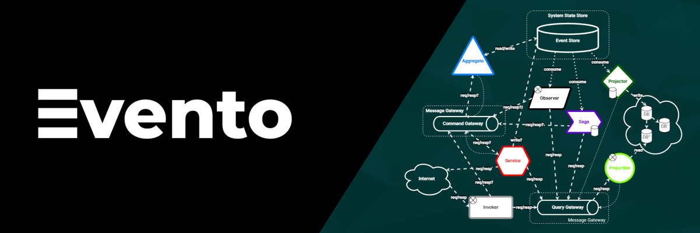

[](https://www.eventoframework.com/)

# [Evento Framework](https://www.eventoframework.com/)

[](LICENSE.txt) [](LICENSE.txt)
[](https://github.com/EventoFramework/evento-framework/actions/workflows/ci.yml)
[](https://github.com/EventoFramework/evento-framework/actions/workflows/codeql.yml)
[](https://securityscorecards.dev/viewer/?uri=github.com/EventoFramework/evento-framework)
[](https://github.com/EventoFramework/evento-framework/releases)
[](https://central.sonatype.com/artifact/com.eventoframework/evento-bundle)
[](https://hub.docker.com/r/eventoframework/evento-server)


## What is Evento Framework?

The Evento Framework equips developers with a robust toolkit for building and managing distributed applications that leverage the Event Sourcing and CQRS (Command Query Responsibility Segregation) architectural patterns. This potent combination empowers you to create:

-   **Resilient Systems:** Event sourcing guarantees data consistency and facilitates effortless recovery from unforeseen disruptions.
-   **Scalable Architectures:** Evento's distributed nature allows you to seamlessly scale your application horizontally to meet ever-growing demands.
-   **Maintainable Codebases:** The well-defined separation of concerns between commands, events, and queries promotes clean code and fosters easier reasoning about system behavior.
-   **Visualize Your System:** Gain a bird's-eye view of your application's architecture through intuitive GUIs provided by compatible monitoring tools. These tools can integrate seamlessly with Evento, allowing you to visualize components, event flows, and command execution.
-   **Comprehend Component Behavior:** Delve into the behavior of individual components within your application. Explore event handling, command processing, and query execution at a granular level to identify bottlenecks or unexpected interactions.
-   **Enriched Telemetry:** Evento gathers and exposes detailed telemetry data about your application's performance. This data includes metrics on event delivery, command execution times, and query response latencies. By analyzing this telemetry, you can optimize your application and ensure it delivers exceptional performance.

[](https://www.eventoframework.com/)

**Evento Framework: The Foundation Based on [RECQ Architecture](https://www.eventoframework.com/recq-patterns/)**

The Evento Framework, built upon the principles of the [RECQ (Reactive, Event-Driven Commands and Queries)](https://www.eventoframework.com/recq-patterns/) architecture, provides a comprehensive set of abstractions and APIs to navigate the world of event-driven development. RECQ emphasizes:

-   **Reactive Programming:** Evento embraces reactive principles, promoting responsiveness and elasticity in your applications.
-   **Event-Driven Communication:** Communication within your system primarily happens through events, leading to a loosely coupled and modular architecture.
-   **Command/Query Separation:** Evento adheres to CQRS, ensuring commands and queries flow through distinct channels, enhancing data integrity and performance.

**[Key Features of the Evento Framework](https://docs.eventoframework.com/evento-framework/evento-framework-introcution)**

The Evento Framework serves as the cornerstone of your development experience. It provides a comprehensive set of abstractions and APIs to navigate the world of event-driven development. Here's a glimpse into what you can accomplish with Evento:

-   **[Component-Based Architecture](https://docs.eventoframework.com/evento-framework/component):** Define your application logic through well-structured components annotated with `@Aggregate`, `@Projector`, or `@Saga`. These components encapsulate the core functionalities of your application.
-   **Automatic Discovery:** Evento intelligently scans your bundles (packaged application units) to identify these components, eliminating the need for tedious manual configuration.
-   **Performance Monitoring (Optional):** Gain valuable insights into the performance of your application by leveraging built-in monitoring capabilities.
-   **Flexible Configuration:** Tailored Evento's behavior to your specific project requirements through a rich set of configuration options.

**[Evento Server: The Orchestrator](https://docs.eventoframework.com/evento-server/evento-server-introduction)**

The Evento Server acts as the central nervous system for your distributed application. It performs several critical tasks:

-   **Bundle Management:** The server oversees the registration and discovery of your Evento bundles. It understands how these bundles interact and orchestrates communication between them.
-   **Event Processing:** The server acts as a robust event conduit, ensuring that events are delivered efficiently to the appropriate components within your bundles.
-   **Command Routing:** When commands are issued, the server deftly directs them to the designated command handlers within your bundles for efficient execution.
-   **Query Handling:** Similarly, the server acts as an intermediary for queries, directing them to the corresponding query handlers in your bundles to retrieve the requested data.

**Together, the Evento Framework and its Server form a cohesive ecosystem that simplifies and streamlines the creation of distributed applications. Embrace the Evento philosophy and experience the power of event sourcing and CQRS!**

## v2.0 — What's New

Evento Framework v2.0 is a ground-up rewrite of the transport and server bus:

- **CBOR wire protocol** — binary framing (4-byte length prefix + CBOR), replacing the v1 JSON/socket protocol. Wire-format compatibility with v1 is intentionally broken.
- **Netty transport** — fully async, virtual-thread business executor, transparent chunking (no message-size limit), optional TLS.
- **Sealed `Message` records** — exhaustive dispatch enforced by the compiler; adding a new wire type is a one-liner.
- **Exactly-once QoS** — dedup cache on both broker and bundle sides; callers can retry with the same `correlationId`.
- **v2 consumer engines** — `ProjectorEngine`, `SagaEngine`, `ObserverEngine` composed on focused SPIs (`ConsumerLock`, `ConsumerStateStore`, `SagaStateStore`, `DeadEventQueue`, `DedupeStore`). JDBC impls for Postgres and MySQL included.
- **Metrics-only, no built-in scaling** — the framework emits performance metrics only; instance lifecycle is an external concern (k8s / Nomad). Running several servers as a cluster is covered below.
- **Zero-copy forwarding** — broker relays `Request`/`Response` as raw bytes without re-encoding.

## Cluster Mode (2.5)

Several `evento-server` instances can share one PostgreSQL event store and catalog — from a hot standby on one site to one server per continent. Since 2.5.0 the cluster is production-ready:

- **Failover and fail-back.** A bundle uses every server address it is given, most preferred first. It fails over along the list when its server dies, and returns to the first one on its own once that server has been healthy for a stability window. Requests in flight on a server it left fail at once with `BrokerChangedException` instead of hanging until the timeout.
- **Exactly-once commands.** `CommandGateway.sendIdempotent(command, key)` makes a retry safe on whichever server it lands: a duplicate key is answered with the stored event. Commands sent by sagas, projectors and observers get a derived key automatically, and a service bundle can close the last window with a shared outcome store (`setServiceCommandOutcomeStore`).
- **Cells and locality.** Each server routes to the bundles connected to it, so the intended topology is a cell: a server with a complete set of handlers next to it. Bundles declare a zone (`setZone("EU")`) and `evento.server.bus.pick-strategy=locality-preferred` keeps requests in the caller's zone, falling back to any zone only when needed.
- **Safe shared state.** Bounded distributed locks on a pool of their own, per-server presence tracking so that a stale disconnect never wipes a bundle that moved, a catalog keyed per bundle, and commands dropped unexecuted once their caller's deadline has passed.

Measured on a three-continent lab: 492/492 commands confirmed (227/319 on 2.4.6), a cell left without its server back in 10.3 s, and no payment executed twice across server failures.

```java
var bus = new EventoServerMessageBusConfiguration(
        new ClusterNodeAddress("evento-eu", 3030),     // this cell's server first
        new ClusterNodeAddress("evento-am", 3030))
    .withExpectedClusterName("orders-prod");
```

Upgrade all servers together, then the bundles: the first 2.5 server to boot migrates the schema. See [Evento Server Cluster](https://docs.eventoframework.com/evento-server/evento-server-cluster) for topologies, configuration and the upgrade guide.

## Parallel Consumers (2.4.0)

Consumers are sequential by default. A handler can opt into parallel consumption by naming a bounded executor registered on the bundle:

```java
.addConsumerExecutor(ConsumerExecutors.virtual("read-model", 64))

@EventHandler(executor = "read-model", retry = 3)
void on(OrderTotalRecomputed event) { … }
```

The checkpoint advances when a task *starts*, so a consumer never runs more than the executor's capacity ahead of completion — that is the backpressure, and it bounds the crash-loss window to the running tasks. Parallel dispatch relaxes ordering and, for in-flight events on a hard kill, delivery; both can be taken back: `ConsumerExecutors.partitioned(...)` keeps same-aggregate events in order, and `CheckpointMode.WATERMARK` restores at-least-once. Counters land on `/actuator/prometheus`.

See [Parallel Consumers](https://docs.eventoframework.com/evento-framework/eventobundle/parallel-consumers) for the guarantees, the `retry` caveat and the connection-pool sizing rule.

## Throughput and Capacity (2.4.0)

A server absorbs concurrent requests up to `evento.server.bus.business-executor-max-size` (default `cores × 32`); past that they queue, and past the queue they run on the calling event loop so pressure reaches the client over TCP.

What makes exceeding capacity worse than merely slow is that every request carries a client deadline and **nothing cancels the work when it expires**. Beyond the limit the server keeps producing responses for callers that have already given up, so throughput collapses rather than degrading — CPU and databases look idle throughout, and client retries hold it there. Reducing *client* concurrency is what recovers it, and fewer concurrent clients often complete strictly more work.

Alert on `evento.server.bus.executor.saturated`, watch `…queue.depth` as the earlier signal, and read `WARN` expiry lines as capacity exhaustion rather than unlucky individual requests. A bundle can bound itself with `BundleClientConfig.Builder.maxInFlightRequests(n)`, and an expiry now surfaces as `RequestTimeoutException` — meaning *indeterminate*, not failed, because the work may have been applied.

See [Throughput and Capacity](https://docs.eventoframework.com/evento-server/setup-evento-server/throughput-and-capacity) for the sizing arithmetic and the detection playbook.

## Streamed Queries and Read-Your-Writes (2.6)

A large query answer no longer has to travel, and sit, whole in the Evento Server. Any query can be consumed as a stream, pulled with flow control so that no hop holds more than a window of it; a projection can produce it lazily from a cursor, and the views can even skip the server and flow bundle to bundle:

```java
@QueryHandler
Streamed<OrderView> handle(ExportOrders q) {
    return Streamed.of(() -> repository.streamByCustomer(q.getCustomerId()));
}

try (var orders = queryGateway.stream(new ExportOrders(customerId), QueryOptions.defaults().direct())) {
    orders.forEach(writer::write);
}
```

The server keeps no query answers any more (on a 64 MiB answer: nothing retained instead of 65 MiB, and 153 ms instead of 634 ms with a direct stream), `Page<View>` answers by offset or cursor, a bundle answers its own queries in process with the same tracing, and `sendTracked` + `QueryOptions.after(token)` make a query wait until the projections reflect a write.

See [Streamed and Paged Queries](https://docs.eventoframework.com/evento-framework/component/projection/streaming-and-paged-queries) and [Read Your Writes](https://docs.eventoframework.com/evento-framework/component/projection/read-your-writes).

## Payload Versioning (2.6)

Payload classes can change shape or name without losing the history written with the old one. A class declares its revision, and upcasters registered on the bundle turn older payloads into the current shape when they are read; the event store is never rewritten:

```java
@Revision(1)
public class ItemAdded extends DomainEvent { String itemId; String title; int quantity; }

.addUpcasters(
    Upcaster.from(ItemAdded.class, 0).to(1, json -> json.set("title", json.remove("name"))),
    Upcaster.from("ItemRenamed", 0).to(ItemRenamedV2.class, 0))   // the old class can be deleted
```

Upcasting covers projectors, sagas, observers, aggregates (events and snapshots), commands and queries; a renamed command or query is still routed under its former name. Upgrade the servers to 2.6 before deploying the first `@Revision`.

See [Payload Versioning and Upcasting](https://docs.eventoframework.com/evento-framework/payload-and-messages/payload-versioning) and [Upgrading to 2.6](https://docs.eventoframework.com/evento-server/evento-server-cluster/upgrading-to-2-6).

## Getting Started

To start using Evento Framework, see the [Getting Started documentation](https://docs.eventoframework.com/getting-started/quick-start).

## Documentation

The documentation of Evento Framework includes:

- [Main documentation](https://docs.eventoframework.com/)
- [RECQ Patterns](https://docs.eventoframework.com/recq-patterns/recq-patterns)
- [Tutorial](https://docs.eventoframework.com/getting-started/todolist-recq-tutorial)
- [Evento Framework](https://docs.eventoframework.com/evento-framework/evento-framework-introcution)
- [Evento Server](https://docs.eventoframework.com/evento-server/evento-server-introduction)
- [Evento Server Cluster](https://docs.eventoframework.com/evento-server/evento-server-cluster)
- [Evento GUI](https://docs.eventoframework.com/evento-gui/explore-recq-systems-visually)

## Repository Resources

- [Contributing guide](CONTRIBUTING.md) — environment setup, tests, branching, commits, and PR process.
- [Security policy](SECURITY.md) — supported versions and responsible disclosure process.
- [Compatibility policy](COMPATIBILITY.md) — semantic versioning, which server and bundle versions work together, upgrade order, deprecation and support.
- [Support guide](SUPPORT.md) — where to ask questions, report bugs, and ask for commercial authorisations.
- [Governance](GOVERNANCE.md) and [maintainers](MAINTAINERS.md) — project roles, decisions, releases, and ownership.
- [Agent notes](CLAUDE.md) — repository orientation for developer agents and maintainers.

## Community & Author

The Evento Framework is in its early stages, actively evolving with the contributions from the developer community. We need your help to shape Evento into a robust and widely adopted framework for distributed applications. Here's how you can get involved:

-   **Star⭐️ the Repository on GitHub:** Show your support and help us gain visibility! Find the Evento Framework on GitHub: [https://github.com/EventoFramework/evento-framework](https://github.com/EventoFramework/evento-framework)
-   **Follow on LinkedIn:** Stay up-to-date on the latest developments and announcements. Connect with me, the author, on LinkedIn: [Gabor Galazzo](https://www.linkedin.com/in/gabor-galazzo/)
-   **Contribute Code or Documentation:** We welcome contributions of all kinds. If you have an idea or find a bug, don't hesitate to submit a pull request or issue on GitHub.

By joining forces, we can make Evento a valuable tool for building the next generation of distributed applications!

## License
Copyright 2020-2026 © Gabor Galazzo.

From **2.6.0** everything is public, every feature included (single sign-on and audit trail of the
console too): there is no closed edition. Versions up to 2.5.x keep the licences they were released
with.

- **Client libraries — Apache-2.0.** `evento-transport-api`, `evento-transport-netty`, `evento-common`,
  `evento-bundle`, `evento-consumer-state-store-jdbc`, `evento-spring-boot-starter`,
  `evento-opentelemetry`, `evento-test`: the jars your application links against, with no obligation
  on it.
- **Server, web console and the rest — Apache-2.0 with the Commons Clause.** Use, change and run
  `evento-server` and `evento-gui` freely, in production, for your own applications, also to sell
  your own products built on them. What needs a written authorisation is **selling Evento itself**:
  offering it as a hosted service, reselling it, or selling consulting, support or training about it
  ([`LICENSE-COMMERCIAL.txt`](LICENSE-COMMERCIAL.txt)).
- **The names Evento and RECQ** are not for commercial offerings without authorisation
  ([`TRADEMARKS.md`](TRADEMARKS.md)); the RECQ ideas are free for anyone to apply.

Details in [`LICENSE.txt`](LICENSE.txt); contributions go through the [CLA](CLA.md).
