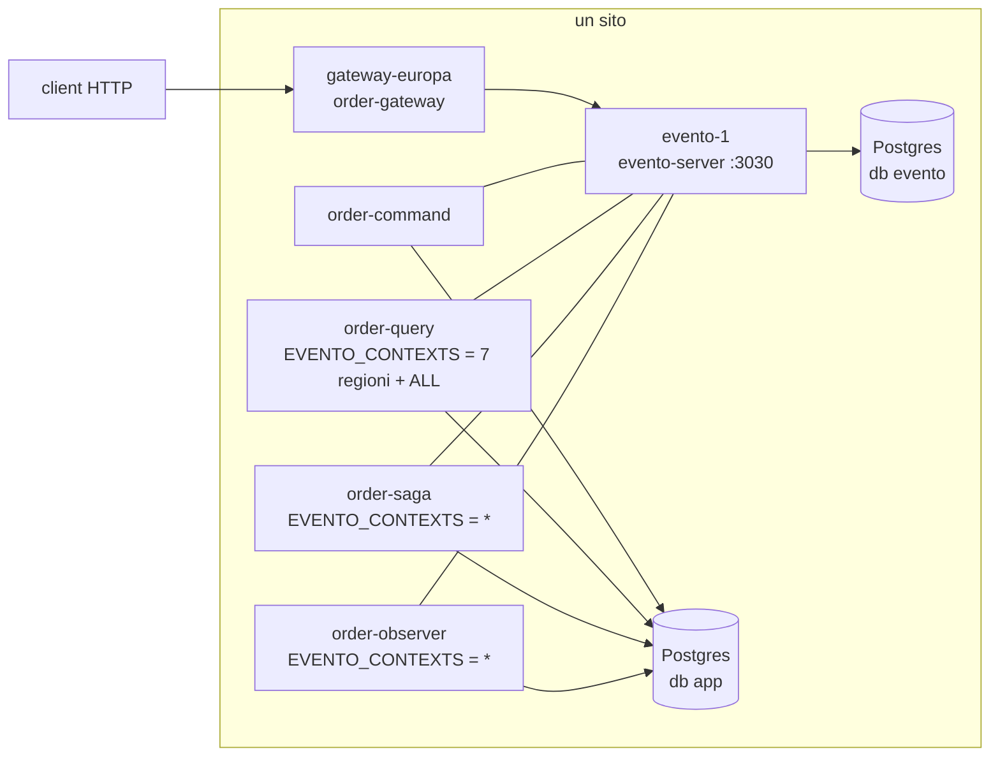
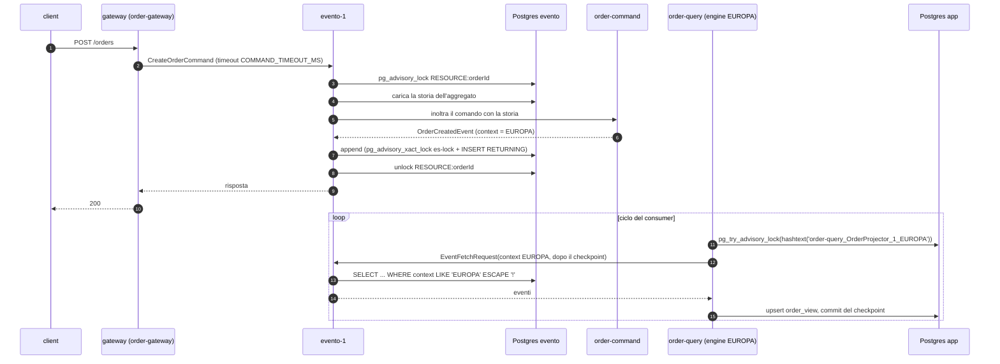

# L0: un server, un Postgres

[Indice](README.md) · successivo: [L1](L1-server-ha.md)

## Quando usarlo

- Sviluppo, test, ambienti piccoli, un solo sito.
- Quando un fermo di qualche minuto (riavvio del server o del database) è accettabile.
- Come punto di partenza: ogni livello successivo **riusa questa configurazione** e cambia solo
  alcune variabili.

L0 non ha niente di "cluster": è il riferimento contro cui misurare cosa costa ogni livello in
più. Tutti i server, bundle e scenari del laboratorio girano con immagini che funzionano anche
così.

## Topologia



Ogni bundle apre **una** sessione TCP verso il server (bus v2, porta 3030). Il server è l'unico
broker: instrada comandi e query agli handler registrati e serve i fetch degli eventi dal database
`evento`. I bundle con consumer tengono checkpoint, lock di lane e stato delle saghe nel proprio
database (`app`, via `JdbcConsumerStateStore`, `JdbcConsumerLock`, `JdbcSagaStateStore`).

## Flusso critico: un comando e la sua proiezione



La sequenza è la stessa in ogni livello; da L2 in poi le frecce verso `ES` attraversano la WAN e
ognuna costa un round trip (G9, N9).

## Configurazione esatta

Frammento compose derivato da [`../docker/compose.yaml`](../docker/compose.yaml): **stesse immagini**,
stesse variabili; cambiano solo nomi host e valori.

### Server

```yaml
  evento-1:
    image: evento-lab-cluster/server:${LAB_TAG}
    mem_limit: 512m
    environment:
      SPRING_DATASOURCE_URL: jdbc:postgresql://pg:5432/evento?tcpKeepAlive=true&connectTimeout=10
      SPRING_DATASOURCE_USERNAME: postgres
      SPRING_DATASOURCE_PASSWORD: secret
      EVENTO_ES_MODE: CPES                      # il default (dalla 2.6 anche nel codice)
      EVENTO_CLUSTER_NAME: evento-l0            # annunciato nel Welcome; il default "evento-server" va cambiato
      EVENTO_CLUSTER_NODE_SERVER_ID: evento-1   # diventa evento.server.bus.server-instance-id (Welcome.serverInstanceId)
      EVENTO_SERVER_INSTANCE_ID: evento-1       # evento.server.instance.id (default "server-0")
      JAVA_OPTS: -XX:MaxRAMPercentage=70 -XX:+UseSerialGC -Xss512k
```

Postgres: un'istanza con i database `evento` e `app` (lo script del laboratorio
[`../docker/pg/primary-init.sh`](../docker/pg/primary-init.sh) crea quelli in `EXTRA_DATABASES`).

### Bundle

Parti comuni a tutti i deployment:

```yaml
x-env-l0: &env-l0
  EVENTO_SERVER_ADDRESSES: evento-1:3030
  EVENTO_CLUSTER_NAME: evento-l0
  EVENTO_CHECKPOINT_MODE: DEFAULT
  APP_DB_URL: jdbc:postgresql://pg:5432/app?tcpKeepAlive=true&connectTimeout=10
  APP_DB_USER: postgres
  APP_DB_PASSWORD: secret
```

| Deployment | Immagine | Variabili proprie |
|---|---|---|
| `order-command` | `order-command` | `EVENTO_INSTANCE_ID=order-command` |
| `order-query` | `order-query` | `EVENTO_INSTANCE_ID=order-query`, `EVENTO_CONTEXTS=EUROPA,AFRICA,AMERICA,SUD_AMERICA,CINA,INDIA,AUSTRALIA_NZ,ALL`, `APP_DB_POOL_SIZE=16` |
| `order-query-wildcard` (facoltativo) | `order-query` | `EVENTO_INSTANCE_ID=order-query-wildcard`, `EVENTO_CONTEXTS=*` (riempie `order_view_global`, serve a `GET /orders/global/{id}`) |
| `order-saga` | `order-saga` | `EVENTO_INSTANCE_ID=order-saga`, `EVENTO_CONTEXTS=*` |
| `order-observer` | `order-observer` | `EVENTO_INSTANCE_ID=order-observer`, `EVENTO_CONTEXTS=*` |
| `gateway-europa` (uno per regione servita) | `order-gateway` | `EVENTO_INSTANCE_ID=gateway-europa`, `EVENTO_REGION=EUROPA`, `COMMAND_TIMEOUT_MS=30000` |

Perché `order-query` elenca le regioni più `ALL` e non `*`: `OrderQueryBundle.plan` dà a
`OrderProjector` i contesti regionali e a `CatalogProjector` solo un `ALL` scritto esplicitamente.
Con `*` il deployment proietterebbe tutti gli ordini in `order_view_global` e **nessun** prezzo
(il wildcard non accende mai la lane globale, vedi [contexts.md](contexts.md)). Con
`DATA_TARGETS` vuoto la lane `ALL` scrive solo nel database locale e lo dice nel log
(`event=lab_fanout_no_targets`), che in L0 è il comportamento voluto.

`EVENTO_ZONE` non serve: con un solo server non c'è scelta di località.

### Matrice bundle × L0

| Bundle | Deployment | `EVENTO_CONTEXTS` | Lane (consumerId) | Database |
|---|---|---|---|---|
| `order-command` | 1 | – | – | `app` (`payments`) |
| `order-query` | 1 (+1 `*` facoltativo) | 7 regioni + `ALL` | `order-query_OrderProjector_1_<R>` ×7, `order-query_CatalogProjector_1_ALL` (+ `order-query_OrderProjector_1_*`) | `app` |
| `order-saga` | 1 | `*` | `order-saga_PaymentSaga_1_*` | `app` |
| `order-observer` | 1 | `*` | `order-observer_NotificationObserver_1_*` | `app` |
| `order-gateway` | 1 per regione | – (`EVENTO_REGION`) | – | nessuno |

## Garanzie

- **Mutua esclusione per aggregato**: `pg_advisory_lock(hashtext('RESOURCE:'+aggregateId))` sui
  `DomainCommand` (`CommandBrokerHandler`).
- **Ordine globale di commit (CPES)**: il numero di sequenza è assegnato sotto il lock `es-lock`
  nella stessa istruzione dell'INSERT (G9); sequenza = ordine di commit.
- **Consumer at-least-once, checkpoint monotono**: il commit del checkpoint usa
  `GREATEST(last_sequence, ?)` (G11); una replica dello stesso consumerId aspetta il lock della lane.
- **Deadline dei comandi (N3)**: il server scarta un comando scaduto negli stadi `queued`,
  `lock_wait`, `before_forward`, `before_append` (`RequestExpiredException`, metrica
  `evento.server.requests.expired{stage}`). Dopo l'ultimo controllo il comando può ancora
  committare in ritardo (N15).

## Limiti noti

| Limite | Effetto | Prova |
|---|---|---|
| Server e database sono single point of failure | ogni guasto ferma tutto | per costruzione; vedi L1 e L4 |
| G5: nessuna idempotenza tra retry (**corretto**: chiavi di idempotenza, [L5](L5-limits-roadmap.md#g5--n14-chiave-di-idempotenza-end-to-end)) | senza chiave un retry dopo un timeout può duplicare gli eventi; con la chiave il retry riceve l'evento salvato | prima: [S14](../results/S14/after/report.md), [S00 `:before`](../results/S00/before/report.md) (3 pagamenti doppi); dopo: [S14 `after-g5n16`](../results/S14/after-g5n16/report.md) 0 chiavi doppie |
| Gate di staleness del fetch (Low) | un consumer con orologio indietro > 30 s non riceve eventi (`evento.es.fetch.max.age.ms`) | [S15](../results/S15/after/report.md) |
| N7 | `updated_at` del checkpoint non si muove: una lane ferma non si vede dalla tabella | [FINDINGS N7](../FINDINGS.md#n7-consumer-checkpoints-carry-no-update-time) |
| N8 | un bundle senza handler (il gateway) non ha riga in `core__bundle` | [FINDINGS N8](../FINDINGS.md#n8-a-send-only-bundle-is-absent-from-the-catalog) |

## Dimensionamento

| Componente | Memoria (limite / misurata) | Connessioni al database |
|---|---|---|
| evento-server | 512 MiB / 330–350 MiB | Hikari `maximum-pool-size` 20 (min idle 5) + lock pool `evento.lock.pool.maximum-size` 10 = **30** al picco, 7 a riposo |
| bundle con consumer | 256 MiB / ~200–215 MiB | `APP_DB_POOL_SIZE` (default 12). Ogni engine tiene **una** connessione per tutto il ciclo (lock della lane), quindi pool > numero di engine + scritture concorrenti: 8 engine → 16 |
| `order-command` | 288 MiB | `APP_DB_POOL_SIZE` 12 |
| gateway | 256 MiB | nessuna (pool `DATA_TARGETS` solo per la diagnostica `?db=`) |
| Postgres | 256–320 MiB nel laboratorio | `max_connections` ≥ 30 (server) + Σ pool dei bundle; qui ≈ 30 + 12 + 16 + 12 + 12 + 12 = 94 al picco teorico |

Opzioni JVM usate ovunque nel laboratorio: `-XX:MaxRAMPercentage=70 -XX:+UseSerialGC -Xss512k`
(`LAB_JAVA_OPTS`).

## Checklist

- [ ] `EVENTO_ES_MODE=CPES`. APES è deprecato dalla 2.6: su un server CPES è altrettanto veloce,
      con più server i consumer di APES possono saltare eventi. Un database APES passa a CPES
      fermando tutti i server e riavviandoli con `EVENTO_ES_MODE=CPES` (la sequenza riparte sopra
      l'ultimo id, `event=es_mode_switched`).
- [ ] `EVENTO_CLUSTER_NAME` diverso da `evento-server` e uguale su server e bundle.
- [ ] `EVENTO_CLUSTER_NODE_SERVER_ID` ed `EVENTO_SERVER_INSTANCE_ID` impostati (i default sono
      `iris-evento-server` e `server-0`).
- [ ] Ogni bundle con consumer ha `EVENTO_CONTEXTS` esplicito (`BundleDeployment.requireContexts`
      rifiuta di partire senza).
- [ ] `order-query` elenca `ALL` se deve proiettare il listino.
- [ ] Pool dei bundle > numero di engine.
- [ ] `max_connections` di Postgres ≥ somma dei picchi.
- [ ] Il gateway usa un `COMMAND_TIMEOUT_MS` che il chiamante rispetta (è la deadline che il server
      applica, N3).
