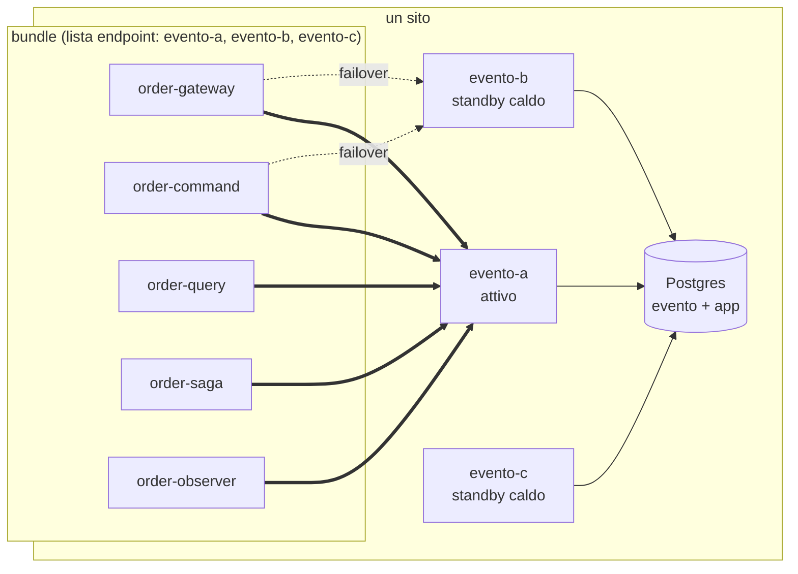
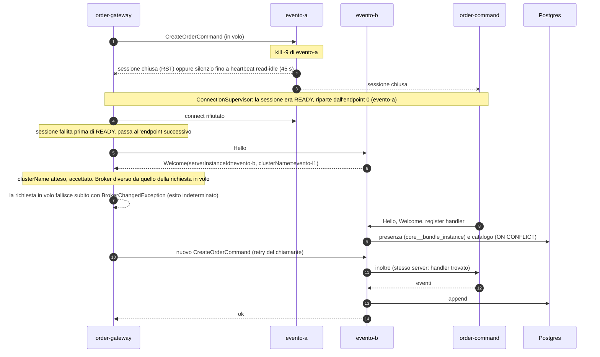

# L1: alta disponibilità del server (un sito, più server, un database)

[Indice](README.md) · precedente: [L0](L0-single-server.md) · successivo: [L2](L2-cells.md)

## Quando usarlo

- Un solo sito (una region cloud, un datacenter), latenza trascurabile tra server e database.
- Vuoi che la morte o il riavvio di un evento-server non fermi l'applicazione.
- Il database resta unico (per la sua alta disponibilità vedi [L4](L4-db-failover.md)).

L1 è **attivo/passivo per il bus**: tutti i bundle preferiscono lo **stesso** server, gli altri
server sono pronti a riceverli. Non è un bilanciamento del carico tra server. Il motivo è G1: i
server non si inoltrano richieste tra loro, quindi un comando arriva al suo handler solo se
chiamante e handler sono collegati allo stesso server.

## Topologia



Variante con VIP: i bundle hanno un solo indirizzo (un bilanciatore L4 con il server attivo come
primario e gli altri come `backup`), come fa il laboratorio con i `bus-<cella>` di
[`../docker/nginx/nginx.conf`](../docker/nginx/nginx.conf) (`BUS_VIA_LB=true`).

## Flusso critico: il server attivo muore



Punti chiave, tutti nel codice di `ConnectionSupervisor` e `BundleCorrelationTracker`:

- **Lista di endpoint (G2).** `EventoServerMessageBusConfiguration` riceve tutti gli indirizzi;
  una sessione che fallisce **prima** di READY passa al successivo (a giro). Una sessione che era
  READY e cade riparte dall'endpoint 0: è l'unico punto di ritorno, perché **non esiste una sonda
  di failback** in background (N16).
- **Identità del broker (G13).** `withExpectedClusterName` fa rifiutare un broker che annuncia un
  altro `clusterName` (`event=cluster_name_mismatch`). Il vecchio `withExpectedServerInstanceId`
  accetta **un solo** id e quindi rifiuta per contratto ogni failover (S13 variante A).
- **Richieste in volo (G4).** Se il nuovo `Welcome` nomina un altro `serverInstanceId`, le richieste
  inviate sulla sessione precedente falliscono subito con `BrokerChangedException` ("may or may not
  have been applied") invece di aspettare 30 s il timeout. Richiede id server univoci.
- **Catalogo e presenza (G7, G8).** Il bundle che arriva sul nuovo server scrive la propria presenza
  in `core__bundle_instance` (`BundlePresence`); il `NodeLeft` tardivo del vecchio server non
  cancella più le righe di un bundle che vive altrove.

## Configurazione esatta

Stesse immagini di L0. Cambiano: numero di server, `EVENTO_SERVER_ADDRESSES`.

### Server (×2 o ×3, stesso database)

```yaml
x-server-l1: &server-l1
  image: evento-lab-cluster/server:${LAB_TAG}
  mem_limit: 512m
  environment: &server-l1-env
    SPRING_DATASOURCE_URL: jdbc:postgresql://pg:5432/evento?tcpKeepAlive=true&connectTimeout=10
    SPRING_DATASOURCE_USERNAME: postgres
    SPRING_DATASOURCE_PASSWORD: secret
    EVENTO_ES_MODE: CPES                     # obbligatorio con più server (APES: G10, G20)
    EVENTO_CLUSTER_NAME: evento-l1           # uguale su tutti i server
    SPRING_DATASOURCE_HIKARI_MAXIMUM_POOL_SIZE: "20"
    EVENTO_LOCK_POOL_MAXIMUM_SIZE: "10"

services:
  evento-a:
    <<: *server-l1
    environment:
      <<: *server-l1-env
      EVENTO_CLUSTER_NODE_SERVER_ID: evento-a   # univoco: è il Welcome.serverInstanceId che G4 confronta
      EVENTO_SERVER_INSTANCE_ID: evento-a
  evento-b:
    <<: *server-l1
    environment:
      <<: *server-l1-env
      EVENTO_CLUSTER_NODE_SERVER_ID: evento-b
      EVENTO_SERVER_INSTANCE_ID: evento-b
```

Avvio: i server eseguono `schema.sql` a ogni avvio; dopo G14 lo fanno sotto un advisory lock, ma
un avvio in catena (`depends_on: service_healthy`, come nel laboratorio) resta la scelta prudente.

### Bundle

```yaml
x-env-l1: &env-l1
  EVENTO_SERVER_ADDRESSES: evento-a:3030,evento-b:3030   # STESSO ordine in ogni bundle
  EVENTO_CLUSTER_NAME: evento-l1                          # il guard di identità compatibile col failover
  # EVENTO_EXPECTED_SERVER_ID: non impostarlo: accetta un solo broker e blocca il failover (S13 A)
  EVENTO_CHECKPOINT_MODE: DEFAULT
  APP_DB_URL: jdbc:postgresql://pg:5432/app?tcpKeepAlive=true&connectTimeout=10
  APP_DB_USER: postgres
  APP_DB_PASSWORD: secret
  EVENTO_HEARTBEAT_READ_IDLE_S: "15"   # facoltativo: rileva una partizione silenziosa in 15 s invece di 45
```

Variante VIP: `EVENTO_SERVER_ADDRESSES: bus:3030` dove `bus` è un bilanciatore L4 con il server
attivo come primario e gli altri come `backup` (nel laboratorio: `upstream bus_eu` con
`max_fails=1 fail_timeout=10s`). Il VIP rimanda le **nuove** connessioni al primario appena torna,
ma le sessioni già aperte sul backup restano lì (N16 vale anche qui).

I deployment e le variabili proprie sono quelli di L0 (`EVENTO_INSTANCE_ID`, `EVENTO_CONTEXTS`,
`EVENTO_REGION`). Per ridondare gli handler si aggiungono repliche con un altro
`EVENTO_INSTANCE_ID`: il server sceglie tra le istanze vive (`EVENTO_SERVER_BUS_PICK_STRATEGY`,
default `random`), come misura S02.

### Matrice bundle × L1

| Bundle | Deployment | Cosa cambia rispetto a L0 | Nota |
|---|---|---|---|
| `order-command` | 1–2 repliche | `EVENTO_SERVER_ADDRESSES=evento-a:3030,evento-b:3030` | le repliche sullo stesso server si sostituiscono a vicenda (S02) |
| `order-query` | 1–2 repliche | lista endpoint | due repliche con gli stessi contesti competono per le stesse lane (G24): una proietta, l'altra aspetta |
| `order-saga` | 1–2 repliche | lista endpoint | come sopra |
| `order-observer` | 1–2 repliche | lista endpoint | come sopra |
| `order-gateway` | 1 per regione | lista endpoint | i suoi comandi falliscono con `BrokerChangedException` al cambio di broker |
| server | 2–3 | id univoci, `EVENTO_CLUSTER_NAME` comune | stesso database |

## Garanzie

- **Failover del bus**: misurato nella topologia a celle (stesso meccanismo) in
  [S03 `:after`](../results/S03/after/report.md): la cella APAC, rimasta senza server, ha confermato
  44/44 comandi, il primo **10.3 s** dopo il kill; su `:before` 0/18.
- **Nessuna attesa di 30 s per le richieste in volo**: [S14 `:after`](../results/S14/after/report.md),
  13/24 primi tentativi falliti, tutti `broker_changed`, **0** dopo ≥ 25 s (su `:before` 24/24 dopo
  ≥ 25 s).
- **Identità**: [S13 `:after`](../results/S13/after/report.md) variante C: un bundle che si aspetta un
  altro cluster viene rifiutato (40 `cluster_name_mismatch`, mai READY); variante B: con il guard del
  nome cluster il failover funziona 3/3. Su `:before` la variante C si collega al cluster sbagliato.
- **Catalogo intatto dopo il ritorno del server**: [S04 `:after`](../results/S04/after/report.md),
  0 consumer cancellati dopo una pausa di 60 s (su `:before` 10, N12).
- **Consumer**: il fetch è servito da qualunque server (legge il database condiviso); il lock della
  lane è nel database dei consumer, quindi la lane sopravvive al cambio di server.

## Limiti noti

| Id | Limite | Prova |
|---|---|---|
| G1 | nessun inoltro tra server: chiamante e handler devono stare sullo stesso server, altrimenti `no handler for <Payload>` | [S01](../results/S01/after/report.md): 0/5 in ≤ 14 ms, identico su `:before` |
| N16 | nessun failback: dopo il ritorno del server attivo i bundle restano sul backup fino alla prossima disconnessione. Se un bundle solo si riconnette (endpoint 0), il cluster si divide e G1 fa fallire le chiamate | [S13 `after-n16-evidence`](../results/S13/after-n16-evidence/report.md): `gateway-europa` sul server tornato, 0/3 `no handler` |
| G5 / N14 | `BrokerChangedException` dice "esito indeterminato", ma nessuna chiave di idempotenza permette un retry sicuro | [S14](../results/S14/after/report.md): 9 dei 13 primi tentativi falliti erano già stati salvati, 8 chiavi salvate due volte; [S03 `after-run1`](../results/S03/after-run1/report.md): pagamento eseguito due volte |
| G17 | dashboard e amministrazione dei consumer mostrano la vista **del server** a cui ti colleghi | [CLUSTER-READINESS G17](../../.claude/CLUSTER-READINESS.md) |
| G22 | una partizione silenziosa (senza RST) si rileva solo dopo il read-idle (45 s di default) | `EVENTO_HEARTBEAT_READ_IDLE_S` / `setHeartbeatReadIdle` |

Regola operativa che segue da N16 + G1: **dopo il ritorno di un server, riavvia i bundle che sono
rimasti sul backup** (tutti insieme), oppure lasciali lì finché il backup è sano. Il laboratorio
lo fa prima di ogni scenario (`placementRestoredAtStart`, L22).

## Dimensionamento

| Voce | Valore |
|---|---|
| Connessioni per server | 20 (Hikari) + 10 (lock pool) = 30 al picco, 7 a riposo; il laboratorio fissa il lock pool a 16 (`EVENTO_LOCK_POOL_MAXIMUM_SIZE`) |
| Connessioni al database dai server | server × 30; 3 server = 90 (sotto il `max_connections=100` di default di Postgres, come dice il commento in `application.properties`) |
| Pool dei bundle | come L0; il failover non cambia il numero di connessioni applicative |
| Memoria server | 512 MiB di limite, ~340 MiB usati: anche lo standby consuma memoria e 7 connessioni a riposo |
| Tempo di failover | ≈ rilevamento (immediato con RST, fino a `heartbeatReadIdle` senza) + backoff di riconnessione + handshake + registrazione: 10.3 s misurati in S03 |

## Checklist

- [ ] Server con `EVENTO_CLUSTER_NODE_SERVER_ID` / `EVENTO_SERVER_INSTANCE_ID` **univoci** e lo
      stesso `EVENTO_CLUSTER_NAME`.
- [ ] Ogni bundle ha la **stessa** lista `EVENTO_SERVER_ADDRESSES`, nello stesso ordine (o lo stesso VIP).
- [ ] `EVENTO_CLUSTER_NAME` impostato sui bundle; `EVENTO_EXPECTED_SERVER_ID` **non** impostato.
- [ ] Il chiamante gestisce `BrokerChangedException` come esito indeterminato: non ripete un comando
      non idempotente senza una verifica (G5).
- [ ] Runbook: dopo il ritorno di un server, riavviare i bundle rimasti sul backup (N16).
- [ ] `max_connections` ≥ server × (Hikari + lock pool) + pool dei bundle.
- [ ] Avvio dei server in catena, o almeno sulla versione con G14.
