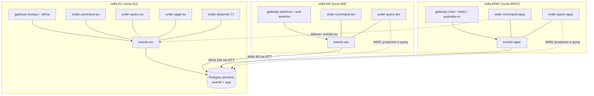
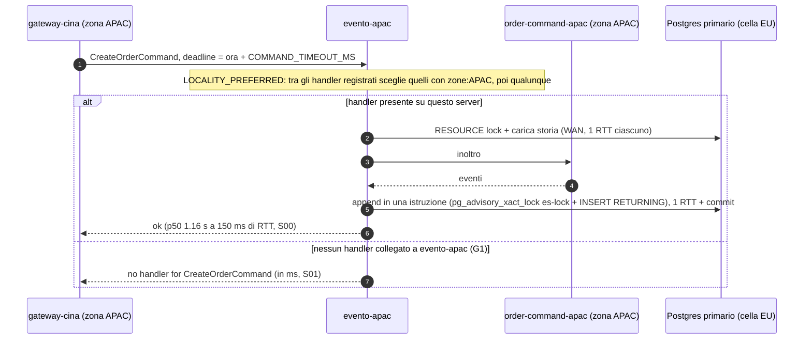
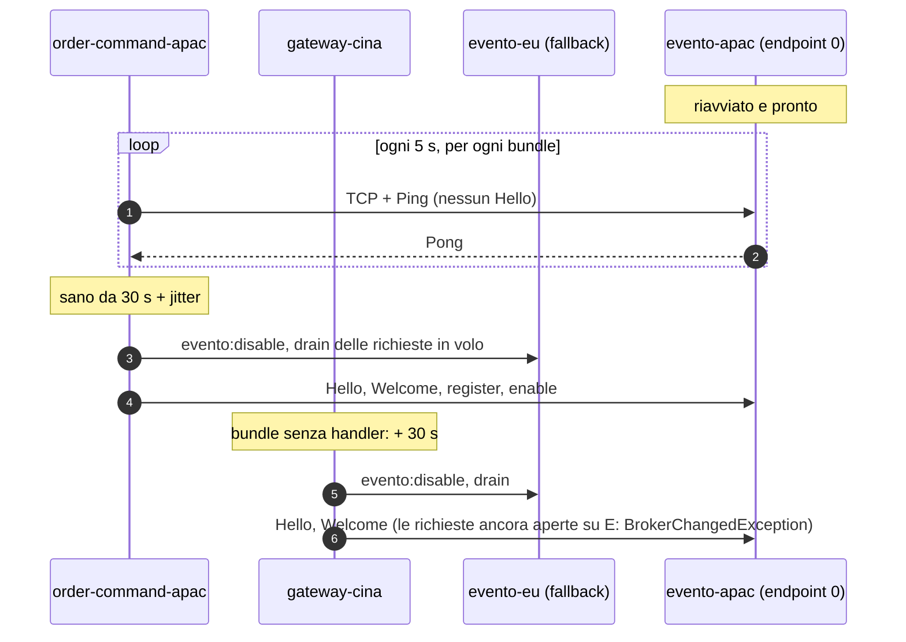

# L2: celle (un server per sito, un Postgres condiviso)

[Indice](README.md) · precedente: [L1](L1-server-ha.md) · successivo: [L3](L3-multi-region-contexts.md)

## Quando usarlo

- Hai utenti in più siti lontani (EU, AM, APAC) e vuoi che ogni sito abbia il **proprio** broker,
  così che comandi e query entrino nel cluster vicino all'utente.
- Accetti che il database (event store) sia uno solo, in un sito: ogni append di un sito remoto
  paga il round trip verso il primario.
- I dati applicativi non devono ancora essere separati per regione (quello è [L3](L3-multi-region-contexts.md)).

## Perché ogni cella ha un set completo di handler (G1)

Ogni evento-server è un broker indipendente: registro degli handler, tabella di inoltro e
correlazioni stanno nella JVM (`ClusterRegistry`, `ConnectionRegistry`). Non esiste un
collegamento server-server. Una richiesta il cui handler non è collegato **allo stesso server**
fallisce subito con `no handler for <PayloadType>`. È una **scelta di progetto**, non un difetto:
la connettività è regionale, un client può essere collegato solo ad alcuni server, e la cella,
con il suo server e un set completo di handler accanto, è la topologia prevista. Le richieste
restano nella cella, un guasto di cella resta nella cella, e la coerenza tra celle viene dal
database degli eventi condiviso. Quindi:

- ogni cella deve ospitare **tutti** gli handler che i suoi chiamanti usano: comandi
  (`order-command`), query (`order-query`), e i comandi emessi dalle saghe;
- i consumer puri (proiettori, osservatori) possono stare ovunque, perché il fetch è servito da
  qualunque server leggendo lo stesso `es__events`.

Lo scenario [S01](../results/S01/after/report.md) lo dimostra: fermato `order-command-am`, la
regione AMERICA riceve 0/5 `no handler for CreateOrderCommand` in ≤ 14 ms, **anche** se gli handler
sono vivi in EU e APAC. Stesso risultato su `:before` e `:after`: è il comportamento voluto
(G1, scelta di progetto); S01 mostra il costo di una cella a cui manca un handler. Una mesh di
server resta un'opzione per topologie con celle parziali (vedi [L5](L5-limits-roadmap.md)).

## Topologia



Tre isole di routing, un solo stato condiviso: `es__events` e il catalogo (`core__bundle`,
`core__component`, `core__handler`, `core__consumer`, `core__bundle_instance`).

## Flusso critico: un comando dalla cella APAC



Dopo un failover (vedi [L1](L1-server-ha.md)) la cella APAC finisce su `evento-eu`: da quel momento
`evento-eu` vede `order-command-eu` (zona EU) e `order-command-apac` (zona APAC). Con
`locality-preferred` il gateway EU continua a usare l'handler EU e il gateway APAC quello APAC;
con `random` metà dei comandi attraverserebbe la WAN due volte.

Quando `evento-apac` torna, i bundle APAC tornano da soli (failback, N16): ciascuno sonda il proprio
endpoint 0 senza registrarsi e si sposta quando è rimasto sano per la finestra di stabilità (30 s)
più un jitter (0–10 s); i bundle senza handler (i gateway) aspettano in più l'intero intervallo di
jitter (10 s), così partono dopo ogni handler che ha iniziato la finestra insieme a loro. Le sonde
ricevono risposta solo quando `evento-apac` è pronto (readiness Spring), non appena apre la porta.
L'ordine conta per G1: se un gateway arrivasse su `evento-apac` prima di `order-command-apac`,
avrebbe `no handler for` finché l'handler non lo raggiunge; gli handler che tornano per primi,
invece, lasciano i gateway ancora su `evento-eu`, dove l'handler EU della stessa classe continua a
servirli (con `random` o, in mancanza della zona APAC, con `locality-preferred`). Se su
`evento-eu` non resta nessun handler per quel comando (una coppia HA, o una classe che esiste solo
nella cella APAC), il primo `no handler for` fa tornare il gateway **subito**, senza aspettare la
sua finestra (ritorno reattivo, `event=failback_reactive`): costa una richiesta fallita per
gateway e un intervallo di sonda al massimo, non ~30 s. Il ritorno resta per bundle, non atomico
per la cella: alcuni comandi isolati possono fallire con `no handler for`, `BrokerChangedException`
o `RequestNotSentException` (non inviato, ripetibile), poi la cella è di nuovo tutta sul suo server.



## Località, presenza e catalogo

- **Pick per località (G12).** Il bundle annuncia `zone:<ZONA>` nell'Hello
  (`EventoBundle.Builder.setZone`, nel laboratorio `EVENTO_ZONE` tramite `FrameworkFeatures`);
  il server con `evento.server.bus.pick-strategy=locality-preferred`
  (`ClusterRegistry.PickStrategy.LOCALITY_PREFERRED`) preferisce gli handler della stessa zona del
  chiamante. `GET /api/cluster-status/zones` mostra la mappa istanza → zona del server. Prova:
  in [S05 `:after`](../results/S05/after/report.md) lo stesso aggregato conteso da EUROPA e CINA ha
  p50 186 ms per EUROPA e 1070 ms per CINA: ognuno servito nella propria cella.
- **Presenza (G7).** `core__bundle_instance` (`BundlePresence`) registra quale server tiene la
  sessione di ogni istanza, con heartbeat dal clock del database
  (`evento.server.presence.heartbeat-interval-ms`, 30 s; righe vecchie dopo
  `evento.server.presence.stale-after-ms`, 180 s). Un server che vede cadere un'istanza pulisce il
  catalogo solo se ne è ancora il proprietario. Prova: [S04 `:after`](../results/S04/after/report.md)
  0 consumer cancellati contro 10 su `:before` (N12).
- **Catalogo (G8, N1).** Inserimenti `ON CONFLICT` sotto un'unica chiave `DISCOVERY:<bundle>`;
  componenti con chiave `bundle:name`. Prova: 0 avvii su 7 con righe mancanti su `:after`, 7 su 7
  su `:before` ([AFTER-SUMMARY](../results/AFTER-SUMMARY.md)).
- **Ritardo di registrazione (N6).** Le righe `core__consumer` compaiono fino a ~25 s dopo che il
  bundle è `healthy`; uno strumento che legge il catalogo subito dopo un rollout vede buchi
  transitori (lo script `repair-catalog.sh --check` aspetta `REPAIR_SETTLE_S`, 90 s).

## Configurazione esatta

Stesse immagini. Rispetto a L1 cambiano: un server per cella, `EVENTO_ZONE`, l'ordine degli
indirizzi (il **proprio** server per primo) e la strategia di pick.

### Server

Questi valori sono quelli di [`../docker/compose.yaml`](../docker/compose.yaml) (`x-server-env`,
`evento-eu`, `evento-am`, `evento-apac`); in L2 il database è uno solo, quindi l'URL elenca un
host:

```yaml
x-server-env: &server-env
  SPRING_DATASOURCE_USERNAME: postgres
  SPRING_DATASOURCE_PASSWORD: secret
  SPRING_DATASOURCE_HIKARI_MAXIMUM_POOL_SIZE: "20"
  EVENTO_LOCK_POOL_MAXIMUM_SIZE: "16"
  EVENTO_CLUSTER_NAME: evento-lab-cluster
  EVENTO_ES_MODE: CPES
  EVENTO_SERVER_BUS_PICK_STRATEGY: locality-preferred

services:   # ognuno con image: evento-lab-cluster/server:${LAB_TAG} (x-server nel compose)
  evento-eu:   {environment: {<<: *server-env, EVENTO_CLUSTER_NODE_SERVER_ID: evento-eu,   EVENTO_SERVER_INSTANCE_ID: evento-eu,
                SPRING_DATASOURCE_URL: "jdbc:postgresql://pg-eu:5432/evento?tcpKeepAlive=true&connectTimeout=10"}}
  evento-am:   {environment: {<<: *server-env, EVENTO_CLUSTER_NODE_SERVER_ID: evento-am,   EVENTO_SERVER_INSTANCE_ID: evento-am,
                SPRING_DATASOURCE_URL: "jdbc:postgresql://toxi-am:20211/evento?tcpKeepAlive=true&connectTimeout=10"}}
  evento-apac: {environment: {<<: *server-env, EVENTO_CLUSTER_NODE_SERVER_ID: evento-apac, EVENTO_SERVER_INSTANCE_ID: evento-apac,
                SPRING_DATASOURCE_URL: "jdbc:postgresql://toxi-apac:20311/evento?tcpKeepAlive=true&connectTimeout=10"}}
```

(`toxi-<cella>:<porta>` è il proxy WAN del laboratorio; in produzione è l'indirizzo del primario
visto dalla cella.)

### Bundle

Blocchi per cella, identici a `x-bus-*` del compose:

```yaml
x-bus-eu:   &bus-eu   {EVENTO_ZONE: EU,   EVENTO_SERVER_ADDRESSES: "evento-eu:3030,toxi-eu:20123,toxi-eu:20133"}
x-bus-am:   &bus-am   {EVENTO_ZONE: AM,   EVENTO_SERVER_ADDRESSES: "evento-am:3030,toxi-am:20213,toxi-am:20233"}
x-bus-apac: &bus-apac {EVENTO_ZONE: APAC, EVENTO_SERVER_ADDRESSES: "evento-apac:3030,toxi-apac:20313,toxi-apac:20323"}

x-env-l2: &env-l2
  EVENTO_CLUSTER_NAME: evento-lab-cluster
  EVENTO_CHECKPOINT_MODE: DEFAULT
  APP_DB_USER: postgres
  APP_DB_PASSWORD: secret
  # un solo database applicativo: ogni cella lo raggiunge (le remote via WAN)
  # EU:   APP_DB_URL=jdbc:postgresql://pg-eu:5432/app?tcpKeepAlive=true&connectTimeout=10
  # AM:   APP_DB_URL=jdbc:postgresql://toxi-am:20212/app?tcpKeepAlive=true&connectTimeout=10
  # APAC: APP_DB_URL=jdbc:postgresql://toxi-apac:20312/app?tcpKeepAlive=true&connectTimeout=10
```

| Deployment | Immagine | Ambiente |
|---|---|---|
| `order-command-<cella>` ×3 | `order-command` | `env-l2`, `bus-<cella>`, `APP_DB_URL` della cella, `EVENTO_INSTANCE_ID` |
| `order-query-<cella>` ×3 | `order-query` | `env-l2`, `bus-<cella>`, `EVENTO_CONTEXTS=EUROPA,AFRICA,AMERICA,SUD_AMERICA,CINA,INDIA,AUSTRALIA_NZ,ALL` (uguale nelle tre celle), `APP_DB_POOL_SIZE=16` |
| `order-saga-<cella>` ×1–3 | `order-saga` | `env-l2`, `bus-<cella>`, `EVENTO_CONTEXTS=*` |
| `order-observer` ×1 | `order-observer` | `env-l2`, `bus-eu`, `EVENTO_CONTEXTS=*` |
| `gateway-<regione>` ×7 | `order-gateway` | `env-l2`, `bus-<cella della regione>`, `EVENTO_REGION=<regione>` |

### Matrice bundle × L2

| Bundle | Per cella | Cosa cambia rispetto a L1 | Perché |
|---|---|---|---|
| `order-command` | **1 obbligatorio** | `EVENTO_ZONE`, proprio server per primo | G1: ogni comando della cella deve trovare l'handler sul server della cella |
| `order-query` | **1 obbligatorio** (per le query) | `EVENTO_ZONE`, stessi contesti in ogni cella | le query sono richieste: G1 vale anche per loro. Le tre repliche competono per le stesse 8 lane (G24) |
| `order-saga` | 0–1 | `EVENTO_ZONE` | una lane globale per contesto; il `ProcessPaymentCommand` esce dal server della replica che tiene la lane e trova l'`order-command` di quella cella |
| `order-observer` | 1 in tutto | `EVENTO_ZONE` | consumer puro: nessun vincolo di cella |
| `order-gateway` | 1 per regione della cella | `EVENTO_ZONE`, proprio server per primo | entra nel cluster dal server della cella |
| server | 1 | `EVENTO_SERVER_BUS_PICK_STRATEGY=locality-preferred` | G12 |

## Garanzie

- **Isolamento del routing**: una cella senza server non ferma le altre (S03: EU+AM 62/62 durante il
  kill di `evento-apac`, p50 192 ms).
- **Coerenza tra celle**: stesso event store, stessa mutua esclusione per aggregato, stesso ordine
  globale; nessun fork di aggregato osservato nemmeno con contesa da due celle (S05: 120/120, 0
  deadlock; su `:before` 8 deadlock tra server, G3).
- **Partizione di una cella remota**: le altre celle continuano a scrivere (S07 `:after`: EU+AM
  41/41 durante 62 s di partizione di APAC; su `:before` 0/16 e nessun append nel cluster per ~90 s,
  N11).
- **Throughput**: a 7 × 20 ordini/min, 492/492 confermati, 9.35 append/s (S00).

## Limiti noti

| Id | Limite | Prova |
|---|---|---|
| G1 (scelta di progetto) | nessun inoltro tra server: la cella deve ospitare ogni handler che i suoi chiamanti usano | [S01](../results/S01/after/report.md) |
| N16 (residuo) | il failback è per bundle, non per cella: durante il ritorno chiamanti e handler della stessa cella possono stare su server diversi e G1 dà `no handler for`; il primo `no handler for` fa tornare subito il chiamante (ritorno reattivo), quindi il costo è una richiesta fallita per chiamante, non una finestra; con un VIP non c'è failback | prima del fix: [S13 `after-n16-evidence`](../results/S13/after-n16-evidence/report.md), [FINDINGS N16](../FINDINGS.md); fix: `BundleClientFailbackIT`, S03 e S13 da rieseguire |
| N5 / N9 | ogni append serializza su un lock globale raggiunto via WAN: un comando remoto costa ancora ~7–9 round trip | [S00](../results/S00/after/report.md): p50 AM 0.73–0.76 s, APAC 1.16–1.18 s; [S06](../results/S06/after/report.md): a 300 ms di RTT, p50 APAC 22.8 s |
| N15 | sotto contesa del `es-lock` un comando può committare dopo la deadline del chiamante | [S06](../results/S06/after/report.md): 31 comandi scaduti e salvati a 300 ms |
| N4 / G24 | le lane dei consumer non hanno affinità: il detentore può essere in una cella remota e scrivere via WAN | [S16](../results/S16/after/report.md): scrittori EU 9 / APAC 6 |
| N6 | il catalogo dei consumer arriva fino a ~25 s dopo il `healthy` | [FINDINGS N6](../FINDINGS.md) |
| G17 / G18 | dashboard locale al server; discovery sul thread del bus (una riconnessione di massa rallenta il bus) | [CLUSTER-READINESS](../../.claude/CLUSTER-READINESS.md) |

## Dimensionamento

| Voce | Valore |
|---|---|
| Connessioni dei server al primario | 3 × (20 + 16) = 108 nel laboratorio; con i default 3 × 30 = 90 |
| Connessioni dei bundle | Σ `APP_DB_POOL_SIZE` dei deployment; in L2 puntano tutti allo stesso Postgres: ≈ 3 × 12 (command) + 3 × 16 (query) + 12 (saga) + 12 (observer) = 108 al picco teorico |
| `max_connections` | ≥ 108 + 108; il laboratorio usa 200 con i DB separati (misurate 67–73 connessioni client sul primario ES a regime, [integrazione](../results/_integration/after/checks.md)) |
| Memoria | server 512 MiB; bundle 256 MiB (`order-command` 288 MiB) |
| Latenza di un comando remoto | ≈ 7–9 × RTT verso il primario (N9) |
| Capacità di append | 7.0 append/s fino a 150 ms di RTT, 6.55 a 300 ms (S06); il collo di bottiglia è il `es-lock` globale |

## Checklist

- [ ] In ogni cella: `order-command`, `order-query` e un gateway per ogni regione servita.
- [ ] Nessun bundle di una cella ha nella sua lista, per primo, il server di un'altra cella.
- [ ] `EVENTO_ZONE` su ogni bundle, `EVENTO_SERVER_BUS_PICK_STRATEGY=locality-preferred` su ogni server.
- [ ] Id server univoci (la presenza si basa su di essi: con un id condiviso ogni server crede di
      possedere ogni riga).
- [ ] Il primario ES nella cella con più scritture (N5: la cella del primario è favorita).
- [ ] Dopo il ritorno di un server, verificare `event=failback_completed` nei bundle della sua cella
      entro finestra + jitter (+ l'intervallo di jitter per i gateway); riavviarli solo se restano
      altrove (VIP, immagini senza N16, `event=failback_suspended` dopo rifiuti per identità).
- [ ] Monitorare `no handler for` nei log del server: pochi casi isolati durante un failback sono
      attesi (G1 + N16, uno per chiamante prima del ritorno reattivo), una serie continua no.
