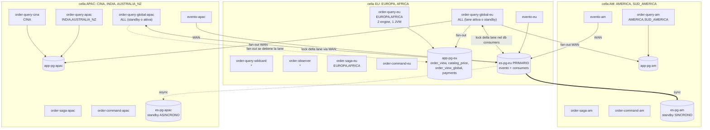
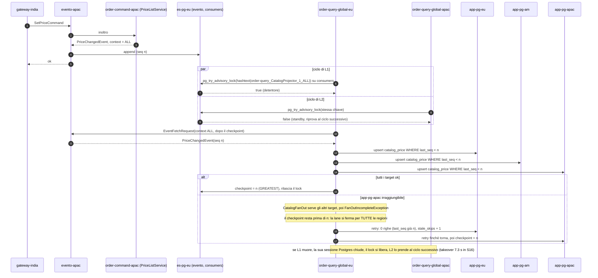

# L3: multi-regione con i context (DB regionali, contesto `ALL`, una lane globale)

[Indice](README.md) · precedente: [L2](L2-cells.md) · successivo: [L4](L4-db-failover.md)

È la topologia che il laboratorio esegue per intero: [`../docker/compose.yaml`](../docker/compose.yaml),
36 container, 21 JVM di bundle, verificata in [`../results/_integration/after/checks.md`](../results/_integration/after/checks.md)
e da tutti gli scenari S00…S17.

## Quando usarlo

- I dati applicativi devono restare nella regione (read model, side effect, stato dei consumer):
  per latenza, per sovranità del dato o per isolare i guasti.
- Le regioni sono più delle celle (qui 7 regioni in 3 celle) e vuoi raggrupparle per cella
  senza scrivere una classe per regione.
- Esistono eventi **globali** (listino prezzi, catalogo, promozioni) che ogni regione deve vedere.

## I quattro concetti

1. **Regione = context dell'evento.** L'aggregato copia la regione dal comando nell'evento
   (`Event#setContext`; i comandi non hanno un context di framework, G23). I consumer filtrano per
   context lato server (`WHERE context LIKE ? ESCAPE '!'`, G15 corretto).
2. **Un componente, un engine per contesto.** Il deployment dichiara i suoi contesti in
   `EVENTO_CONTEXTS`; il bundle chiama `EventoBundle.Builder.setComponentContexts(OrderProjector.class, "EUROPA", "AFRICA")`
   e il builder avvia un engine per contesto, con consumerId
   `<bundleId>_<Component>_<versione>_<context>`. Nessuna classe per regione. Dettagli in [contexts.md](contexts.md).
3. **`ALL` è un contesto vero, `*` è il wildcard.** Gli eventi globali portano il contesto
   letterale `"ALL"` (`Contexts.GLOBAL`); **una sola** lane nel cluster lo consuma
   (`order-query_CatalogProjector_1_ALL`) e scrive in **tutti** i database regionali, in modo
   idempotente. `*` (`Context.WILDCARD`, alias deprecato `Context.ALL`) riceve ogni contesto,
   `ALL` compreso: non va mai usato dove si intende `"ALL"`.
4. **Query nella cella.** Ogni deployment `order-query` di una cella legge il database della
   cella, che contiene tutte le regioni della cella e la copia del listino; con
   `locality-preferred` e `EVENTO_ZONE` la query di un gateway è servita nella sua cella.

## Topologia



Ogni database applicativo ha anche una replica locale asincrona (`app-pg-*-r`), promuovibile
(vedi [L4](L4-db-failover.md)). `order_view_global` vive in `app-pg-eu`; le celle AM e APAC la leggono
via WAN (`GLOBAL_VIEW_DB_URL`).

## Flusso critico: un evento globale e la lane `ALL`



Il lock della lane è preso **a ogni ciclo di fetch** (`JdbcConsumerLock.tryAcquire`), quindi il
detentore può alternarsi tra le repliche anche senza guasti (N4): resta una lane (un consumerId, un
checkpoint), ma senza località.

## Configurazione esatta

Copiata da [`../docker/compose.yaml`](../docker/compose.yaml). Tutti i deployment di un bundle usano
**la stessa immagine**; nessun ramo di codice sceglie la topologia.

### Server

```yaml
x-server-env: &server-env
  SPRING_DATASOURCE_USERNAME: postgres
  SPRING_DATASOURCE_PASSWORD: secret
  SPRING_DATASOURCE_HIKARI_MAXIMUM_POOL_SIZE: "20"
  EVENTO_LOCK_POOL_MAXIMUM_SIZE: "16"
  EVENTO_CLUSTER_NAME: evento-lab-cluster
  EVENTO_ES_MODE: CPES
  EVENTO_SERVER_BUS_PICK_STRATEGY: ${PICK_STRATEGY:-locality-preferred}
  JAVA_OPTS: *java-opts

services:   # con image: evento-lab-cluster/server:${LAB_TAG:-dev} (x-server)
  evento-eu:
    environment:
      <<: *server-env
      SPRING_DATASOURCE_URL: jdbc:postgresql://es-pg-eu:5432,toxi-eu:20121,toxi-eu:20131/evento?targetServerType=primary&tcpKeepAlive=true&connectTimeout=10
      EVENTO_CLUSTER_NODE_SERVER_ID: evento-eu
      EVENTO_SERVER_INSTANCE_ID: evento-eu
  evento-am:
    environment:
      <<: *server-env
      SPRING_DATASOURCE_URL: jdbc:postgresql://toxi-am:20211,es-pg-am:5432,toxi-am:20231/evento?targetServerType=primary&tcpKeepAlive=true&connectTimeout=10
      EVENTO_CLUSTER_NODE_SERVER_ID: evento-am
      EVENTO_SERVER_INSTANCE_ID: evento-am
  evento-apac:
    environment:
      <<: *server-env
      SPRING_DATASOURCE_URL: jdbc:postgresql://toxi-apac:20311,toxi-apac:20321,es-pg-apac:5432/evento?targetServerType=primary&tcpKeepAlive=true&connectTimeout=10
      EVENTO_CLUSTER_NODE_SERVER_ID: evento-apac
      EVENTO_SERVER_INSTANCE_ID: evento-apac
```

### Frammenti comuni dei bundle

```yaml
x-env-common: &env-common
  EVENTO_CLUSTER_NAME: evento-lab-cluster
  EVENTO_CHECKPOINT_MODE: ${CONSUMER_CHECKPOINT_MODE:-DEFAULT}
  APP_DB_USER: postgres
  APP_DB_PASSWORD: secret
  JAVA_OPTS: *java-opts

x-bus-eu:   &bus-eu   {EVENTO_ZONE: EU,   EVENTO_SERVER_ADDRESSES: "${BUS_ADDR_EU:-evento-eu:3030,toxi-eu:20123,toxi-eu:20133}"}
x-bus-am:   &bus-am   {EVENTO_ZONE: AM,   EVENTO_SERVER_ADDRESSES: "${BUS_ADDR_AM:-evento-am:3030,toxi-am:20213,toxi-am:20233}"}
x-bus-apac: &bus-apac {EVENTO_ZONE: APAC, EVENTO_SERVER_ADDRESSES: "${BUS_ADDR_APAC:-evento-apac:3030,toxi-apac:20313,toxi-apac:20323}"}

x-db-eu: &db-eu
  APP_DB_URL: jdbc:postgresql://app-pg-eu:5432,app-pg-eu-r:5432/app?targetServerType=primary&tcpKeepAlive=true&connectTimeout=10
x-db-am: &db-am
  APP_DB_URL: jdbc:postgresql://app-pg-am:5432,app-pg-am-r:5432/app?targetServerType=primary&tcpKeepAlive=true&connectTimeout=10
  GLOBAL_VIEW_DB_URL: jdbc:postgresql://toxi-am:20212/app?targetServerType=primary&tcpKeepAlive=true&connectTimeout=10
x-db-apac: &db-apac
  APP_DB_URL: jdbc:postgresql://app-pg-apac:5432,app-pg-apac-r:5432/app?targetServerType=primary&tcpKeepAlive=true&connectTimeout=10
  GLOBAL_VIEW_DB_URL: jdbc:postgresql://toxi-apac:20312/app?targetServerType=primary&tcpKeepAlive=true&connectTimeout=10

# i tre database regionali visti dalla cella (fan-out della lane ALL; diagnostica ?db= dei gateway)
x-targets-eu: &targets-eu
  DATA_TARGETS: >-
    eu=jdbc:postgresql://app-pg-eu:5432,app-pg-eu-r:5432/app?targetServerType=primary&tcpKeepAlive=true&connectTimeout=5;
    am=jdbc:postgresql://toxi-eu:20122/app?targetServerType=primary&tcpKeepAlive=true&connectTimeout=5;
    apac=jdbc:postgresql://toxi-eu:20132/app?targetServerType=primary&tcpKeepAlive=true&connectTimeout=5

# stato della lane ALL: il db 'consumers' sul cluster dell'event store, CONDIVISO dalle repliche ALL
x-consumers-eu: &consumers-eu
  CONSUMER_STATE_DB_URL: jdbc:postgresql://es-pg-eu:5432,toxi-eu:20121,toxi-eu:20131/consumers?targetServerType=primary&tcpKeepAlive=true&connectTimeout=10
  CONSUMER_STATE_DB_POOL_SIZE: "6"
x-consumers-apac: &consumers-apac
  CONSUMER_STATE_DB_URL: jdbc:postgresql://toxi-apac:20311,toxi-apac:20321,es-pg-apac:5432/consumers?targetServerType=primary&tcpKeepAlive=true&connectTimeout=10
  CONSUMER_STATE_DB_POOL_SIZE: "6"
```

(`x-targets-am` e `x-targets-apac` sono gli stessi tre database visti dalle altre celle.)

### Deployment

| Servizio | Immagine | Frammenti | Variabili proprie |
|---|---|---|---|
| `order-command-eu` / `-am` / `-apac` | `order-command` | common, bus, db della cella | `EVENTO_INSTANCE_ID` |
| `order-query-eu` | `order-query` | common, bus-eu, db-eu | `EVENTO_CONTEXTS=EUROPA,AFRICA` |
| `order-query-am` | `order-query` | common, bus-am, db-am | `EVENTO_CONTEXTS=AMERICA,SUD_AMERICA` |
| `order-query-cina` | `order-query` | common, bus-apac, db-apac | `EVENTO_CONTEXTS=CINA` |
| `order-query-apac` | `order-query` | common, bus-apac, db-apac | `EVENTO_CONTEXTS=INDIA,AUSTRALIA_NZ` |
| `order-query-global-eu` | `order-query` | common, bus-eu, db-eu, targets-eu, consumers-eu | `EVENTO_CONTEXTS=ALL` |
| `order-query-global-apac` | `order-query` | common, bus-apac, db-apac, targets-apac, consumers-apac | `EVENTO_CONTEXTS=ALL` |
| `order-query-wildcard` | `order-query` | common, bus-eu, db-eu | `EVENTO_CONTEXTS=*` |
| `order-saga-eu` / `-am` / `-apac` | `order-saga` | common, bus, db della cella | `EVENTO_CONTEXTS` = regioni della cella |
| `order-observer` | `order-observer` | common, bus-eu, db-eu | `EVENTO_CONTEXTS=*` |
| `order-observer-eu` / `-am` / `-apac` (profilo `regional-observers`) | `order-observer` | common, bus, db della cella | `EVENTO_BUNDLE_ID=order-observer-regional`, `EVENTO_CONTEXTS` = regioni della cella |
| `gateway-<regione>` ×7 | `order-gateway` | common, bus e targets della cella | `EVENTO_REGION=<regione>` |

Cosa produce (verificato in [integrazione](../results/_integration/after/checks.md)): 17 consumerId,
uno per (componente, contesto); `order-query_OrderProjector_1_EUROPA` e `_AFRICA` dalla sola JVM
`order-query-eu`; `order-query_CatalogProjector_1_ALL` **una volta**, con due istanze registrate e un
checkpoint; lane wildcard `order-query_OrderProjector_1_*` e `order-observer_NotificationObserver_1_*`;
nessun `CatalogProjector_1_*`.

### Matrice bundle × L3

| Bundle | Deployment | `EVENTO_CONTEXTS` | Engine per JVM | Scrive in | Cosa cambia rispetto a L2 |
|---|---|---|---|---|---|
| `order-command` | 1 per cella | – | – | `payments` della cella | `APP_DB_URL` regionale |
| `order-query` regionale | 1 per gruppo di regioni della cella | regioni | 1 per regione | `order_view` della cella | contesti diversi per cella: le lane **non** competono tra celle |
| `order-query` globale | 2 (EU, APAC), competono | `ALL` | 1 (`CatalogProjector`) | `catalog_price` in ogni `DATA_TARGETS` | `DATA_TARGETS`, `CONSUMER_STATE_DB_URL` **condiviso** |
| `order-query` wildcard | 1 | `*` | 1 (`OrderProjector`) | `order_view_global` | nuovo |
| `order-saga` | 1 per cella | regioni della cella | 1 per regione | `payments` (via `order-command` della cella) | la saga gira nella cella dell'ordine |
| `order-observer` | 1 (+3 regionali facoltativi) | `*` (o regioni) | 1 (o 1 per regione) | `observed_events` | bundle id diverso per le lane regionali |
| `order-gateway` | 1 per regione | – (`EVENTO_REGION`) | – | – | `DATA_TARGETS` solo per `?db=` |

## Regole che non si possono sbagliare

- **Stesso bundle id per tutte le repliche `ALL`**, e stesso `CONSUMER_STATE_DB_URL`. Un bundle id
  diverso (per esempio `order-query-global-b`) crea una **seconda lane indipendente** (G24) e ogni
  prezzo verrebbe applicato due volte; un database di stato diverso fa lo stesso, perché la
  competizione passa solo per la tabella dei lock condivisa.
- **`ALL` va scritto per nome.** `ContextSelection.global()` restituisce `[ALL]` solo se `ALL` è
  elencato; il wildcard non accende mai la lane globale, così il deployment `*` non diventa una
  seconda lane `ALL`. Un componente con un insieme di contesti **vuoto** non avvia engine; solo un
  componente **senza** voce riceve il default `*` (`EventoBundle`, `contexts.getOrDefault(..., Set.of(Context.WILDCARD))`).
- **`*` non si mescola.** `ContextSelection.parse` rifiuta `*` insieme ad altri contesti, nomi
  sconosciuti e liste vuote: un refuso non diventa una lane silenziosa.
- **Fan-out idempotente.** `CatalogStore` applica un evento solo se `last_seq` memorizzato è
  inferiore alla sequenza dell'evento; un replay incrementa solo `stale_skips`.
- **Contesti con `_`.** `SUD_AMERICA` e `AUSTRALIA_NZ` funzionano solo su server con G15; su un
  server più vecchio `_` è un wildcard di LIKE (S11 `:before`: 2 righe finite nella regione sbagliata).

## Query nella cella

`OrderProjection` risponde a `FindOrderQuery` e `FindPriceQuery` dal database della propria cella.
Ogni `order-query` della cella legge lo stesso database, quindi qualunque deployment della cella
risponde per tutte le sue regioni e per il listino. Con G1 i server sono isole e le query restano
nella cella comunque; con `locality-preferred` restano nella cella anche quando un failover mette
bundle di più celle sullo stesso server. Verifica ([integrazione](../results/_integration/after/checks.md)):
`GET /orders/{id}` risponde nella cella dell'ordine per tutte le 7 regioni, e la stessa lettura da
un'altra cella restituisce 404.

## Garanzie (misurate su `:after`)

| Proprietà | Misura | Fonte |
|---|---|---|
| Isolamento regionale (I4) | 0 righe di contesti estranei, anche con `SUDXAMERICA` / `AUSTRALIAXNZ` | [S11](../results/S11/after/report.md), [S17](../results/S17/after/report.md) |
| Vista globale completa (I5) | la lane `*` vede 14/14 ordini | [S17](../results/S17/after/report.md) |
| Un engine per contesto in una JVM | 2 engine in `order-query-eu`, 16 checkpoint nei database giusti | [S17](../results/S17/after/report.md) |
| Una sola lane `ALL` | 1 checkpoint; mai due detentori in 50 campioni; nessuna sequenza proiettata da entrambe le repliche | [S16](../results/S16/after/report.md), [integrazione](../results/_integration/after/checks.md) |
| Fan-out esattamente una volta per target | 5 eventi × 3 database, `applied_events = 1`; 6 replay assorbiti | [S16](../results/S16/after/report.md) |
| Takeover della lane | 7.3 s (integrazione 5.2 s; `:before` 7.7 s) | [S16](../results/S16/after/report.md) |
| Convergenza dopo un guasto | 0.2–3.7 s in ogni scenario | [AFTER-SUMMARY](../results/AFTER-SUMMARY.md) |

## Limiti noti

| Id | Limite | Prova |
|---|---|---|
| una lane per N target | se un database regionale è giù, la lane `ALL` si ferma per **tutte** le regioni | [S16](../results/S16/after/report.md): EU e AM ricevono 1 prezzo su 4 durante l'assenza di `app-pg-apac` |
| N4 | il detentore della lane salta tra le repliche; la replica APAC scrive EU e AM via WAN | [S16](../results/S16/after/report.md): scrittori EU 9 / APAC 6, fan-out 10.2 s (`:before` 2.1 s, detentore fermo) |
| N7 | `updated_at` del checkpoint non cambia: una lane ferma non si vede | [FINDINGS N7](../FINDINGS.md) |
| G23 | i comandi non portano il context: l'aggregato deve copiarlo nell'evento | `OrderAggregate` |
| saga state | lo stato delle saghe non ha la dimensione del context (Low) | [CLUSTER-READINESS](../../.claude/CLUSTER-READINESS.md) |
| gate di staleness | un consumer con orologio indietro > 30 s non riceve eventi | [S15](../results/S15/after/report.md) |
| G1, N16 | come in L1 e L2 | [S01](../results/S01/after/report.md), [S13](../results/S13/after/report.md) |
| G5/N14 | implementato dopo le misure (chiavi di idempotenza, vedi [L5](L5-limits-roadmap.md#g5--n14-chiave-di-idempotenza-end-to-end)); in una cella partizionata resta la finestra residua: un pagamento eseguito il cui evento non si è potuto salvare viene rieseguito dal retry della saga dopo la guarigione | [S07](../results/S07/after/report.md) (pre-fix: 2 pagamenti doppi); [S07 `after-g5n16`](../results/S07/after-g5n16/report.md): 0 pagamenti doppi, finestra residua non colpita |

Le alternative al fan-out (una lane per regione) e i loro costi sono in [contexts.md](contexts.md).

## Dimensionamento

| Voce | Valore |
|---|---|
| JVM | 3 server (512 MiB) + 21 bundle (256 MiB, `order-command` 288 MiB); limiti totali ≈ 8.9 GiB su 36 container |
| Postgres | `es-pg-eu` 320 MiB, standby ES 192 MiB, `app-pg-*` 256 MiB, repliche applicative 96 MiB; `max_connections=200`, `shared_buffers=32MB` |
| Primario ES | 3 × (20 + 16) + 2 × 6 (stato della lane `ALL`) = **120** al picco; misurate 67–73 connessioni client ([integrazione](../results/_integration/after/checks.md)) |
| Primario applicativo EU (stima dai default, non misurata) | 6 deployment × 12 + target e lettori della vista globale dalle altre celle (3 + 3 × 4) + pool diagnostici dei gateway (3 ciascuno, `minimumIdle=0`) ≈ 110 al picco |
| Pool per JVM | `APP_DB_POOL_SIZE` 12, `CONSUMER_STATE_DB_POOL_SIZE` 12 (6 per la lane `ALL`), `GLOBAL_VIEW_DB_POOL_SIZE` 4, un pool da 3 per ogni `DATA_TARGETS` (0 idle) |
| Engine | 1 connessione tenuta per engine per tutto il ciclo: `order-query-eu` (2 engine) sta largo in 12 |
| Rete | 18 proxy WAN; RTT EU–AM 80 ms, EU–APAC 150 ms, AM–APAC 170 ms |

## Checklist

- [ ] Ogni evento porta il context della regione (copiato dal comando).
- [ ] Gli eventi globali portano il contesto letterale `ALL` (una costante tua, come `Contexts.GLOBAL`),
      mai `Context.ALL` / `Context.WILDCARD`.
- [ ] Esattamente un gruppo di deployment con `EVENTO_CONTEXTS=ALL`, stesso bundle id, stesso
      `CONSUMER_STATE_DB_URL`, `DATA_TARGETS` con **tutti** i database regionali.
- [ ] Le scritture del fan-out sono idempotenti (guardia sulla sequenza).
- [ ] I deployment regionali di una cella coprono tutte le regioni della cella e scrivono nel suo database.
- [ ] Nessun deployment `*` ha anche `ALL` (è rifiutato comunque).
- [ ] Server con G15 se i contesti contengono `_` o `%`.
- [ ] `repair-catalog.sh --check` (o una query su `core__consumer`) dopo il rollout, attendendo N6:
      17 consumerId attesi in questa topologia.
- [ ] Monitoraggio del ritardo della lane `ALL` rispetto alla testa del contesto (N7 impedisce di
      usare `updated_at`).
