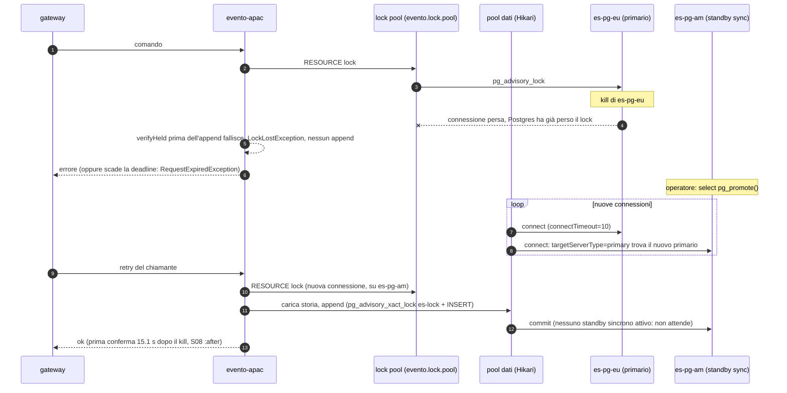

# L4: failover di Postgres (event store e database applicativi)

[Indice](README.md) · precedente: [L3](L3-multi-region-contexts.md) · successivo: [L5](L5-limits-roadmap.md)

## Quando usarlo

Sempre, da L1 in su: con più server il database diventa l'unico single point of failure. L4 non
cambia la topologia dei bundle, cambia **gli URL JDBC, la replica di Postgres e i timeout**. Il
laboratorio ha:

- event store: `es-pg-eu` primario, `es-pg-am` standby **sincrono** (`SYNC_STANDBY_NAMES: FIRST 1 (es_pg_am)`),
  `es-pg-apac` standby **asincrono**; il database `consumers` (stato della lane `ALL`) è sullo
  stesso cluster e viene replicato con l'event store;
- database applicativi: `app-pg-<cella>` primario + `app-pg-<cella>-r` replica locale asincrona.

La promozione è manuale (`select pg_promote()`); Evento non gestisce l'elezione del primario, la
**segue**. Un orchestratore (Patroni o simili) è fuori dal perimetro del laboratorio.

## Topologia

```mermaid
flowchart LR
    subgraph EU["cella EU"]
        sEU["evento-eu"]
        esEU[("es-pg-eu<br/>primario")]
        appEU[("app-pg-eu<br/>primario")]
        appEUr[("app-pg-eu-r<br/>replica async")]
        qEU["bundle EU"]
    end
    subgraph AM["cella AM"]
        sAM["evento-am"]
        esAM[("es-pg-am<br/>standby SYNC")]
    end
    subgraph APAC["cella APAC"]
        sAP["evento-apac"]
        esAP[("es-pg-apac<br/>standby ASYNC")]
    end
    esEU ==>|"streaming sincrono: il commit aspetta AM"| esAM
    esEU -.->|"streaming asincrono"| esAP
    appEU -.->|"streaming asincrono"| appEUr
    sEU -->|"url: es-pg-eu, AM, APAC<br/>targetServerType=primary"| esEU
    sAM -->|"url: EU, es-pg-am, APAC"| esEU
    sAP -->|"url: EU, AM, es-pg-apac"| esEU
    qEU -->|"url: app-pg-eu, app-pg-eu-r<br/>targetServerType=primary"| appEU
```



## Flusso critico: il primario ES muore e lo standby sincrono viene promosso



## I cinque meccanismi

### 1. URL multi-host con `targetServerType=primary`

Il driver PostgreSQL prova gli host nell'ordine e accetta solo quello scrivibile. Ogni server
elenca **prima il nodo più vicino**, poi gli altri, così il primo tentativo dopo una promozione è
economico:

```
evento-eu:   jdbc:postgresql://es-pg-eu:5432,toxi-eu:20121,toxi-eu:20131/evento?targetServerType=primary&tcpKeepAlive=true&connectTimeout=10
evento-am:   jdbc:postgresql://toxi-am:20211,es-pg-am:5432,toxi-am:20231/evento?targetServerType=primary&tcpKeepAlive=true&connectTimeout=10
evento-apac: jdbc:postgresql://toxi-apac:20311,toxi-apac:20321,es-pg-apac:5432/evento?targetServerType=primary&tcpKeepAlive=true&connectTimeout=10
bundle EU:   jdbc:postgresql://app-pg-eu:5432,app-pg-eu-r:5432/app?targetServerType=primary&tcpKeepAlive=true&connectTimeout=10
```

Mai puntare un server a uno standby o a un pgbouncer in *transaction mode*: le scritture e gli
advisory lock di sessione non funzionano lì.

### 2. Standby sincrono contro asincrono

| | Standby sincrono (`es-pg-am`) | Standby asincrono (`es-pg-apac`) |
|---|---|---|
| Costo | ogni commit aspetta la conferma dello standby: +1 RTT EU–AM (80 ms) per append, parte del costo N9 | nessuno |
| Cosa si perde alla promozione | **nulla** di confermato | le transazioni confermate al client ma non ancora replicate |
| Effetto su Evento | nessuno (S08: 0 persi, 0 duplicati, 0 fork, nessun checkpoint oltre la testa) | eventi confermati spariscono (I1 violato); le sequenze ripartono dalla testa dello standby e **vengono riassegnate**; un consumer il cui checkpoint era oltre la nuova testa salta in silenzio gli eventi nuovi con quelle sequenze; il checkpoint monotono (G11) impedisce di tornare indietro, quindi il salto non si ripara da solo |
| Misurato nel laboratorio | sì, [S08](../results/S08/after/report.md) | **no** (variante `S08_PROMOTE=es-pg-apac` prevista, non eseguita) |

Regola: **promuovi sempre lo standby sincrono.** Con un solo standby sincrono, se quello è giù il
primario non committa (`synchronous_commit=on`): per questo `evento-eu` parte solo dopo che
`es-pg-am` è `healthy` nel compose. Dopo una promozione il nuovo primario non ha uno standby
sincrono: le repliche del laboratorio partono con `synchronous_standby_names = ''`
(`replica-entrypoint.sh`, L24), altrimenti il promosso aspetterebbe sé stesso come standby e
nessuna scrittura riprenderebbe (era la causa del "no write resumed" della prima esecuzione S08 su `:before`).

### 3. Lock pool separato (G3)

Prima delle correzioni ogni `PgDistributedLock` teneva **una** connessione fissa: un thread in
attesa di un lock bloccava ogni altro acquire e release del server (deadlock tra server, S05
`:before`: 8), e quando quella connessione moriva Postgres rilasciava i lock senza che la JVM lo
sapesse. Ora:

- ogni lock tenuto possiede una connessione presa da un pool dedicato
  (`evento.lock.pool.maximum-size`, default 10; `evento.lock.pool.connection-timeout-ms`, 1000);
- l'attesa è limitata da `evento.lock.acquire.timeout.ms` (60000) o dalla deadline del comando;
  dalla 3.0 chi aspetta si mette in coda in PostgreSQL (`pg_advisory_lock` con `lock_timeout`, al
  massimo metà del lock pool), che assegna il lock al primo in fila: i server si alternano su un
  aggregato conteso invece di lasciarlo a chi lo tiene già (B2);
- prima dell'append `verifyHeld` controlla che il lock sia ancora tenuto; se la connessione è
  morta il comando fallisce con `LockLostException` invece di scrivere senza mutua esclusione;
- il lock globale `es-lock` è ora `pg_advisory_xact_lock` dentro la stessa istruzione dell'INSERT
  (G9): muore con la transazione, non può sopravvivere a una sessione persa.

Prove: [S05](../results/S05/after/report.md) 0 deadlock (120/120); [S07](../results/S07/after/report.md)
la partizione di APAC non ferma più le scritture di EU e AM (41/41 contro 0/16, N11).

### 4. Keepalive e rilevamento delle sessioni morte

Una partizione silenziosa non chiude il socket: Postgres tiene vivo il backend, e i suoi advisory
lock, finché il keepalive TCP non lo uccide (G25, N11). Impostazioni del laboratorio (tutti i
Postgres, `x-pg-command` nel compose):

```
tcp_keepalives_idle=10  tcp_keepalives_interval=5  tcp_keepalives_count=3  client_connection_check_interval=5s
wal_sender_timeout=30s  wal_receiver_timeout=30s
```

Lato client: `tcpKeepAlive=true` e `connectTimeout=10` in ogni URL (5 per i `DATA_TARGETS`), e nel
server `socketTimeout=30`, `connectTimeout=30`, `loginTimeout=30` (`spring.datasource.hikari.data-source-properties.*`).
Lato bus, `EVENTO_HEARTBEAT_READ_IDLE_S` / `setHeartbeatReadIdle` accorcia il rilevamento di un
broker silenzioso (default 45 s).

### 5. Deadline dei comandi (N3)

Il timeout del chiamante (`COMMAND_TIMEOUT_MS` nel gateway, `Request.timeoutMillis` sul filo)
diventa la deadline del server: un comando scaduto viene scartato negli stadi `queued`,
`lock_wait`, `before_forward`, `before_append` con `RequestExpiredException` e contato in
`evento.server.requests.expired{stage}`. In S08 `:after` uno dei 3 errori dopo il kill è proprio
`not executed: the caller's deadline passed 87 ms ago (stage before_forward)`. Limite: dopo
`before_append` l'istruzione può ancora aspettare il `es-lock` e committare in ritardo (N15).

## Configurazione esatta

Nulla cambia nelle immagini né nelle variabili dei bundle rispetto a L3: cambiano i valori.

| Dove | Variabile / proprietà | Valore L4 |
|---|---|---|
| server | `SPRING_DATASOURCE_URL` | multi-host, host vicino per primo, `targetServerType=primary&tcpKeepAlive=true&connectTimeout=10` |
| server | `SPRING_DATASOURCE_HIKARI_MAXIMUM_POOL_SIZE` | 20 |
| server | `EVENTO_LOCK_POOL_MAXIMUM_SIZE` | 10 (default) – 16 (laboratorio) |
| server | `EVENTO_LOCK_ACQUIRE_TIMEOUT_MS` | 60000 (default) |
| bundle | `APP_DB_URL` | `primario,replica` + `targetServerType=primary` |
| bundle `ALL` | `CONSUMER_STATE_DB_URL` | multi-host sul cluster ES (`/consumers`) |
| bundle `ALL`, gateway | `DATA_TARGETS` | multi-host per il target locale, `connectTimeout=5` |
| Postgres primario | `SYNC_STANDBY_NAMES` | `FIRST 1 (<standby vicino>)` per l'event store; vuoto per i database applicativi |
| Postgres | `-c` | keepalive sopra, `max_connections=200`, `synchronous_commit=on`, `hot_standby_feedback=on` |
| repliche | `replica-entrypoint.sh` | `synchronous_standby_names = ''` in `postgresql.auto.conf` (L24) |

### Matrice bundle × L4

| Bundle | Database seguiti | Cosa succede alla promozione del primario ES | Cosa succede alla promozione del primario applicativo |
|---|---|---|---|
| `order-command` | app della cella | i comandi in volo falliscono (lock perso o deadline); i nuovi riprendono sul nuovo primario | la tabella `payments` segue il multi-host URL |
| `order-query` regionale | app della cella (stato consumer incluso) | il fetch si ferma finché i server non riconnettono; nessun checkpoint oltre la testa (standby sync) | il lock della lane cade con la connessione; la lane riprende sul promosso; checkpoint monotono (S09: 59 campioni, 0 regressioni) |
| `order-query` `ALL` | `consumers` (cluster ES) + 3 target | stato della lane sul cluster ES: segue la promozione | un target giù ferma la lane per tutti (vedi L3) |
| `order-saga` | app della cella | come sopra; un `ProcessPaymentCommand` fallito viene ripetuto dalla saga (rischio N14) | stato della saga sul promosso |
| `order-observer` | app EU | come sopra | come sopra |
| `order-gateway` | nessuno | vede errori o timeout, deve decidere il retry (G5) | – |

## Garanzie (misurate)

| Guasto | `:before` | `:after` | Fonte |
|---|---|---|---|
| kill `es-pg-eu`, promozione di `es-pg-am` (sync) | scritture riprese in 7.6 s, 105/106 dopo il kill | scritture riprese in **15.1 s**, 103/106 (p50 874 ms); 0 persi, 0 duplicati, 0 fork | [S08 before](../results/S08/before/report.md), [S08 after](../results/S08/after/report.md) |
| kill `app-pg-eu`, promozione di `app-pg-eu-r` | checkpoint monotoni (58 campioni), lane riprese | monotoni (59), lane riprese, 0 replay necessari | [S09 before](../results/S09/before/report.md), [S09 after](../results/S09/after/report.md) |
| partizione silenziosa di APAC (lock orfani) | nessun append nel cluster per ~90 s (N11) | EU+AM 41/41, lane `*` ferme ≤ 5 s | [S07 before](../results/S07/before/report.md), [S07 after](../results/S07/after/report.md) |

## Limiti noti

| Id | Limite | Prova |
|---|---|---|
| N17 | la ripresa dopo la promozione è più lenta su `:after` (15.1 s contro 7.6 s, una esecuzione ciascuno). Ipotesi non verificata: due pool per server (dati e lock) devono entrambi scoprire che il vecchio primario è sparito | [S08](../results/S08/after/report.md) |
| async | la promozione di uno standby asincrono perde eventi confermati e può lasciare consumer oltre la testa: non misurato | – |
| G5 | un commit ambiguo (connessione persa dopo l'INSERT, prima della risposta) seguito da un retry può duplicare | [S14](../results/S14/after/report.md), [FINDINGS N14](../FINDINGS.md) |
| G6 | manca la fence `aggregate_seq`: senza lock, due server potrebbero scrivere dalla stessa storia. Nessun fork osservato (S05, S08) | [L5](L5-limits-roadmap.md) |
| G19 | le cache di aggregato del server non si invalidano tra server dopo `deleteAggregate` | [CLUSTER-READINESS](../../.claude/CLUSTER-READINESS.md) |
| G21 | nessun datasource di sola lettura: i fetch vanno al primario anche se una replica CPES andrebbe bene | [L5](L5-limits-roadmap.md) |
| N15 | l'append non ha un `lock_timeout` legato alla deadline | [S06](../results/S06/after/report.md) |

## Dimensionamento

| Voce | Valore |
|---|---|
| Connessioni per server | Hikari 20 + lock pool 10 (16) = 30 (36). Dopo la promozione tutte si riaprono verso il nuovo primario: il nuovo primario deve avere lo stesso `max_connections` |
| Primario ES del laboratorio | 3 × 36 + 2 × 6 = 120 al picco, `max_connections=200` |
| Standby | 192 MiB (ES), 96 MiB (applicativi) nel laboratorio; `wal_keep_size=512MB` perché uno standby lento non perda il WAL |
| Latenza aggiunta dallo standby sincrono | 1 RTT verso lo standby per commit (80 ms EU–AM) |
| Tempo di ripresa | rilevamento (kill: immediato; partizione: keepalive ~25 s) + promozione (manuale, 5 s in S08: `S08_PROMOTE_DELAY_S`) + riconnessione dei pool (`connectTimeout` 10 s per host morto) |

## Checklist

- [ ] Ogni URL JDBC di server e bundle è multi-host con `targetServerType=primary`, host vicino per primo.
- [ ] L'event store ha uno standby **sincrono** in un'altra cella, e la procedura promuove sempre quello.
- [ ] Le repliche non ereditano `synchronous_standby_names` (L24).
- [ ] Keepalive TCP e `client_connection_check_interval` impostati su ogni Postgres.
- [ ] `max_connections` identico su primario e standby, dimensionato sul picco.
- [ ] I chiamanti trattano errori e timeout durante il failover come esiti indeterminati (G5).
- [ ] Dopo una promozione: ricostruire uno standby sincrono prima di considerare il cluster protetto.
- [ ] Mai un server su uno standby o dietro un pooler in transaction mode.
