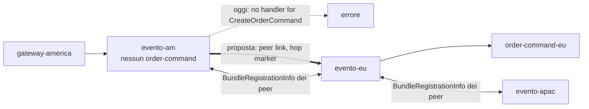
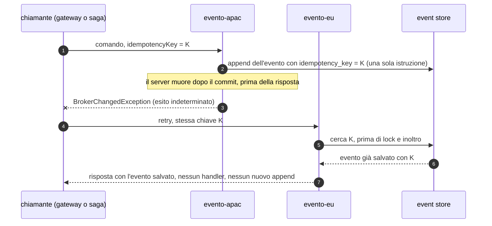

# L5: limiti aperti e roadmap

[Indice](README.md) · precedente: [L4](L4-db-failover.md)

Questo non è un livello da deployare: è l'elenco di ciò che, dopo le correzioni misurate in
[`../results/COMPARISON.md`](../results/COMPARISON.md), **resta aperto**, con la prova che lo
dimostra e il lavoro che lo chiuderebbe. Tutti i nomi di proprietà o API marcati *(proposta)* **non
esistono** nel codice: sono progetti.

**Aggiornamento G5 e N16 (misurati).** La chiave di idempotenza end-to-end (G5) e il failback (N16)
sono stati implementati dopo le prime misure e poi misurati nella riesecuzione `after-g5n16`
([AFTER-SUMMARY](../results/AFTER-SUMMARY.md), §"Re-run with idempotency keys"): S14 **0 chiavi salvate
due volte** (prima 8) e 4/4 retry di comandi già salvati con risposta 2xx; S03 e S07 **0 pagamenti
eseguiti due volte**; S03 **8/8** JVM APAC e S13 **7/7** JVM EU tornati sul proprio server senza
riavvii, in 55.7 s e 53.3 s.

**Aggiornamento `after-inbox` (2026-10-09).** La finestra residua di G5 (un handler di servizio eseguito
il cui evento non è stato salvato) è chiusa dallo **store degli esiti lato bundle**: S18 la colpisce apposta
(3 pagamenti su 3 nella finestra) e **0** sono rieseguiti; con lo store spento, 3. E la chiave non costa
più un round trip: un comando di aggregato con chiave fa 2 statement sull'event store come uno senza
chiave (prima 4), uno di servizio 2 (prima 6; senza chiave 1); S00 p50 APAC 1135–1220 ms contro
1359–1472 ms di `after-g5n16` ([AFTER-SUMMARY](../results/AFTER-SUMMARY.md), §"Re-run with the service
outcome store").

## Quando leggerlo

- Prima di scegliere L2 o L3 per un sistema reale: la regola delle celle (G1, scelta di progetto:
  ogni cella ospita tutti i suoi handler) e il residuo di N16 decidono quali guasti richiedono un
  intervento umano.
- Quando pianifichi il lavoro sul framework: la tabella di priorità in fondo ordina gli interventi
  per impatto misurato.

## Quadro

| Id | Limite | Gravità | Prova | Rimedio oggi | Lavoro che lo chiude |
|---|---|---|---|---|---|
| G1 | nessun inoltro server-server: **scelta di progetto**, non un limite da chiudere (un client può essere collegato solo ad alcuni server; la topologia prevista è a celle) | – (era Blocker nella valutazione iniziale) | [S01](../results/S01/after/report.md): 0/5 `no handler` in ≤ 14 ms quando a una cella manca un handler | architettura a celle con handler completi (L2) | nessuno dovuto; una mesh di server resta un'opzione (sotto) |
| N16 | failback dopo il failover degli endpoint: **implementato e misurato** (sonda lato bundle con readiness del server, ritorno reattivo su `no handler for`): S03 8/8 JVM a casa in 55.7 s, S13 7/7 in 53.3 s, senza riavvii, 0 falliti; resta il ritorno non atomico per cella (al più una richiesta fallita per chiamante; 0 osservate) | High → Medium | prima: [S13 `after-n16-evidence`](../results/S13/after-n16-evidence/report.md), [S03](../results/S03/after/report.md); dopo: [S03 `after-g5n16`](../results/S03/after-g5n16/report.md), [S13 `after-g5n16`](../results/S13/after-g5n16/report.md); `BundleClientFailbackIT` | lista di indirizzi (non VIP); il laboratorio ripristina comunque il posizionamento (L22) | ritorno coordinato per cella, o la mesh G1 che rende innocuo l'ordine (sotto) |
| G5 / N14 | ~~nessuna idempotenza tra retry~~ **implementato e misurato**: 0 chiavi doppie, 0 pagamenti doppi; la finestra "handler di servizio eseguito, evento non salvato" è chiusa dallo store degli esiti (S18: 0 rieseguiti, 3 senza store). Restano: store per cella, effetti esterni al database dell'handler, chiavi senza scadenza | High → Low | prima: [S14](../results/S14/after/report.md) 8 chiavi doppie; [S03 `after-run1`](../results/S03/after-run1/report.md), [S07](../results/S07/after/report.md) pagamenti doppi. Dopo: [S14 `after-g5n16`](../results/S14/after-g5n16/report.md) 0 chiavi doppie, 4/4 retry 2xx; [S03](../results/S03/after-g5n16/report.md) e [S07](../results/S07/after-g5n16/report.md) 0 pagamenti doppi; [S18 `after-inbox`](../results/S18/after-inbox/report.md) 0 rieseguiti, [senza store](../results/S18/after-inbox-store-off/report.md) 3. Codice: `IdempotentCommandPostgresIT`, `ServiceOutcomeReplayPostgresIT` | `X-Idempotency-Key` → `sendIdempotent`; saghe: chiave derivata automatica; `setServiceCommandOutcomeStore` + `ServiceCommandOutcomes.recordWith` nella transazione dell'handler | retention di chiavi ed esiti; chiave passata a valle per effetti esterni |
| G6 | nessuna fence `aggregate_seq` sugli append | High (latente) | nessun fork osservato (S05, S08); PK su `es__events` aggiunta | lock per aggregato + `verifyHeld` | colonna `aggregate_seq` con `UNIQUE(aggregate_id, aggregate_seq)` (sotto) |
| N5 / N9 / N15 | ogni append serializza sul `es-lock` globale raggiunto via WAN; commit dopo la deadline | Medium | [S06](../results/S06/after/report.md): p50 APAC 22.8 s a 300 ms; 31 commit dopo il timeout | primario ES nella cella più scrivente | `SET LOCAL lock_timeout` = deadline residua; append per aggregato con la fence G6 |
| N4 | la lane `ALL` salta tra repliche, senza località | Medium | [S16](../results/S16/after/report.md): scrittori EU 9 / APAC 6, fan-out 10.2 s | una sola replica attiva nella cella del primario | affinità della lane (sotto) |
| G21 | nessun datasource di lettura | Medium | per costruzione (un solo `spring.datasource`) | – | `evento.es.read.datasource.*` *(proposta)* |
| staleness | un consumer con orologio indietro > 30 s non riceve eventi | Low→Medium | [S15](../results/S15/after/report.md): 0 ordini proiettati, 120 fetch scartati | `evento.es.fetch.max.age.ms=0` disattiva il gate; NTP | misurare l'età dal tempo di ricezione del server |
| N17 | promozione ES più lenta su `:after` | Low | [S08](../results/S08/after/report.md): 15.1 s contro 7.6 s | – | ripetere S08 e tracciare i pool |
| N6 / N7 / N8 | registrazione tardiva, `updated_at` fermo, gateway senza riga di catalogo | Low | [FINDINGS](../FINDINGS.md) | attese negli strumenti | readiness "registrato"; `updated_at = now()`; riga di bundle sempre |
| G17 / G18 | dashboard locale; discovery sul thread del bus | Medium | [CLUSTER-READINESS](../../.claude/CLUSTER-READINESS.md) | interrogare ogni server | proxy delle azioni admin al server proprietario (presenza già disponibile) |
| G10 / G20 | WATERMARK O(gap), Snowflake da MAC | – | [S12](../results/S12/after/report.md): non misurabile con CPES | usare CPES | – |

## G1: mesh di server (opzione, non correzione)

G1 è una scelta di progetto: ogni server instrada verso i propri bundle, la connettività è
regionale (un client può essere collegato solo ad alcuni server) e la topologia prevista è la
cella con tutti i suoi handler ([L2](L2-cells.md)). Il fatto resta: una richiesta raggiunge solo
gli handler collegati allo stesso server. Una mesh servirebbe solo a topologie diverse, con celle
parziali: un server che non ha l'handler inoltrerebbe al peer che lo ha.

Progetto ([CLUSTER-READINESS G1](../../.claude/CLUSTER-READINESS.md)): ogni server si collega ai
peer come se fosse un bundle, annuncia i propri handler, e su un miss locale inoltra con la
`ForwardingTable` esistente e un marcatore di hop contro i cicli. Chiuderebbe anche il danno di
N16 (un gateway sul server "sbagliato" troverebbe comunque l'handler). Costo: un salto WAN in più
per le richieste inoltrate, e una tabella di routing da mantenere coerente tra server.

## N16: failback

Delle due strade considerate (sonda lato bundle, hint "go home" lato server) è stata implementata
la **sonda lato bundle**, perché non richiede messaggi nuovi sul filo né stato di cluster sul
server. `ConnectionSupervisor`, mentre è READY su un endpoint diverso dallo 0:

1. sonda l'endpoint 0 ogni `failbackProbeInterval` (5 s) con TCP + `Ping`/`Pong` (risposto
   dall'heartbeat handler del server, sotto il router): senza `Hello` non c'è registrazione,
   `NodeJoined`, consegna del buffer di risposte né supersede. Il server risponde solo quando è
   pronto (`BusLifecycle.setProbeReadiness`, nel server Spring la readiness
   `ACCEPTING_TRAFFIC`): la porta del bus si apre molto prima di JPA ed event store;
2. si sposta quando l'endpoint 0 ha risposto a ogni sonda per `failbackStabilityWindow` (30 s) +
   jitter casuale fino a `failbackJitter` (10 s); una sonda fallita azzera la finestra (niente
   ping-pong con un server che va e viene); i bundle senza handler aspettano in più l'intero
   intervallo di jitter, così partono dopo gli handler che hanno iniziato la finestra insieme;
3. **ritorno reattivo**: se una richiesta riceve `no handler for` dal server attuale mentre
   l'endpoint 0 risponde alle sonde, il bundle si sposta subito (`event=failback_reactive`);
4. nuove richieste in uscita rifiutate (`SendFailedException`, non inviate; ai gateway
   `RequestNotSentException`), `evento:disable` sul server attuale, drain limitato da
   `failbackDrainTimeout` (10 s) di richieste in entrata (fino alla scrittura completa della
   risposta) e in uscita, chiusura e dial immediato dell'endpoint 0; le richieste rimaste aperte
   falliscono con `BrokerChangedException` al `Welcome` del nuovo server. Notifiche e risposte
   passano; un `enable()` durante il drain è rimandato alla registrazione sull'endpoint 0;
5. i controlli di identità (`expectedClusterName` / `expectedServerInstanceId`) valgono
   sull'handshake del ritorno: se falliscono il bundle ruota al successivo e la finestra seguente
   raddoppia (fino a 16×); dopo 3 rifiuti di fila il failback si sospende
   (`event=failback_suspended`) finché una sessione sull'endpoint 0 non riesce per altra via o il
   processo riparte.

Configurazione: `EventoBundle.Builder.setFailbackEnabled/ProbeInterval/StabilityWindow/Jitter/DrainTimeout`
(nel laboratorio `EVENTO_FAILBACK_WINDOW_S`). Resta aperto:

- **ritorno non atomico per cella**: ogni bundle torna al proprio istante, e chiamanti e handler di
  una cella possono stare per poco su server diversi (G1: `no handler for`). "Handler prima,
  chiamanti dopo" più il ritorno reattivo riducono il costo a una richiesta fallita per chiamante
  (poi il chiamante torna entro un intervallo di sonda + drain); lo eliminano la mesh G1 o un
  ritorno coordinato (tutti i bundle di una zona insieme, deciso dal server con presenza + zona);
- **VIP**: con un solo indirizzo non c'è un endpoint 0 da sondare;
- la readiness copre l'avvio; un guasto del database **dopo** l'avvio non la ritira (Spring non
  mette il database nel gruppo di readiness di default): lì resta la finestra di stabilità;
- **misurato** (`after-g5n16`): in S03 gli 8 JVM APAC tornano tutti su `evento-apac` (handler 38–44 s
  dopo l'avvio del server, gateway 51–55 s, ogni passaggio 0.50–0.68 s), in S13 i 7 JVM EU su
  `evento-eu` in 53.3 s; nessun `failback_failed`, `failback_suspended` o `failback_reactive`, e nessun
  `no handler for`, perché gli handler erano già a casa quando i gateway si sono spostati.

## G5 / N14: chiave di idempotenza end-to-end

**Stato: implementata e misurata** (branch `cluster/idempotency`; laboratorio `after-g5n16`: S14 0
chiavi doppie e 4/4 retry 2xx con `event=idempotent_replay stage=before_lock`, S03/S07 0 pagamenti
doppi). Nessuna configurazione: basta mandare la chiave, oppure lasciarla derivare. Costo misurato: un
comando con chiave da una cella remota paga circa un RTT in più verso il primario ES (S00 p50 APAC
1.36–1.47 s contro 1.16–1.18 s; la cella del primario non cambia).

- **Da dove viene la chiave.** Esplicita: `CommandGateway.sendIdempotent(comando, chiave)`; il
  gateway del laboratorio passa l'header `X-Idempotency-Key` (gli item di una create usano
  `<chiave>#<n>`). Derivata: un comando mandato da una saga, un projector o un observer senza chiave
  riceve `evento:<consumerId>:<sequenza dell'evento>:<TipoComando>:<n>` (`n` conta i comandi **di
  quel tipo** nell'invocazione), quindi un evento riconsegnato (o il retry dell'handler) rimanda
  **le stesse** chiavi. `PaymentSaga` non cambia una riga. Le chiavi derivate valgono solo per i
  gateway che lo dichiarano (`supportsIdempotencyKeys()`); un decoratore scritto prima di G5 riceve
  il `send` normale. Le chiavi esplicite che iniziano con `evento:` sono rifiutate.
- **Dove è salvata.** `es__events.idempotency_key` (nullable) con indice `UNIQUE` parziale
  (`WHERE idempotency_key IS NOT NULL`), creato al boot online (`CONCURRENTLY`); le righe vecchie
  restano fuori dall'indice. Con la chiave si salva l'**identità** del comando
  (`idempotency_command` + `aggregate_id`): una chiave presentata da un altro comando (altro tipo,
  altro aggregato) è rifiutata con `IdempotencyKeyMismatchException`, mai risposta con l'evento
  dell'altro. Per questo una create senza id del client ricava l'id dell'ordine dalla chiave.
  I comandi di servizio in esecuzione hanno una riga in `es__idempotency_claims` (proprietario,
  lease sull'orologio del database); un handler che non restituisce nulla lascia la riga
  "completata", così il retry non lo riesegue.
- **Cosa fa il server.** Cerca la chiave dentro un round trip che il comando fa comunque, mai in uno
  suo: un comando di aggregato nella lettura della storia sotto il lock dell'aggregato (un ramo
  `UNION ALL` della query degli eventi), un comando di servizio nello statement che rivendica la
  chiave. Se c'è, risponde con l'evento salvato (`event=idempotent_replay`, metrica
  `evento.server.commands.idempotent.replayed`), su qualunque server arrivi il retry. Costo misurato
  al driver JDBC (`IdempotentCommandPostgresIT`): aggregato con chiave 2 statement come senza (prima
  4), servizio con chiave 2 contro 1 (prima 6). Duplicati concorrenti: per un comando di aggregato
  l'indice unico fa da recinto anche senza lock; un comando di servizio
  **rivendica** la chiave con una riga di claim prima dell'inoltro (l'append la marca completata nello
  stesso statement, quindi non serve un secondo controllo), così due duplicati in volo non
  eseguono entrambi il pagamento e chi aspetta non tiene nessuna connessione (il vecchio lock di
  cluster `IDEMPOTENCY:<chiave>` teneva una connessione del pool dei lock per tutto l'handler, oltre
  a quella del lock `RESOURCE:`: con il pool pieno i comandi si aspettavano a vicenda). Un comando
  con chiave scartato per deadline (N3) la cui chiave risulta salvata riceve l'evento salvato; uno
  che smette di aspettare un'altra esecuzione della stessa chiave riceve
  `IdempotencyKeyInProgressException` (esito indeterminato), mai "scaduto".
- **Finestra residua: chiusa dallo store degli esiti.** Un handler di servizio eseguito il cui evento
  **non** è stato salvato (append fallito, server morto tra risposta e append: il caso di S07, cella
  partizionata) non lascia la chiave al broker, e il retry viene inoltrato di nuovo. Lo sa solo il
  bundle che l'ha eseguito, quindi è lui a tenere il registro (pattern inbox):
  `EventoBundle.Builder.setServiceCommandOutcomeStore(...)` (`JdbcServiceCommandOutcomeStore`, tabella
  `evento_v2_service_outcome`). Con lo store, un comando con chiave il cui esito è registrato riceve
  quell'esito senza rieseguire l'handler (`event=service_outcome_replayed`). Il pagamento del
  laboratorio registra l'esito **nella propria transazione** (`ServiceCommandOutcomes.recordWith`):
  riga `payments` ed esito committano insieme o per niente. Misurato da S18: 3 pagamenti nella
  finestra, 0 rieseguiti; con `EVENTO_SERVICE_OUTCOME_STORE=off`, 3 rieseguiti. Limiti: lo store deve
  essere condiviso da ogni istanza che può ricevere il retry (nel laboratorio è per cella, nel database
  della cella); un effetto fuori da quel database (un PSP) richiede di passare la chiave a valle.
- **Upgrade a rotazione (limite aperto).** Un server senza G5 ignora la chiave (salta il campo
  sconosciuto e fa un append senza chiave): durante un upgrade, un retry con chiave che arriva a un
  server vecchio viene eseguito come un comando senza chiave. L'exactly-once vale solo quando tutti i
  server hanno G5: aggiornare prima i server, poi contare sulle chiavi.
- **Le chiavi non scadono (limite aperto).** Una chiave vive quanto il suo evento (o la sua riga di
  claim completata): l'indice e la tabella dei claim crescono soltanto, e riavvolgere un consumer
  (rimettere indietro il checkpoint per rielaborare la storia) rimanda le stesse chiavi derivate,
  quindi i comandi che manda diventano repliche invece di essere rieseguiti. Per rieseguirli,
  riavvolgere con un nuovo consumer id. Retention/TTL delle chiavi: lavoro futuro.
- Perché era urgente dopo G4: `:after` fallisce in fretta, quindi il retry parte mentre il primo
  tentativo sta ancora committando. In S14, 9 dei 13 primi tentativi falliti erano già salvati (su
  `:before` 1 su 24, perché il timeout di 30 s lasciava finire l'originale).

## G6: fence `aggregate_seq`

Oggi la correttezza di un append dipende dal lock per aggregato (`RESOURCE:<id>`) e da `verifyHeld`.
Una colonna `aggregate_seq` con `UNIQUE(aggregate_id, aggregate_seq)` renderebbe l'append
ottimistico: chi scrive dalla storia vecchia viola il vincolo invece di biforcare l'aggregato. Porta
anche a togliere il round trip del lock per aggregato (una parte degli ~7–9 RTT di N9) e, con
append per aggregato, a ridurre il peso del `es-lock` globale (N5, N15).

## N4: affinità della lane globale

`JdbcConsumerLock` prende il lock a ogni ciclo di fetch, quindi il detentore non è stabile. Opzioni:

| Opzione | Effetto | Costo |
|---|---|---|
| lease con durata e rinnovo, preferenza per chi la teneva | il detentore resta finché è sano | un takeover aspetta la scadenza del lease |
| hint di affinità (zona preferita) al lock | la replica nella cella del primario applicativo/ES vince quando è viva | configurazione in più |
| una sola replica attiva, l'altra ferma (operativo) | nessun salto | takeover manuale |

## Configurazione

Salvo il failback N16, nessuna delle voci sopra ha oggi una configurazione. Le leve disponibili che **mitigano**:

| Leva | Dove | Mitiga |
|---|---|---|
| `EVENTO_SERVER_BUS_PICK_STRATEGY=locality-preferred`, `EVENTO_ZONE` | server, bundle | parte di N16 (le richieste restano nella zona del chiamante anche su un server condiviso) |
| `evento.es.fetch.max.age.ms` (`EVENTO_ES_FETCH_MAX_AGE_MS`) `=0` | server | gate di staleness (a costo di servire fetch scaduti) |
| `EVENTO_LOCK_ACQUIRE_TIMEOUT_MS` | server | attese sui lock per aggregato; **non** il `es-lock` dentro l'istruzione (N15) |
| `EVENTO_HEARTBEAT_READ_IDLE_S` | bundle | rilevamento di un broker silenzioso |
| `EVENTO_FAILBACK_WINDOW_S` (`setFailbackStabilityWindow`) | bundle | N16: quanto a lungo il server 0 deve essere sano prima del failback |
| `EVENTO_LAB_RESTORE_PLACEMENT` (driver del laboratorio) | scenari | N16 nei test |

## Matrice bundle × roadmap

| Bundle | G1 mesh (opzione) | G5 idempotenza | G6 fence | N4 affinità | G21 read datasource |
|---|---|---|---|---|---|
| `order-command` | non serve più in ogni cella | fatto dal broker; la finestra residua è chiusa dallo store degli esiti (registrato nella transazione del pagamento) | nessuna modifica | – | – |
| `order-query` | query servite da qualunque cella (ma i dati restano regionali: L3 invariato) | – | – | la lane `ALL` resta nella cella scelta | fetch da una replica vicina |
| `order-saga` | – | fatto: chiave derivata da (consumer, sequenza, ordinale), nessuna modifica | – | – | fetch da una replica vicina |
| `order-observer` | – | – | – | – | fetch da una replica vicina |
| `order-gateway` | un gateway può stare su qualunque server | fatto: `X-Idempotency-Key` → `sendIdempotent` | – | – | – |

## Garanzie che resterebbero da dimostrare

Per ognuna, lo scenario che lo proverebbe è già nel laboratorio:

| Lavoro | Scenario | Risultato atteso |
|---|---|---|
| G1 mesh (opzione) | S01 | AMERICA 5/5 anche senza `order-command-am` |
| N16 failback (implementato, **misurato**) | S03, S13 | **ottenuto**: S03 8/8 e S13 7/7 JVM a casa senza riavvii (55.7 s, 53.3 s), osservazioni "fail back" AS_EXPECTED, il ripristino di sicurezza di S13 non trova nulla |
| G5 (implementato, **misurato**) | S14, S03, S07, S18 | **ottenuto**: S14 0 chiavi doppie, 4/4 retry di comandi già salvati 2xx (kill a 3000 ms; `after-inbox` anche a 2000 ms); S03 e S07 0 pagamenti doppi; S18 finestra residua colpita 3 volte, 0 pagamenti rieseguiti (3 senza store) |
| N4 | S16 | un solo scrittore, fan-out vicino ai 2.1 s di `:before` |
| N15 | S06 | 0 comandi salvati dopo il timeout a 300 ms |
| staleness | S15 | ordini proiettati con orologio a −40 s |

## Dimensionamento (impatto previsto)

- **Mesh**: una connessione per coppia di server e un salto WAN per ogni richiesta inoltrata.
- **Idempotenza** (implementata): una colonna e un indice unico parziale su `es__events` (solo le
  righe con chiave) e una colonna per l'identità del comando; per un comando con chiave una lettura
  (evento e claim in una sola istruzione) prima del lock e una sotto il lock; per un comando di
  servizio con chiave una riga di claim (insert, rinnovo del lease, delete: nessuna connessione
  tenuta mentre l'handler gira o mentre un duplicato aspetta). I comandi senza chiave non cambiano.
- **Fence**: un indice unico in più; un round trip in meno per comando (niente lock per aggregato).
- **Read datasource**: pool aggiuntivi verso le repliche, carico di fetch tolto al primario.

## Checklist decisionale

- [ ] I miei chiamanti mandano una chiave di idempotenza quando ritentano (`sendIdempotent`)? Le
      saghe la derivano da sole; un client HTTP deve passarla (G5).
- [ ] I miei bundle di servizio con side effect hanno uno store degli esiti condiviso da tutte le loro
      istanze, e registrano l'esito nella transazione del side effect (finestra residua G5)? Gli effetti
      esterni ricevono la chiave?
- [ ] Posso tollerare qualche secondo di `no handler for` mentre una cella torna sul suo server
      (N16 residuo + G1)? Uso una lista di indirizzi, non un VIP, così il failback avviene da solo?
- [ ] Ogni cella avrà sempre tutti gli handler che i suoi chiamanti usano (G1, la regola delle celle)?
- [ ] Il RTT verso il primario ES delle celle remote è compatibile con la latenza richiesta
      (≈ 7–9 RTT per comando, N9)?
- [ ] Ho un solo punto che produce eventi globali, e posso accettare che un database regionale giù
      fermi il listino per tutti (lane unica)?
- [ ] Gli orologi dei consumer sono sincronizzati entro 30 s (gate di staleness)?
