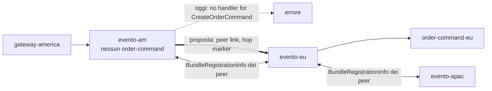
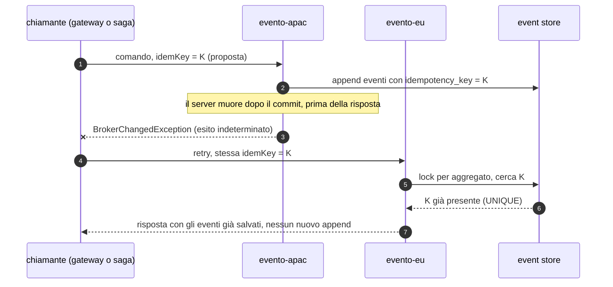

# L5: limiti aperti e roadmap

[Indice](README.md) · precedente: [L4](L4-db-failover.md)

Questo non è un livello da deployare: è l'elenco di ciò che, dopo le correzioni misurate in
[`../results/COMPARISON.md`](../results/COMPARISON.md), **resta aperto**, con la prova che lo
dimostra e il lavoro che lo chiuderebbe. Tutti i nomi di proprietà o API marcati *(proposta)* **non
esistono** nel codice: sono progetti.

## Quando leggerlo

- Prima di scegliere L2 o L3 per un sistema reale: i limiti G1, G5 e N16 decidono quali guasti
  richiedono un intervento umano.
- Quando pianifichi il lavoro sul framework: la tabella di priorità in fondo ordina gli interventi
  per impatto misurato.

## Quadro

| Id | Limite | Gravità | Prova | Rimedio oggi | Lavoro che lo chiude |
|---|---|---|---|---|---|
| G1 | nessun inoltro server-server | Blocker (per la topologia) | [S01](../results/S01/after/report.md): 0/5 `no handler` in ≤ 14 ms | architettura a celle con handler completi (L2) | mesh di server (sotto) |
| N16 | nessun failback dopo il failover degli endpoint | High | [S13 `after-n16-evidence`](../results/S13/after-n16-evidence/report.md), [S03](../results/S03/after/report.md) | riavviare i bundle rimasti fuori cella (il laboratorio lo fa, L22) | sonda di failback o hint "torna a casa" |
| G5 / N14 | nessuna idempotenza tra retry | High | [S14](../results/S14/after/report.md) 8 chiavi doppie; [S03 `after-run1`](../results/S03/after-run1/report.md), [S07](../results/S07/after/report.md) pagamenti doppi | handler idempotenti a livello applicativo (`payments` per ordine) | chiave di idempotenza end-to-end (sotto) |
| G6 | nessuna fence `aggregate_seq` sugli append | High (latente) | nessun fork osservato (S05, S08); PK su `es__events` aggiunta | lock per aggregato + `verifyHeld` | colonna `aggregate_seq` con `UNIQUE(aggregate_id, aggregate_seq)` (sotto) |
| N5 / N9 / N15 | ogni append serializza sul `es-lock` globale raggiunto via WAN; commit dopo la deadline | Medium | [S06](../results/S06/after/report.md): p50 APAC 22.8 s a 300 ms; 31 commit dopo il timeout | primario ES nella cella più scrivente | `SET LOCAL lock_timeout` = deadline residua; append per aggregato con la fence G6 |
| N4 | la lane `ALL` salta tra repliche, senza località | Medium | [S16](../results/S16/after/report.md): scrittori EU 9 / APAC 6, fan-out 10.2 s | una sola replica attiva nella cella del primario | affinità della lane (sotto) |
| G21 | nessun datasource di lettura | Medium | per costruzione (un solo `spring.datasource`) | – | `evento.es.read.datasource.*` *(proposta)* |
| staleness | un consumer con orologio indietro > 30 s non riceve eventi | Low→Medium | [S15](../results/S15/after/report.md): 0 ordini proiettati, 120 fetch scartati | `evento.es.fetch.max.age.ms=0` disattiva il gate; NTP | misurare l'età dal tempo di ricezione del server |
| N17 | promozione ES più lenta su `:after` | Low | [S08](../results/S08/after/report.md): 15.1 s contro 7.6 s | – | ripetere S08 e tracciare i pool |
| N6 / N7 / N8 | registrazione tardiva, `updated_at` fermo, gateway senza riga di catalogo | Low | [FINDINGS](../FINDINGS.md) | attese negli strumenti | readiness "registrato"; `updated_at = now()`; riga di bundle sempre |
| G17 / G18 | dashboard locale; discovery sul thread del bus | Medium | [CLUSTER-READINESS](../../.claude/CLUSTER-READINESS.md) | interrogare ogni server | proxy delle azioni admin al server proprietario (presenza già disponibile) |
| G10 / G20 | WATERMARK O(gap), Snowflake da MAC | – | [S12](../results/S12/after/report.md): non misurabile con CPES | usare CPES | – |

## G1: mesh di server

Oggi ([L2](L2-cells.md)) la cella deve contenere ogni handler. Con una mesh, un server che non ha
l'handler inoltra al peer che lo ha, e le celle possono essere parziali.

Progetto ([CLUSTER-READINESS G1](../../.claude/CLUSTER-READINESS.md)): ogni server si collega ai
peer come se fosse un bundle, annuncia i propri handler, e su un miss locale inoltra con la
`ForwardingTable` esistente e un marcatore di hop contro i cicli. Chiuderebbe anche il danno di
N16 (un gateway sul server "sbagliato" troverebbe comunque l'handler). Costo: un salto WAN in più
per le richieste inoltrate, e una tabella di routing da mantenere coerente tra server.

## N16: failback

`ConnectionSupervisor` torna all'endpoint 0 solo alla disconnessione successiva. Due strade:

1. **sonda lato bundle**: mentre è collegato a un endpoint non preferito, prova periodicamente
   l'endpoint 0 (con jitter); quando risponde, drena le richieste in volo e cambia sessione;
2. **hint lato server**: il server che vede tornare disponibile il server "di casa" di un bundle
   (presenza + zona) chiude la sessione di quel bundle con un motivo "go home".

Finché non esiste, la regola operativa è: dopo il ritorno di un server, riavviare **tutti** i bundle
della sua cella rimasti altrove, insieme (riavviarne solo una parte divide la cella, e G1 fa il resto).

## G5 / N14: chiave di idempotenza end-to-end

- La chiave nasce **una volta** dal chiamante: la richiesta HTTP per il gateway, `(sagaId, sequenza
  dell'evento)` per una saga.
- Viaggia nell'envelope, il server la controlla sotto il lock dell'aggregato prima dell'append e la
  salva con gli eventi (`es__events.idempotency_key` nullable con indice `UNIQUE`, *proposta*).
- Il side effect dell'handler va chiavato allo stesso modo (qui: `payments` per ordine).
- Perché è urgente dopo G4: `:after` fallisce in fretta, quindi il retry parte mentre il primo
  tentativo sta ancora committando. In S14, 9 dei 13 primi tentativi falliti erano già salvati (su
  `:before` 1 su 24, perché il timeout di 30 s lasciava finire l'originale).

## G6: fence `aggregate_seq`

Oggi la correttezza di un append dipende dal lock per aggregato (`RESOURCE:<id>`) e da `verifyHeld`.
Una colonna `aggregate_seq` con `UNIQUE(aggregate_id, aggregate_seq)` renderebbe l'append
ottimistico: chi scrive dalla storia vecchia viola il vincolo invece di biforcare l'aggregato. Porta
anche a togliere il round trip del lock per aggregato (una parte degli ~7–9 RTT di N9) e, con
append per aggregato, a ridurre il peso del `es-lock` globale (N5, N15).

## N4: affinità della lane globale

`JdbcConsumerLock` prende il lock a ogni ciclo di fetch, quindi il detentore non è stabile. Opzioni:

| Opzione | Effetto | Costo |
|---|---|---|
| lease con durata e rinnovo, preferenza per chi la teneva | il detentore resta finché è sano | un takeover aspetta la scadenza del lease |
| hint di affinità (zona preferita) al lock | la replica nella cella del primario applicativo/ES vince quando è viva | configurazione in più |
| una sola replica attiva, l'altra ferma (operativo) | nessun salto | takeover manuale |

## Configurazione

Nessuna delle voci sopra ha oggi una configurazione. Le leve disponibili che **mitigano**:

| Leva | Dove | Mitiga |
|---|---|---|
| `EVENTO_SERVER_BUS_PICK_STRATEGY=locality-preferred`, `EVENTO_ZONE` | server, bundle | parte di N16 (le richieste restano nella zona del chiamante anche su un server condiviso) |
| `evento.es.fetch.max.age.ms` (`EVENTO_ES_FETCH_MAX_AGE_MS`) `=0` | server | gate di staleness (a costo di servire fetch scaduti) |
| `EVENTO_LOCK_ACQUIRE_TIMEOUT_MS` | server | attese sui lock per aggregato; **non** il `es-lock` dentro l'istruzione (N15) |
| `EVENTO_HEARTBEAT_READ_IDLE_S` | bundle | rilevamento di un broker silenzioso |
| `EVENTO_LAB_RESTORE_PLACEMENT` (driver del laboratorio) | scenari | N16 nei test |

## Matrice bundle × roadmap

| Bundle | G1 mesh | G5 idempotenza | G6 fence | N4 affinità | G21 read datasource |
|---|---|---|---|---|---|
| `order-command` | non serve più in ogni cella | deve chiavare i side effect (`payments`) | nessuna modifica | – | – |
| `order-query` | query servite da qualunque cella (ma i dati restano regionali: L3 invariato) | – | – | la lane `ALL` resta nella cella scelta | fetch da una replica vicina |
| `order-saga` | – | deriva la chiave da (saga, evento) | – | – | fetch da una replica vicina |
| `order-observer` | – | – | – | – | fetch da una replica vicina |
| `order-gateway` | un gateway può stare su qualunque server | genera la chiave per richiesta | – | – | – |

## Garanzie che resterebbero da dimostrare

Per ognuna, lo scenario che lo proverebbe è già nel laboratorio:

| Lavoro | Scenario | Risultato atteso |
|---|---|---|
| G1 mesh | S01 | AMERICA 5/5 anche senza `order-command-am` |
| N16 failback | S03, S13 | dopo il ritorno del server, 0 bundle fuori cella senza riavvii (`placementRestoredAtStart` vuoto) |
| G5 | S14, S03, S07 | 0 chiavi doppie, 0 pagamenti doppi |
| N4 | S16 | un solo scrittore, fan-out vicino ai 2.1 s di `:before` |
| N15 | S06 | 0 comandi salvati dopo il timeout a 300 ms |
| staleness | S15 | ordini proiettati con orologio a −40 s |

## Dimensionamento (impatto previsto)

- **Mesh**: una connessione per coppia di server e un salto WAN per ogni richiesta inoltrata.
- **Idempotenza**: una colonna e un indice unico su `es__events`; una lettura sull'indice per
  comando, sotto il lock già preso.
- **Fence**: un indice unico in più; un round trip in meno per comando (niente lock per aggregato).
- **Read datasource**: pool aggiuntivi verso le repliche, carico di fetch tolto al primario.

## Checklist decisionale

- [ ] I miei comandi sono idempotenti a livello applicativo? Se no, L1+ duplica sotto guasto (G5).
- [ ] Posso riavviare una cella intera dopo il ritorno del suo server (N16)?
- [ ] Ogni cella avrà sempre tutti gli handler (G1)?
- [ ] Il RTT verso il primario ES delle celle remote è compatibile con la latenza richiesta
      (≈ 7–9 RTT per comando, N9)?
- [ ] Ho un solo punto che produce eventi globali, e posso accettare che un database regionale giù
      fermi il listino per tutti (lane unica)?
- [ ] Gli orologi dei consumer sono sincronizzati entro 30 s (gate di staleness)?
