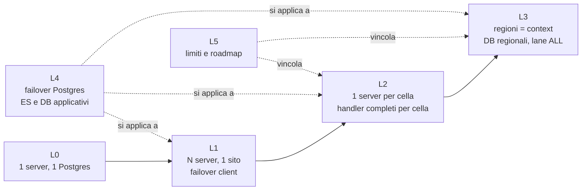

# Guida al cluster mode di Evento

Questa guida spiega come si porta un'applicazione Evento da **un server su un Postgres** a
**tre celle attive su tre continenti**, un livello di complessità alla volta. Ogni affermazione
è legata al codice (classi, proprietà e variabili qui citate esistono nel repository) o a un
risultato misurato dagli scenari di chaos in [`../results/`](../results/), su due set di immagini:

- `:before`: Evento 2.4.6 (`FRAMEWORK_REF=e7b823fe`), cioè senza le correzioni per il cluster;
- `:after`: il branch `feat/evento-lab-cluster`, cioè con le correzioni (G2, G3, G4, G7, G8, G9,
  G12, G13, G14, G15, G16, N1, N3 …).

Gli identificativi dei gap (G1…G25) sono definiti in
[`.claude/CLUSTER-READINESS.md`](../../.claude/CLUSTER-READINESS.md); quelli trovati dal
laboratorio (N1…N17) e i difetti del laboratorio stesso (L1…L24) in [`../FINDINGS.md`](../FINDINGS.md).

## Percorso di lettura

| # | Documento | Cosa aggiunge | Leggilo se |
|---|---|---|---|
| 0 | [L0-single-server.md](L0-single-server.md) | un server, un Postgres, tutti i bundle | parti da zero; è anche la base di ogni altro livello |
| 1 | [L1-server-ha.md](L1-server-ha.md) | 2–3 server sullo stesso database, failover del client (lista di endpoint, `expectedClusterName`, `BrokerChangedException`) | vuoi sopravvivere alla morte di un server |
| 2 | [L2-cells.md](L2-cells.md) | celle geografiche: un server per sito, un set **completo** di handler per cella (G1: ogni server instrada verso i propri bundle, per scelta), pick per località, catalogo e presenza condivisi | hai utenti su più siti e vuoi risposte locali |
| 3 | [L3-multi-region-contexts.md](L3-multi-region-contexts.md) | regioni come *context*, database applicativi regionali, contesto `ALL` con **una** lane globale e fan-out, query nella cella | i dati devono restare nella regione, con eventi globali (listino) |
| 4 | [L4-db-failover.md](L4-db-failover.md) | failover di Postgres: URL multi-host, standby sincrono vs asincrono, lock pool, keepalive, deadline | vuoi sopravvivere alla morte del primario |
| 5 | [L5-limits-roadmap.md](L5-limits-roadmap.md) | cosa resta aperto (fence `aggregate_seq`, read datasource, affinità della lane N4, residuo del failback N16, retention delle chiavi G5) e le opzioni (mesh G1) | devi decidere se il cluster è adatto al tuo caso |

Documenti trasversali:

- [config-reference.md](config-reference.md): ogni variabile d'ambiente del laboratorio e ogni
  proprietà del server che riguarda il cluster, con i default (letti dal codice).
- [contexts.md](contexts.md): formato del consumerId, un engine per contesto, `*` contro `"ALL"`,
  alternative per il fan-out globale (A: una lane, implementata; B: una lane per regione).
- [chaos-scenarios.md](chaos-scenarios.md): S00…S17, con obiettivo, guasto, invarianti e numeri
  `:before` contro `:after`.
- [command-latency.md](command-latency.md): quanto costa un comando di dominio, fase per fase
- [query-path.md](query-path.md): quanto costa una risposta di query al broker, per dimensione e modalità (3.0)
  (lock, story, forward, append, …), misurato in locale e per cella in WAN, e cosa ottimizzare.

## Come si relazionano i livelli

- **L0 → L3 sono cumulativi.** Ogni livello mantiene le regole del precedente e ne aggiunge
  di nuove. Il laboratorio in [`../docker/compose.yaml`](../docker/compose.yaml) è un L3 completo
  con un L4 parziale (standby ES sincrono e asincrono, repliche applicative promuovibili).
- **L4 è ortogonale.** Riguarda i database, non la topologia dei bundle: si applica da L1 in su
  (in L0 il database è comunque un single point of failure).
- **L5 non è un livello da deployare**, ma l'elenco dei limiti che vincolano L2 e L3 e dei lavori
  che li rimuoverebbero.

## Principio: le stesse immagini, solo configurazione

Ogni bundle ha **un** jar e **una** immagine (`evento-lab-cluster/<modulo>:$LAB_TAG`), costruita da
[`../scripts/build-images.sh`](../scripts/build-images.sh). Nessun livello ricompila nulla. La
topologia si decide solo con l'ambiente, letto da `BundleDeployment`
(`lab-support`, [`BundleDeployment.java`](../lab-support/src/main/java/com/evento/lab/cluster/support/BundleDeployment.java))
e passato a `EventoBundle.Builder` da `BundleRunner`:

| Immagine | Bundle id | Componenti | Consuma |
|---|---|---|---|
| `evento-lab-cluster/server` | – | evento-server | – |
| `evento-lab-cluster/order-command` | `order-command` | `OrderAggregate`, `PaymentService`, `PriceListService` | nulla |
| `evento-lab-cluster/order-query` | `order-query` | **un** `OrderProjector`, **un** `CatalogProjector`, `OrderProjection` (query) | `EVENTO_CONTEXTS` |
| `evento-lab-cluster/order-saga` | `order-saga` | **una** `PaymentSaga` | `EVENTO_CONTEXTS` (solo regioni o `*`) |
| `evento-lab-cluster/order-observer` | `order-observer` | **un** `NotificationObserver` | `EVENTO_CONTEXTS` |
| `evento-lab-cluster/order-gateway` | `order-gateway` | nessuno: HTTP, invia comandi e query | nulla |

### Matrice bundle × livello (sintesi)

Le celle dicono *quanti deployment* e *cosa cambia* nell'ambiente. I dettagli esatti sono nel
documento di ciascun livello.

| Bundle | L0 | L1 | L2 | L3 |
|---|---|---|---|---|
| `order-command` | 1 deployment; `EVENTO_SERVER_ADDRESSES=<server>` | 1+ repliche; lista `A,B[,C]` **nello stesso ordine** per tutti, oppure un VIP | **1 per cella** (obbligatorio, G1); proprio server per primo | come L2; `APP_DB_URL` = DB della cella (tabella `payments`) |
| `order-query` | 1; `EVENTO_CONTEXTS=<regioni>,ALL` | come L0 + lista endpoint | 1 per cella (serve le query della cella), stessi contesti: le repliche competono per le stesse lane | 1 per gruppo di regioni della cella + `ALL` (2 repliche, una lane) + `*` (vista globale) |
| `order-saga` | 1; `EVENTO_CONTEXTS=*` | come L0 + lista endpoint | 1–N, stessi contesti (lane condivise, HA) | 1 per cella con le regioni della cella |
| `order-observer` | 1; `*` | come L0 + lista endpoint | 1; `*` | 1 `*` (audit) e, opzionale, 1 per cella con bundle id `order-observer-regional` |
| `order-gateway` | 1 per regione servita; `EVENTO_REGION` | come L0 + lista endpoint | 1 per regione, nella cella della regione | come L2 |
| **server** | 1 | 2–3, stesso DB, `EVENTO_CLUSTER_NAME` comune, id univoci | 1 per cella, `EVENTO_SERVER_BUS_PICK_STRATEGY=locality-preferred` | come L2 |
| variabili in più | – | `EVENTO_CLUSTER_NAME` | `EVENTO_ZONE` | `EVENTO_CONTEXTS` per regione, `DATA_TARGETS`, `CONSUMER_STATE_DB_URL`, `GLOBAL_VIEW_DB_URL` |

L4 non cambia la matrice: cambia gli URL JDBC (multi-host, `targetServerType=primary`) e le
impostazioni di Postgres.

## Numeri chiave (dal laboratorio, `:after`)

| Misura | Valore | Fonte |
|---|---|---|
| Comandi confermati, 7 regioni × 20 ordini/min | 492/492 (`:before` 227/319) | [S00](../results/S00/after/report.md) |
| p50 per cella a 80/150 ms di RTT verso il primario ES | EU 0.13–0.27 s, AM 0.73–0.76 s, APAC 1.16–1.18 s | [S00](../results/S00/after/report.md) |
| Server ucciso → primo ack della cella rimasta senza server | 10.3 s (`:before`: mai, 0/18) | [S03](../results/S03/after/report.md) |
| Primario ES ucciso → scritture riprese (standby sincrono promosso) | 15.1 s (`:before` 7.6 s, N17) | [S08](../results/S08/after/report.md) |
| Takeover della lane `ALL` | 7.3 s (integrazione 5.2 s) | [S16](../results/S16/after/report.md) |
| Avvii a freddo che richiedono la riparazione del catalogo (G8) | 0 su 7 (`:before` 7 su 7) | [AFTER-SUMMARY](../results/AFTER-SUMMARY.md) |

Il quadro completo è in [`../results/COMPARISON.md`](../results/COMPARISON.md).
Le stesse cifre, in forma di presentazione, sono in [`slides/index.html`](slides/index.html)
(istruzioni in [`slides/README.md`](slides/README.md)); le slide numerano i livelli per gruppo di
scenari, la corrispondenza con questa guida è nel README delle slide.

## Convenzioni di questa guida

- I blocchi di configurazione dei livelli L0, L1, L2 e L4 sono **frammenti compose derivati** dal
  file del laboratorio: stesse immagini, stesse variabili, host rinominati. Il blocco di L3 è
  **copiato** da [`../docker/compose.yaml`](../docker/compose.yaml), che è l'unica topologia
  eseguita per intero dagli scenari.
- Dove un comportamento non è stato misurato nel laboratorio (per esempio il failover su uno
  standby asincrono), il testo lo dice esplicitamente.
- I diagrammi sono Mermaid (`flowchart`, `sequenceDiagram`) e si vedono direttamente su GitHub.
