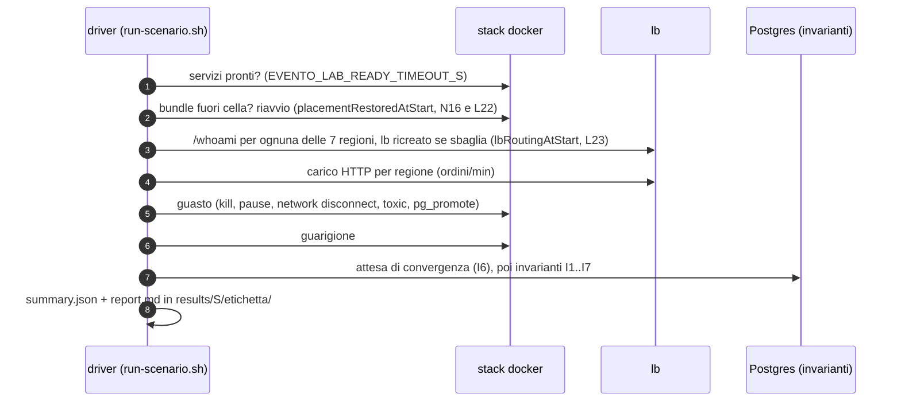

# Scenari di chaos S00…S18

[Indice](README.md)

Ogni scenario è una classe JUnit in
[`../evento-lab-cluster-chaos/src/test/java/com/evento/lab/cluster/chaos/scenario/`](../evento-lab-cluster-chaos/src/test/java/com/evento/lab/cluster/chaos/scenario/)
(`S<nn><Nome>Test`), gira contro la topologia L3 completa
([`../docker/compose.yaml`](../docker/compose.yaml)) e scrive
`results/<S>/<etichetta>/{summary.json,report.md}`. Uno scenario che riproduce un difetto noto
**passa** e registra osservato contro atteso; fallisce solo per errori del harness. Tutti gli
scenari sono stati eseguiti una volta per set di immagini:

- `:before` = Evento 2.4.6 ([BEFORE-SUMMARY](../results/BEFORE-SUMMARY.md));
- `:after` = con le correzioni ([AFTER-SUMMARY](../results/AFTER-SUMMARY.md));
- `after-g5n16` = `:after` con chiavi di idempotenza (G5) e failback (N16): S00, S02, S03, S05, S07,
  S13, S14, S16 rieseguiti su stack nuovi (AFTER-SUMMARY, §"Re-run with idempotency keys"); S03, S07,
  S13 e S14 anche su `:before` (`before-g5n16`), perché il loro harness è cambiato;
- `after-inbox` (2026-10-09) = `after-g5n16` più lo store degli esiti dei comandi di servizio lato
  bundle (G5 inbox: il pagamento registra il proprio esito nella propria transazione) e i controlli
  della chiave dentro round trip che il comando fa comunque: S00, S03, S07, S14 rieseguiti, più il nuovo
  S18 e il suo controllo senza store (AFTER-SUMMARY, §"Re-run with the service outcome store");
- confronto: [COMPARISON](../results/COMPARISON.md).

Verdetti: `AS_EXPECTED` (comportamento corretto), `KNOWN_DEFECT_REPRODUCED` (il difetto
documentato si vede), `UNEXPECTED` (sbagliato in modo non previsto), `INCONCLUSIVE` (il guasto non
ha esercitato la domanda).

## Come gira uno scenario



```bash
scripts/run-scenario.sh S03KillServerTest after       # una classe, etichetta "after"
scripts/run-scenario.sh 'S0*' before                   # un pattern
```

Mai due driver insieme (L23). Le variabili di ogni scenario sono in [config-reference.md](config-reference.md#3-driver-degli-scenari-evento-lab-cluster-chaos).

## Invarianti

| Id | Proprietà |
|---|---|
| I1 | nessun evento perso: ogni operazione confermata ha i suoi eventi in `es__events` |
| I2 | nessun duplicato: un `OrderCreated` per ordine; side effect (`payments`, `observed_events`) una volta |
| I3 | nessun fork: la storia di ogni aggregato si riapplica, sequenze uniche |
| I4 | isolamento regionale: l'`order_view` di ogni cella contiene solo i contesti della cella |
| I5 | completezza globale: `order_view_global` = unione delle tre `order_view` |
| I6 | convergenza: i checkpoint raggiungono la testa dell'event store entro T dopo la guarigione |
| I7 | catalogo: `core__bundle` (tranne il gateway, N8), `core__handler` per ogni comando/query, i 17 consumerId attesi |
| I8 | latenza p50/p99 per regione (osservata, non pass/fail) |

## Riepilogo

| Scenario | Livello | Gap | `:before` | `:after` | `after-g5n16` | `after-inbox` |
|---|---|---|---|---|---|---|
| S00 baseline | L2–L3 | G9, N3 | 227/319, 5.2 append/s | **492/492**, 9.35 append/s | 482/482, 9.02 append/s | 496/496, 9.5 append/s; p50 APAC 1135–1220 ms (nessun RTT in più per la chiave) |
| S01 routing miss | L2 | G1 | 0/5 `no handler` | 0/5 `no handler` (per scelta: regola delle celle) | – | – |
| S02 kill replica handler | L1 | – | 487/487 | 486/486 | 490/490 | – |
| S03 kill server | L1–L2 | G2, G4, G5, N16 | APAC 0/18 | APAC 44/44, 10.3 s | APAC 46/46, 10.9 s; **failback 8/8** in 55.7 s; 0 doppi | APAC 43/43, 10.0 s; failback 8/8 in 66.9 s; 0 doppi, finestra residua colpita 1 volta e chiusa dallo store |
| S04 ritorno del server | L1–L2 | G7, N12, N13 | 10 consumer cancellati | 0 | – | – |
| S05 stesso aggregato da 2 celle | L2 | G3, G6 | 8 deadlock | 0 | 120/120, 0 deadlock | – |
| S06 sweep WAN | L2 | G9, N5, N15 | 1.65 append/s a 300 ms | 6.55 | – | – |
| S07 partizione | L2–L4 | N11, G25, N14 | EU+AM 0/16 | 41/41 | 44/44; **0 pagamenti doppi** | 40/40; 0 pagamenti doppi |
| S08 failover primario ES | L4 | G3, G6, N17 | ripresa 7.6 s | 15.1 s | – | – |
| S09 failover primario applicativo | L4 | G11 | monotono | monotono | – | – |
| S10 avvio a freddo | L1 | G14 | 1/3 fallito | 0/3 | – | – |
| S11 contesti con `_` | L3 | G15, G16, N10 | 2 righe trapelate | 0 | – | – |
| S12 costo WATERMARK | L3 | G10 | INCONCLUSIVE | INCONCLUSIVE | – | – |
| S13 identità del broker | L1 | G13, N16 | cluster estraneo accettato | rifiutato | rifiutato; **failback 7/7** in 53.3 s | – |
| S14 retry storm | L1 | G4, G5 | 24/24 dopo ≥ 25 s | 0 dopo ≥ 25 s; 8 chiavi doppie (prima di G5) | **0 chiavi doppie**, 4/4 retry 2xx (kill 3000 ms) | 0 chiavi doppie, 1/1 retry 2xx (3000 ms); 4/4 (2000 ms) |
| S15 orologio −40 s | L0+ | staleness | 0 proiettati | 0 proiettati (aperto) | – | – |
| S16 lane `ALL` | L3 | G24, N4 | fan-out 2.1 s | 10.2 s (N4) | fan-out 8.1 s (N4), takeover 4.4 s | – |
| S17 routing per contesto | L3 | setComponentContexts | 8/8 | 8/8 | – | – |
| S18 finestra residua | L5 | G5 | – | – | – | **3/3 nella finestra, 0 pagamenti rieseguiti** (senza store: 3) |

## Dettaglio

### S00: baseline, nessun guasto
- **Obiettivo**: capacità e latenza di riferimento; costo di un append remoto (G9).
- **Guasto**: nessuno; 7 regioni × 20 ordini/min, 2 item per ordine, metà completati.
- **Invarianti**: I1–I7, I8 misurata.
- **`:before`** ([report](../results/S00/before/report.md)): 227/319 confermati (71 %), ogni errore un
  timeout di 30 s. p50/p99 EU 10.3/17.9 s, AM 25–26.6/30.5 s, APAC 30.0–30.1/30.5 s. 5.2 append/s,
  I6 in 13.1 s. 83 comandi non confermati salvati comunque, 3 pagamenti doppi (N3).
- **`:after`** ([report](../results/S00/after/report.md)): **492/492**. p50/p99 EU 131–265/449–611 ms,
  AM 733–761/1202–1390 ms, APAC 1156–1178/1927–1980 ms. 9.35 append/s, I6 in 3.5 s, 72/72 pagamenti,
  0 salvati dopo il timeout.
- **`after-g5n16`** ([report](../results/S00/after-g5n16/report.md)): **482/482**; p50/p99 EU 176–180/434–449 ms,
  AM 834–879/1556–1586 ms, APAC 1359–1472/2486–2673 ms; 9.02 append/s, I6 in 3.5 s, 62/62 pagamenti. Ogni
  evento porta una chiave (62 derivate dalla saga): le celle remote pagano circa un RTT in più verso il
  primario ES per comando (APAC +0.2–0.3 s di p50).
- **`after-inbox`** ([report](../results/S00/after-inbox/report.md)): **496/496**; p50/p99 EU 262–264/775–851 ms,
  AM 667–704/1448–1783 ms, APAC 1135–1220/2308–3719 ms; 9.5 append/s, I6 in 3.5 s, 76/76 pagamenti. Ogni comando
  porta ancora la chiave, ma il controllo viaggia nei round trip che il comando fa comunque: il p50 delle
  celle remote torna ai valori di `:after` (AM 733–761, APAC 1156–1178 ms). Il p99 APAC è più largo in questa
  esecuzione (una sola esecuzione per immagine).
- Anche: [`before-catalog-gap`](../results/S00/before-catalog-gap/report.md) (L14),
  [`after-smoke`](../results/S00/after-smoke/report.md) (integrazione, 498/498).

### S01: routing miss tra celle
- **Obiettivo**: mostrare G1, una scelta di progetto (ogni server instrada verso i propri bundle):
  perché la cella deve avere un set completo di handler.
- **Guasto**: stop di `order-command-am`; AMERICA invia comandi.
- **Invarianti**: la cella senza handler fallisce subito; le altre no.
- **`:before`** ([report](../results/S01/before/report.md)): AMERICA 0/5 `no handler for CreateOrderCommand`
  in ≤ 89 ms; di nuovo ok 1.2 s dopo il riavvio; EUROPA 5/5.
- **`:after`** ([report](../results/S01/after/report.md)): identico, ≤ 14 ms, ok 0.88 s dopo il riavvio. **G1 per scelta** (la regola delle celle).

### S02: kill di una replica di handler nella cella
- **Obiettivo**: failover tra repliche sullo stesso server (riferimento di L1).
- **Guasto**: `docker kill order-command-eu` con `REPLICA=true` (c'è `order-command-eu-b`), 60 ordini/min.
- **Invarianti**: I1 per le operazioni confermate; i nuovi comandi vanno alla replica viva.
- **`:before`** ([report](../results/S02/before/report.md)): 487/487; dopo il kill p50/p99 166/296 ms; 1 in volo, riuscito.
- **`:after`** ([report](../results/S02/after/report.md)): 486/486; 176/283 ms; 2 in volo, 0 falliti.
- **`after-g5n16`** ([report](../results/S02/after-g5n16/report.md)): 490/490; dopo il kill 315/315, 174/274 ms;
  2 in volo, 0 falliti.

### S03: kill di un evento-server
- **Obiettivo**: failover del bus (G2), richieste in volo (G4), catalogo sotto riconnessione di massa (G8).
- **Guasto**: `docker kill evento-apac` sotto carico, poi riavvio.
- **Invarianti**: I1, I4, I5, I6, I7; nessuna chiamata appesa 30 s.
- **`:before`** ([report](../results/S03/before/report.md)): APAC **0/18** mentre il server è giù (i bundle
  chiamano solo il primo indirizzo); 3 chiamate in volo falliscono dopo ≥ 25 s; EU+AM 62/62; I6 in 25.9 s.
- **`:after`** ([report](../results/S03/after/report.md)): APAC **44/44**, primo ack **10.3 s** dopo il kill,
  p50/p99 448/570 ms; EU+AM 62/62 (p50 192 ms); 0 chiamate appese; I6 in 0.36 s.
  [`after-run1`](../results/S03/after-run1/report.md): una `ProcessPaymentCommand` riceve
  `BrokerChangedException`, la saga la ripete e il pagamento avviene due volte (**N14**).
- **`after-g5n16`** ([report](../results/S03/after-g5n16/report.md)): **12/12 AS_EXPECTED**. Primo ack APAC
  10.9 s dopo il kill, APAC 46/46 (p50/p99 449/686 ms), EU+AM 57/57, I6 in 0.38 s.
  **Failback (N16), misurato**: gli 8 JVM APAC finiti su `evento-eu` tornano tutti su `evento-apac` senza
  riavvii, l'ultimo 55.7 s dopo che il server è pronto (`apacStillRemoteAfterFailbackWait` vuoto, 8
  `failback_completed`, 0 falliti, 0 sospesi, 0 reattivi). Gli handler tornano 38–44 s dopo l'avvio del
  server, i tre gateway 51–55 s; ogni passaggio dura 0.50–0.68 s (drain 0.26 s); nessun `no handler for`.
  **Idempotenza (G5), misurata**: 0 eventi salvati due volte e 0 pagamenti eseguiti due volte, con 3
  `BrokerChangedException` lato bundle.
- **`after-inbox`** ([report](../results/S03/after-inbox/report.md)): **12/12 AS_EXPECTED**. Primo ack APAC
  10.0 s dopo il kill, APAC 43/43 (p50/p99 472/578 ms), EU+AM 58/58, I6 in 0.37 s; 8/8 JVM a casa, l'ultima
  66.9 s dopo che `evento-apac` è pronto. 0 eventi e 0 pagamenti doppi. La **finestra residua** si è
  presentata da sola: un pagamento (`PaymentSaga_1_INDIA:40`) eseguito mentre il suo evento non si poteva
  salvare; il retry è stato risposto dallo store degli esiti (`event=service_outcome_replayed`), senza
  rieseguire il pagamento. Un altro retry è stato risposto dal broker (`event=idempotent_replay`).
- **`before-g5n16`** ([report](../results/S03/before-g5n16/report.md)): APAC 0/18 come prima; failback
  INCONCLUSIVE (2.4.6 non fa failover, quindi non c'è nulla da riportare indietro); I6 in 22.6 s.

### S04: il server torna dopo il failover
- **Obiettivo**: il `NodeLeft` tardivo del vecchio server non deve cancellare un bundle vivo altrove (G7).
- **Guasto**: A) riavvio di `evento-apac`; B) `docker pause` 60 s (socket semichiuso), poi `unpause`.
- **Invarianti**: I7; comandi APAC durante e dopo.
- **`:before`** ([report](../results/S04/before/report.md)): B cancella **10 consumerId** in tutte le celle
  (N12), riparazione impossibile; sonde durante l'assenza 0/3; poi loop di handshake (N13).
- **`:after`** ([report](../results/S04/after/report.md)): 0 cancellazioni, sonde 3/3, nessun loop.

### S05: stesso aggregato da due celle
- **Obiettivo**: mutua esclusione tra server (G3), assenza di fork (G6), locality (G12).
- **Guasto**: EUROPA e CINA inviano `AddOrderItem` sugli stessi ordini, 150 ms di RTT.
- **Invarianti**: I1, I2, I3.
- **`:before`** ([report](../results/S05/before/report.md)): 112/120, **8 `deadlock detected`** tra server; p50 2.3 s, p99 4.8 s.
- **`:after`** ([report](../results/S05/after/report.md)): **120/120**, 0 deadlock, al massimo 1 attesa di
  lock; p50 0.93 s, p99 2.8 s (EUROPA 186 ms, CINA 1070 ms). Nessun fork su entrambi.
- **`after-g5n16`** ([report](../results/S05/after-g5n16/report.md)): 120/120, 0 deadlock, al massimo 1
  attesa; p50 1.16 s, p99 3.0 s (EUROPA 212 ms, CINA 1317 ms: la lettura della chiave costa un RTT in più).

### S06: sweep di latenza WAN
- **Obiettivo**: curva di throughput in funzione del RTT verso il primario ES (G9, N5).
- **Guasto**: RTT verso `es-pg-eu` a 0, 50, 150, 300 ms (`S06_RTTS_MS`), 40 s per passo, 30 ordini/min.
- **Invarianti**: I1–I6.
- **`:before`** ([report](../results/S06/before/report.md)): 7.0 / 7.0 / 4.05 / 1.65 append/s; p50 APAC
  32 ms / 12.3 s / 30.1 s / 30.2 s; 226 falliti, 136 salvati dopo il timeout.
- **`:after`** ([report](../results/S06/after/report.md)): 7.0 / 7.0 / 7.0 / 6.55 append/s; p50 APAC
  29 ms / 0.43 s / 2.7 s / 22.8 s; p50 EU a 150 ms già 1.7 s; 31 falliti (tutti APAC a 300 ms) e
  **31 salvati dopo il timeout (N15)**.

### S07: partizione di una regione
- **Obiettivo**: una cella tagliata in silenzio non deve fermare le altre (G22, G25, N11); nessun
  duplicato dopo la guarigione.
- **Guasto**: `net-apac` staccato da toxiproxy e lb per ~60 s (nessun RST), poi riattaccato.
- **Invarianti**: I2, I6; lane `*` e `ALL` non ferme oltre la loro testa (L20).
- **`:before`** ([report](../results/S07/before/report.md)): EU+AM **0/16**; nessun append nell'intero
  cluster per ~90 s (**N11**: `es-lock` orfano sulla sessione di `evento-apac`).
- **`:after`** ([report](../results/S07/after/report.md)): EU+AM **41/41** (p50 585 ms); lane `*` ferme
  ≤ 5 s; I6 0.2 s dopo la guarigione; APAC 0/12 (504 dal lb, atteso). 2 pagamenti doppi e un
  `PaymentProcessedEvent` salvato due volte (**N14**).
- **`after-g5n16`** ([report](../results/S07/after-g5n16/report.md)): **6/6 AS_EXPECTED**. EU+AM **44/44**
  durante la partizione (p50 666 ms), lane `*` ferme 0 s, I6 0.2 s. **0 eventi salvati due volte, 0
  pagamenti eseguiti due volte** (G5 misurato). La **finestra residua** (un pagamento eseguito da
  `order-command-apac` mentre `evento-apac` non poteva salvarne l'evento: nessuna chiave registrata, il
  retry della saga lo riesegue) non si è presentata in questa esecuzione: resta documentata, non misurata.
- **`after-inbox`** ([report](../results/S07/after-inbox/report.md)): 6/6 AS_EXPECTED; EU+AM **40/40** (p50
  215 ms), lane `*` ferme 0 s, I6 0.21 s; 0 eventi e 0 pagamenti doppi; finestra non colpita (0 risposte
  dallo store). La finestra è provocata apposta da S18.
- **`before-g5n16`** ([report](../results/S07/before-g5n16/report.md)): EU+AM 0/16 come prima (N11).

### S08: failover del primario ES
- **Obiettivo**: i server seguono la promozione via URL multi-host; lock persi senza fork (G3, G6).
- **Guasto**: `docker kill es-pg-eu`, `pg_promote()` su `es-pg-am` (sincrono) dopo 5 s.
- **Invarianti**: I1, I2, I3; nessun checkpoint oltre la nuova testa.
- **`:before`** ([report](../results/S08/before/report.md)): scritture riprese dopo **7.6 s**, 105/106.
- **`:after`** ([report](../results/S08/after/report.md)): riprese dopo **15.1 s** (N17), 103/106
  (p50 874 ms; un errore è la deadline scaduta a `before_forward`); 0 persi, 0 duplicati, 0 fork.
- [`before-l24`](../results/S08/before-l24/report.md) / [`after-l24`](../results/S08/after-l24/report.md):
  esecuzioni con il difetto L24 (lo standby promosso aspettava sé stesso come sincrono).
- Variante asincrona (`S08_PROMOTE=es-pg-apac`) **non eseguita**.

### S09: failover del primario applicativo
- **Obiettivo**: i checkpoint non tornano indietro (G11); le lane riprendono sul promosso.
- **Guasto**: kill di `app-pg-eu`, promozione di `app-pg-eu-r`.
- **Invarianti**: checkpoint monotoni, I2.
- **`:before`** ([report](../results/S09/before/report.md)): monotoni su 58 campioni, lane riprese.
- **`:after`** ([report](../results/S09/after/report.md)): monotoni su 59 campioni, lane riprese, 0 replay necessari.

### S10: avvio a freddo di 3 server
- **Obiettivo**: `schema.sql` concorrente (G14).
- **Guasto**: 3 server avviati insieme su un database vuoto (`COLD_START=true`), 3 iterazioni.
- **`:before`** ([report](../results/S10/before/report.md)): 1/3 iterazioni con `evento-am` uscito su
  `pg_type_typname_nsp_index`; 20 righe di race.
- **`:after`** ([report](../results/S10/after/report.md)): 0/3, 0 righe.

### S11: contesti con underscore
- **Obiettivo**: `_` non è un wildcard (G15); la GUI mostra i contesti interi (G16, N10).
- **Guasto**: ordini in SUD_AMERICA e AUSTRALIA_NZ più eventi sintetici `SUDXAMERICA` / `AUSTRALIAXNZ`.
- **Invarianti**: I4.
- **`:before`** ([report](../results/S11/before/report.md)): 2 righe trapelate; la pagina consumer mostra
  0/7 lane regionali (N10); G16 non verificabile (L15).
- **`:after`** ([report](../results/S11/after/report.md)): 0 righe trapelate; 7/7 lane con i nomi `_` corretti.

### S12: costo di WATERMARK per contesto
- **Obiettivo**: `recordAbsent` O(gap) (G10).
- **Guasto**: `order-query-eu` ridistribuito con `EVENTO_CONTEXTS=EUROPA` sotto carico globale, DEFAULT contro WATERMARK.
- **`:before`** ([report](../results/S12/before/report.md)): CPU sotto carico ≤ riposo (DEFAULT 950 ms per 254 eventi estranei, WATERMARK 960 ms per 248).
- **`:after`** ([report](../results/S12/after/report.md)): idem (1400 ms per 743, 1310 ms per 731; riposo ~14 ms/s).
  **INCONCLUSIVE** su entrambi: con CPES i buchi sono troppo piccoli per mostrare G10.

### S13: broker sbagliato e identità
- **Obiettivo**: guard di identità compatibile con il failover (G13).
- **Guasto**: `gateway-europa` dietro il VIP; C) si aspetta un cluster estraneo; A) guard a id singolo + kill di `evento-eu`; B) guard sul nome cluster + kill di `evento-eu`.
- **`:before`** ([report](../results/S13/before/report.md)): C si collega comunque (nessuna identità); A 0/3
  (7 `server_instance_mismatch`); B 2/3 senza alcun guard.
- **`:after`** ([report](../results/S13/after/report.md)): C **rifiutato** (40 `cluster_name_mismatch`, mai
  READY); B **3/3 con il guard**; A 0/3 (per contratto). Dopo il ritorno di `evento-eu`, 7 JVM EU ancora
  su `evento-am` (**N16**, [`after-n16-evidence`](../results/S13/after-n16-evidence/report.md)).
- **`after-g5n16`** ([report](../results/S13/after-g5n16/report.md)): C rifiutato (40 `cluster_name_mismatch`),
  B 3/3 con il guard, A 0/3 (per contratto). **Failback (N16), misurato**: i 7 JVM EU finiti su `evento-am`
  tornano tutti su `evento-eu` senza riavvii, 53.3 s dopo il suo ritorno; il riavvio di sicurezza
  (`A.bundlesRestartedIntoPlace`) non trova nulla.
- **`before-g5n16`** ([report](../results/S13/before-g5n16/report.md)): C si collega; B 0/3 prima del kill
  (`no handler`, probabilmente gli handler EU non ancora registrati sul server riavviato; non indagato) e 3/3 dopo; failback
  INCONCLUSIVE (2.4.6 non fa failover).

### S14: retry storm
- **Obiettivo**: richieste in volo al cambio di broker (G4) e duplicati da retry (G5).
- **Guasto**: kill del server 2000 ms dopo l'invio (`S14_KILL_DELAY_MS`), retry attraverso un'altra cella.
- **Invarianti**: I1, I2.
- **`:before`** ([report](../results/S14/before/report.md)): 24/24 primi tentativi falliti dopo ≥ 25 s;
  1/24 già salvato; 1 chiave salvata due volte.
- **`:after`** ([report](../results/S14/after/report.md)): 13/24 falliti, tutti `broker_changed`, **0**
  dopo ≥ 25 s; 9/13 già salvati; **8 chiavi salvate due volte** (G5 più facile da colpire, perché il
  retry parte mentre il primo tentativo committa).
- Varianti a 150 ms: [`before-kill150`](../results/S14/before-kill150/report.md),
  [`after-kill150`](../results/S14/after-kill150/report.md): INCONCLUSIVE per G5 (L17).
- **`after-g5n16`** ([report](../results/S14/after-g5n16/report.md), kill a **3000 ms**): **4/4 AS_EXPECTED**.
  18/24 primi tentativi falliti, tutti `broker_changed`, 0 dopo ≥ 25 s; 4/18 già salvati prima del retry;
  **0 chiavi salvate due volte** e **4/4 retry di comandi già salvati con risposta 2xx** e l'evento salvato
  (`event=idempotent_replay stage=before_lock`, 2 create e 2 add-item). A 2000 ms
  ([`after-g5n16-kill2000`](../results/S14/after-g5n16-kill2000/report.md)) nessun comando era ancora
  arrivato all'append (22/24 falliti, 0 salvati): INCONCLUSIVE. Su uno stack appena creato la prima raffica
  di comandi con chiave è più lenta, per questo il ritardo è salito a 3000 ms (la manopola di L17). A
  150 ms ([`after-g5n16-kill150`](../results/S14/after-g5n16-kill150/report.md)): INCONCLUSIVE come prima.
- **`after-inbox`** ([report](../results/S14/after-inbox/report.md), 3000 ms): 4/4 AS_EXPECTED; 7/24 primi
  tentativi falliti (`broker_changed`, 0 dopo ≥ 25 s): con meno round trip quasi tutti erano già risposti
  al kill; 1 già salvato, 1/1 retry 2xx, 0 chiavi doppie. A 2000 ms
  ([`after-inbox-kill2000`](../results/S14/after-inbox-kill2000/report.md), INCONCLUSIVE con `after-g5n16`):
  16/24 falliti, 4 già salvati, **4/4 retry 2xx, 0 chiavi doppie**.
- **`before-g5n16`** (gateway nuovo, che deriva l'id dell'ordine dalla chiave): kill a 2000 ms
  ([report](../results/S14/before-g5n16/report.md)) 24/24 dopo ≥ 25 s, 1 salvato; a 3000 ms
  ([report](../results/S14/before-g5n16-kill3000/report.md)) 24/24 dopo ≥ 25 s, 2 salvati. 0 chiavi doppie,
  ma ogni retry di una create già salvata è rifiutato con 409 dall'aggregato (0/1 e 0/2 con 2xx).

### S15: orologio sfasato
- **Obiettivo**: il gate di staleness del fetch confronta orologi diversi.
- **Guasto**: `order-query-eu` con libfaketime a −40 s (`S15_IMAGE`, `docker/faketime/Dockerfile`).
- **`:before`** ([report](../results/S15/before/report.md)): 0/5 ordini AFRICA proiettati;
  `EventFetchRequest expired: age=40004ms > max=30000ms` a ogni fetch.
  [`before-ahead40`](../results/S15/before-ahead40/report.md): +40 s è innocuo.
- **`:after`** ([report](../results/S15/after/report.md)): identico, 120 fetch scartati in 60 s. **Aperto**
  (mitigazione: `evento.es.fetch.max.age.ms=0`).

### S16: eventi globali `ALL`
- **Obiettivo**: una lane, fan-out esattamente una volta per database, costo di una lane per N target, takeover (G24, N4).
- **Guasto**: 5 prezzi; stop di `app-pg-apac` con 4 prezzi durante l'assenza; kill del detentore della lane.
- **Invarianti**: `applied_events = 1` per database, un checkpoint, nessuna sequenza proiettata da due repliche.
- **`:before`** ([report](../results/S16/before/report.md)): fan-out in 2.1 s, tutte le scritture da
  `global-eu`; EU/AM 1 prezzo su 4 durante l'assenza; convergenza 2.1 s dopo; takeover **7.7 s**.
- **`:after`** ([report](../results/S16/after/report.md)): fan-out in **10.2 s**, scrittori EU 9 / APAC 6
  (**N4**); EU/AM 1 su 4; convergenza 0.07 s dopo; 6 replay assorbiti; takeover **7.3 s**
  (integrazione 5.2 s). Discussione in [contexts.md](contexts.md).
- **`after-g5n16`** ([report](../results/S16/after-g5n16/report.md)): 7/7 AS_EXPECTED; fan-out in **8.1 s**,
  scrittori APAC 9 / EU 6 (N4 invariato); EU/AM 1 su 4; convergenza 16.3 s dopo il ripristino, 8 replay
  assorbiti; takeover **4.4 s**. I `SetPriceCommand` (comandi di servizio con chiave) non lasciano righe
  in `es__idempotency_claims`.

### S17: routing per contesto
- **Obiettivo**: una classe, un engine per contesto; niente righe tra contesti; `*` vede tutto; nessuna riga `ALL` nelle viste ordini.
- **Guasto**: nessuno; 2 ordini per regione.
- **`:before`** ([report](../results/S17/before/report.md)) e **`:after`** ([report](../results/S17/after/report.md)):
  8/8 AS_EXPECTED; una JVM esegue 2 engine; 16 checkpoint nei database giusti; la lane `*` vede
  14/14 ordini; I6 in 3.4 s.

### S18: finestra residua di G5 (pagamento eseguito, evento non salvato)
- **Obiettivo**: colpire apposta la finestra che le chiavi del broker da sole non chiudono: un handler di
  servizio ha eseguito il side effect, ma il server non riesce a salvarne l'evento; il retry non trova la
  chiave e, senza lo store degli esiti, riesegue il pagamento.
- **Guasto**: 6 ordini `slowpay` distribuiti su CINA, INDIA e AUSTRALIA_NZ (una lane di saga per regione);
  il pagamento risponde `LAB_PAYMENT_SLOW_MS` (4 s) dopo il commit; quando ogni lane ha un pagamento
  committato e senza evento, il link `apac-to-es-pg-eu` viene tagliato per `S18_CUT_S` (20 s), poi
  ripristinato; si aspetta che la saga ritenti.
- **Invarianti**: tentativi di pagamento = 1 per ordine; un `PaymentProcessedEvent` per ordine.
- **`after-inbox`** ([report](../results/S18/after-inbox/report.md)): **3/3 AS_EXPECTED**. 3 pagamenti su 3
  nella finestra al taglio; **0 riesecuzioni** (tentativi = 1 per tutti e 6), 3
  `event=service_outcome_replayed` su `order-command-apac`; un evento per ordine; convergenza 35 s dopo il
  taglio.
- **Controllo senza store** (`EVENTO_SERVICE_OUTCOME_STORE=off` su `order-command-apac`,
  [report](../results/S18/after-inbox-store-off/report.md)): stessa finestra (3 su 3), **3 pagamenti
  rieseguiti** (tentativi = 2), `KNOWN_DEFECT_REPRODUCED`; il broker salva comunque un solo evento per ordine.
- [`after-inbox-run1`](../results/S18/after-inbox-run1/report.md): primo harness, 6 ordini CINA su una sola
  lane: al taglio un solo pagamento committato, già salvato; INCONCLUSIVE.
- Limite: lo store è per cella (stesso database del pagamento); un retry instradato su un'altra cella non lo
  vedrebbe.

## Esecuzioni tenute come evidenza

| Cartella | Perché |
|---|---|
| `S00/before-catalog-gap` | prima S00 con il difetto L14 |
| `S03/after-run1` | evidenza di N14 con collocazione pulita |
| `S07/*-run1`, `S12/*-run1` | harness precedente (L19, L20) |
| `S08/*-l24` | esecuzioni con il difetto L24 |
| `S13/after-n16-evidence`, `S13/*-run1` | prima osservazione di N16; harness precedente (L21) |
| `S14/*-kill150` | kill a 150 ms, INCONCLUSIVE (L17) |
| `S14/after-g5n16-kill2000` | kill a 2000 ms con G5: nessun comando nella finestra ambigua, INCONCLUSIVE |
| `S14/before-g5n16-kill3000` | `:before` allo stesso ritardo dell'esecuzione principale `after-g5n16` |
| `S15/before-ahead40` | orologio avanti: innocuo (L18) |
| `S14/after-inbox-kill2000` | kill a 2000 ms con lo store degli esiti: 4 comandi nella finestra ambigua, 4/4 retry 2xx |
| `S18/after-inbox-run1` | primo harness di S18 (una sola lane): finestra non colpita, INCONCLUSIVE |
| `S18/after-inbox-store-off` | controllo di S18 senza store degli esiti: 3 pagamenti rieseguiti |
