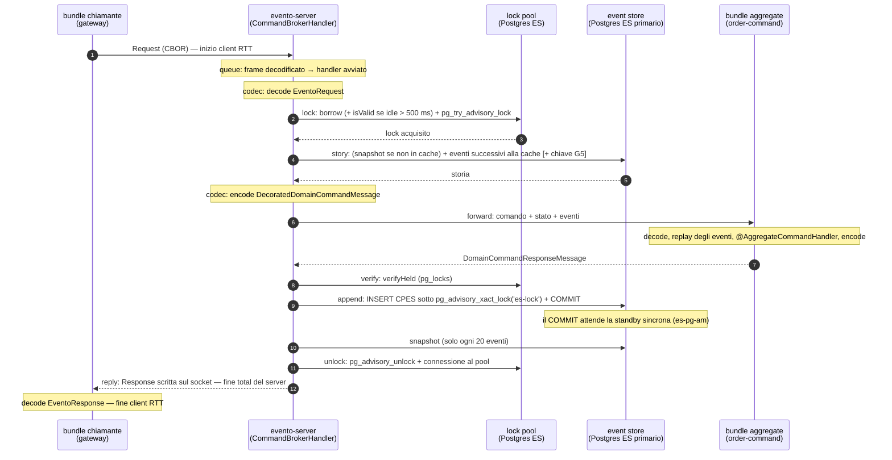

# Latenza di un comando di dominio, fase per fase

**Domanda:** quanto costa in ms (RTT) eseguire un comando su un aggregate in Evento, e dove va il
tempo? Risposta **misurata**, non stimata: in locale (nessuna WAN) e nel laboratorio a tre celle
(WAN emulata da toxiproxy). Tutti i numeri vengono dalla strumentazione permanente descritta sotto;
i dati grezzi sono in [`../results/command-latency/`](../results/command-latency/).

## In breve

| | p50 | p95 | p99 | round trip al DB (tipico) |
|---|---:|---:|---:|---|
| Locale, comando su aggregate esistente (~10 eventi), 1 in volo | **7.2 ms** | 10.6 | 18.7 | 2 event store + 3 lock pool |
| Locale, stesso, 8 in volo | 19.3 ms | 22.2 | 27.3 | idem; l'`append` fa coda sul lock globale CPES |
| Lab, cella **EU** (primario ES locale), add item | **97 ms** | 175 | 249 | idem + attesa della replica sincrona in AM |
| Lab, cella **AM** (80 ms dal primario), add item | **595 ms** | 752 | 821 | ~7 RTT WAN + replica sincrona |
| Lab, cella **APAC** (150 ms dal primario), add item | **1008 ms** | 1234 | 1459 | ~7 RTT WAN + replica sincrona |

In locale il comando è dominato dal **commit con fsync** dell'`append` (3 ms su 7). In WAN il
costo è quasi solo **numero di round trip verso il primario dell'event store × RTT**: un comando
fa 6–7 round trip sequenziali (4–5 sulla creazione in più), due dei quali sono validazioni di
connessione di Hikari che si possono togliere con una riga di configurazione (misurato: −281 ms in
APAC).

## Il percorso e le fasi



| Fase | Cosa misura | Round trip DB |
|---|---|---|
| `queue` | frame decodificato sul thread I/O → handler avviato (coda del business executor, dedup) | 0 |
| `codec` | CBOR lato broker: decode della richiesta, encode del forward (con la storia), decode della risposta, encode della reply | 0 |
| `lock` | permesso + borrow dal lock pool + `pg_try_advisory_lock` (e l'eventuale attesa di un altro detentore) | 1, **+1** se la connessione presa era inattiva da > 500 ms (validazione Hikari) |
| `story` | snapshot (se non in cache) + query degli eventi oltre la cache; la chiave G5 viaggia nella stessa query | 1 (+1 validazione Hikari; creazione: +lookup snapshot JPA) |
| `forward` | invio al bundle aggregate e ritorno: rete in cella + dispatch + handler | 0 |
| `verify` | `verifyHeld`: la sessione possiede ancora l'advisory lock? | 1 |
| `append` | INSERT CPES in un solo statement, commit incluso | 1 + attesa della replica sincrona |
| `snapshot` | salvataggio dello snapshot, solo quando il bundle ne restituisce uno | 1 (bench) / 2+ (JPA) |
| `unlock` | `pg_advisory_unlock` + restituzione della connessione | 1 |
| `reply` | handler terminato → reply scritta sul socket | 0 |
| `total` | frame arrivato → reply scritta | — |

Le fasi sono giri consecutivi di un unico cronometro `System.nanoTime()`: sommano a `total` a meno
dei passi in memoria tra l'una e l'altra (`other`, misurato: p50 0.004 ms in locale, 0.0 in lab).

## Strumentazione (permanente)

- **Server:** `evento.server.command.phase{phase,keyed}` (timer Micrometer con istogramma dei
  percentili, 0.1 ms–30 s; p50/p95/p99 con `histogram_quantile` su `/actuator/prometheus`), solo
  per i comandi aggregate **eseguiti** (evento appeso; replay, rifiuti e drop non sono
  campionati). Una riga DEBUG per comando,
  `event=command_phases payloadType=… correlationId=… keyed=… queue=…ms … total=…ms other=…ms`,
  sul logger `com.evento.server.es.phases` (`LOGGING_LEVEL_COM_EVENTO_SERVER_ES_PHASES=DEBUG`; nel
  lab `EVENTO_PHASE_LOG_LEVEL=DEBUG`). Codice: `CommandPhaseMetrics`, `BusLifecycle.RequestTiming`.
- **Bundle** (niente Micrometer nei bundle: accessor semplici su un istogramma log-lineare lock-free,
  errore ≤ ~3%): `EventoBundle.getLatencies()` → `requestRtt()` per payload type (frame inviato →
  frame di risposta decodificato) e `handlers()` per tipo (`aggregate|service|query`, più
  `.decode`/`.encode`). Il laboratorio li espone su `GET /lab/latency` (con, nel gateway, il tempo
  del `send` per operazione HTTP) e `POST /lab/latency/reset`.
- Test: `CommandPhaseMetricsIT` (ogni fase ≥ il costo iniettato, somma delle fasi ≈ total,
  tag `keyed`), `LatencyHistogramTest`.

## Misura locale (nessuna WAN)

`CommandLatencyBenchmarkIT` (`EVENTO_RUN_BENCH=true`, non gira in CI): `BusLifecycle` +
`CommandBrokerHandler` reali, lock di produzione sul suo pool (10), `EventStore` di produzione in
CPES con cache di produzione su **PostgreSQL 16 in Docker Desktop con fsync attivo**, un vero
`EventoBundle` con `@Aggregate` e un `BundleClient` chiamante, tutto su TCP loopback. 500 comandi di
warm-up, poi 2000 misurati per run. Windows 10, JDK 25.0.4, 8 CPU. Report completo (16 run):
[`../results/command-latency/local-bench.md`](../results/command-latency/local-bench.md).

**Unità di base:** un round trip JDBC (`SELECT 1` su connessione tenuta) = **0.48 ms** p50
(0.65 p95, 0.88 p99): Postgres gira nella VM di Docker Desktop, quindi anche "locale" non è
gratis. Con borrow dal pool 0.53 ms. Un INSERT con commit e fsync: **2.9 ms**.

Comando su aggregate esistente (~10 eventi), non chiave, 1 in volo (ms):

| fase | p50 | p95 | p99 | RT DB |
|---|---:|---:|---:|---|
| queue | 0.02 | 0.04 | 0.06 | 0 |
| codec (broker) | 0.11 | 0.17 | 0.20 | 0 |
| lock | 0.65 | 1.13 | 1.92 | 1 |
| story | 0.87 | 1.39 | 2.33 | 1 |
| forward | 0.47 | 0.71 | 0.97 | 0 |
| ↳ di cui handler nel bundle | 0.08 | 0.13 | 0.18 | |
| ↳ decode / encode nel bundle | 0.06 / 0.02 | 0.10 / 0.03 | 0.14 / 0.05 | |
| verify | 1.00 | 1.60 | 2.20 | 1 |
| append | 3.05 | 3.98 | 7.01 | 1 (commit+fsync) |
| unlock | 0.66 | 1.07 | 2.08 | 1 |
| reply | 0.10 | 0.15 | 0.18 | 0 |
| **total server** | **6.95** | 10.27 | 18.02 | 5 |
| **client RTT** (`CommandGateway.send` → evento) | **7.20** | 10.61 | 18.75 | |
| resto (client RTT − total, per comando) | 0.24 | 0.35 | 0.53 | |

Il "resto" è la rete chiamante↔server su loopback più encode/decode lato chiamante: 0.2–0.3 ms.

Riepilogo di tutti gli scenari (p50, ms):

| scenario | client RTT | total | lock | story | forward | append | unlock | resto |
|---|---:|---:|---:|---:|---:|---:|---:|---:|
| create, non chiave, 1 | 7.76 | 7.48 | 0.67 | 1.32 | 0.47 | 3.03 | 0.65 | 0.27 |
| ~10 eventi, non chiave, 1 | 7.20 | 6.95 | 0.65 | 0.87 | 0.47 | 3.05 | 0.66 | 0.24 |
| ~100 eventi, non chiave, 1 | 7.51 | 7.27 | 0.64 | 0.76 | 0.78 | 3.03 | 0.65 | 0.23 |
| ~100 eventi + snapshot/20, non chiave, 1 | 6.77 | 6.56 | 0.62 | 0.69 | 0.38 | 3.02 | 0.65 | 0.21 |
| create, chiave, 1 | 7.26 | 7.05 | 0.58 | 1.39 | 0.33 | 3.02 | 0.61 | 0.21 |
| ~10 eventi, chiave, 1 | 6.87 | 6.65 | 0.60 | 0.86 | 0.38 | 3.02 | 0.63 | 0.21 |
| ~100 eventi, chiave, 1 | 7.36 | 7.15 | 0.61 | 0.86 | 0.71 | 3.05 | 0.64 | 0.22 |
| ~100 eventi + snapshot/20, chiave, 1 | 6.62 | 6.40 | 0.57 | 0.77 | 0.36 | 2.98 | 0.61 | 0.21 |
| create, non chiave, 8 | 19.81 | 19.59 | 0.65 | 1.61 | 0.32 | 15.23 | 0.64 | 0.21 |
| ~10 eventi, non chiave, 8 | 19.32 | 19.13 | 0.58 | 0.95 | 0.43 | 15.35 | 0.67 | 0.19 |
| ~100 eventi, non chiave, 8 | 19.87 | 19.67 | 0.66 | 1.09 | 0.76 | 15.16 | 0.67 | 0.20 |
| ~100 eventi + snapshot/20, non chiave, 8 | 19.54 | 19.35 | 0.60 | 0.94 | 0.43 | 15.53 | 0.69 | 0.19 |
| create, chiave, 8 | 20.99 | 20.76 | 0.71 | 1.70 | 0.34 | 16.14 | 0.70 | 0.22 |
| ~10 eventi, chiave, 8 | 20.02 | 19.84 | 0.60 | 0.91 | 0.45 | 16.01 | 0.70 | 0.19 |
| ~100 eventi, chiave, 8 | 19.81 | 19.63 | 0.61 | 0.92 | 0.75 | 15.43 | 0.66 | 0.19 |
| ~100 eventi + snapshot/20, chiave, 8 | 19.73 | 19.53 | 0.59 | 0.85 | 0.42 | 15.81 | 0.70 | 0.19 |

Cosa dicono:

- **Chiave G5 gratis:** chiave e non chiave sono indistinguibili (stessi statement: la chiave
  viaggia nella query della storia e nell'INSERT).
- **Dimensione della storia:** da ~10 a ~100 eventi il `forward` passa da 0.47 a 0.78 ms (la
  storia viaggia intera al bundle: encode, rete, decode 0.18 ms, replay 0.20 ms) e il `codec` del
  broker da 0.11 a 0.17 ms; la query della storia no, perché la cache del broker legge solo gli
  eventi nuovi. Con snapshot ogni 20 si torna sotto il caso a 10 eventi. Il salvataggio dello
  snapshot (1 comando ogni 20 qui) costa 3.6 ms p50 (un commit in più).
- **Creazione:** `story` 1.3 ms invece di 0.9: un round trip in più (lookup dello snapshot che
  non esiste; poi la cache ricorda "nessuno snapshot").
- **8 in volo:** il throughput sale da ~124 a ~400 comandi/s ma `append` passa da 3 a 15 ms: il lock
  globale CPES (`pg_advisory_xact_lock('es-lock')`) è tenuto fino al commit, cioè per tutto
  l'fsync, e serializza tutti gli append. Lock, story, forward non cambiano.

## Misura nel laboratorio (WAN)

Immagini `LAB_TAG=after` del working tree, stack completo, `EVENTO_PHASE_LOG_LEVEL=DEBUG`. Carico
leggero e costante: **S00 a 6 ordini/min per regione per 480 s** (7 regioni, ~2.5 comandi/s in
tutto: nessuna coda), 1177 comandi aggregate tutti eseguiti, tutti **con chiave** (il driver manda
sempre `X-Idempotency-Key`). Topologia: primario ES in EU (`es-pg-eu`), standby **sincrona** in
AM, asincrona in APAC; ogni server parla con il primario: EU in locale, AM a **80 ms** di RTT, APAC
a **150 ms** (toxiproxy). Valori dalle righe `event=command_phases` (esatti), confrontati con
`histogram_quantile` su `/actuator/prometheus` (stesso p50 entro il 3%: AM total 640 vs 644 ms).
Report S00: [`../results/S00/latency/report.md`](../results/S00/latency/report.md).

Tutti i comandi aggregate (create, add item, complete), con chiave, ms:

| fase | EU p50 | p95 | p99 | AM p50 | p95 | p99 | APAC p50 | p95 | p99 |
|---|---:|---:|---:|---:|---:|---:|---:|---:|---:|
| queue | 0.1 | 0.2 | 2.1 | 0.1 | 0.3 | 3.6 | 0.1 | 0.2 | 1.1 |
| codec | 0.4 | 0.7 | 1.9 | 0.4 | 0.9 | 2.8 | 0.4 | 0.8 | 2.4 |
| lock | 0.4 | 0.7 | 1.9 | 155.7 | 171.8 | 185.8 | 296.0 | 311.4 | 620.0 |
| story | 1.2 | 3.8 | 7.5 | 98.7 | 336.0 | 341.3 | 298.4 | 612.3 | 621.8 |
| forward | 2.6 | 8.3 | 25.6 | 2.8 | 11.0 | 20.6 | 2.6 | 11.2 | 20.7 |
| verify | 0.7 | 1.8 | 3.3 | 80.8 | 88.4 | 93.6 | 151.4 | 157.9 | 160.1 |
| append | 89.7 | 170.4 | 247.6 | 178.6 | 300.1 | 333.9 | 246.5 | 393.3 | 441.6 |
| unlock | 0.2 | 0.5 | 2.1 | 81.0 | 87.9 | 90.6 | 151.0 | 157.6 | 160.3 |
| reply | 0.2 | 0.5 | 2.6 | 0.3 | 1.2 | 4.3 | 0.3 | 0.9 | 2.3 |
| **total server** | **96.8** | 176.3 | 252.4 | **643.9** | 913.6 | 999.2 | **1054.6** | 1549.1 | 1616.1 |
| n | 339 | | | 340 | | | 498 | | |

Per tipo di comando (p50, ms):

| cella | comando | lock | story | verify | append | unlock | total | gateway `send` |
|---|---|---:|---:|---:|---:|---:|---:|---:|
| EU | create | 0.4 | 1.9 | 0.7 | 88.7 | 0.2 | 95.4 | 96.8 (EUROPA) |
| EU | add item | 0.4 | 1.0 | 0.7 | 89.9 | 0.2 | 96.9 | 97.9 (EUROPA) |
| AM | create | 159.9 | 325.3 | 80.9 | 189.4 | 81.3 | 835.5 | 885.6 / 823.1 (AMERICA / SUD_AMERICA) |
| AM | add item | 152.3 | 85.2 | 80.7 | 177.1 | 80.8 | 595.2 | 642.5 / 579.5 |
| APAC | create | 302.5 | 602.8 | 151.6 | 287.8 | 150.7 | 1462.0 | 1484.9 / 1441.6 / 1469.8 (CINA / INDIA / AUS_NZ) |
| APAC | add item | 164.9 | 157.2 | 151.5 | 244.9 | 151.2 | 1008.4 | 1013.8 / 1007.2 / 1010.9 |

Il bundle aggregate (`order-command`) è irrilevante in ogni cella: handler p50 0.37–0.41 ms (p99
4.5–9 ms), decode 0.2 ms, encode 0.1 ms. `forward` intero (rete in cella inclusa) 2.6–2.8 ms. La
latenza end-to-end vista dal gateway (`send` → evento decodificato) è il `total` del server più
1–50 ms (Spring, gateway, rete in cella, decode; la differenza p50 in AM risente del mix fra i due
gateway). Quella HTTP misurata dal driver di S00 sull'host, attraverso nginx, per regione (p50 /
p95 / p99, ms): EUROPA 103 / 164 / 189, AFRICA 108 / 235 / 278, AMERICA 675 / 970 / 1020,
SUD_AMERICA 610 / 911 / 973, CINA 1089 / 1563 / 1632, INDIA 1044 / 1519 / 1704, AUSTRALIA_NZ
1057 / 1570 / 1632.

**Senza chiave** (sequenze di comandi via curl senza `X-Idempotency-Key`, a raffica e a 1.5 s
l'uno dall'altro; [dati](../results/command-latency/)): add item p50 EU 94–101 ms, AM 581–652 ms,
APAC 1049–1128 ms, stesse fasi del caso con chiave. In WAN la chiave non costa nulla.

### Dove va il tempo, round trip per round trip

Ogni statement verso il primario costa un RTT intero alla cella che lo manda (80 ms da AM, 150 da
APAC; ~0 da EU). Un add item tipico in una cella remota:

| fase | round trip | perché |
|---|---|---|
| lock | **2** | `pg_try_advisory_lock` + la validazione di Hikari (`isValid`) della connessione presa dal lock pool, inattiva da più di 500 ms (`aliveBypassWindowMs`): a carico basso succede quasi sempre (il `ConcurrentBag` di Hikari restituisce spesso la connessione inattiva più vecchia, non l'ultima usata) |
| story | **1–2** (create: **4**) | la query degli eventi oltre la cache + la validazione Hikari della connessione del pool applicativo; sulla creazione anche il lookup JPA dello snapshot (`findById`, con la sua transazione) |
| forward | 0 | il bundle aggregate è nella cella (pick locality-preferred) |
| verify | **1** | query su `pg_locks` |
| append | **1 + replica** | l'INSERT (1 RTT) e il commit, che sul primario EU attende la standby sincrona in AM (80 ms); per tutto il tempo il primario tiene il lock globale `es-lock`, quindi gli append di tutto il cluster fanno coda (p95 EU 170 ms, APAC 393 ms) |
| unlock | **1** | `pg_advisory_unlock` |

Conti: AM add item = 6 × 80 + 80 (replica) ≈ 560 + code → misurato 595 ms; APAC add item =
6 × 150 + 80 ≈ 980 → misurato 1008 ms; APAC create = 9 × 150 + 80 ≈ 1430 → misurato 1462 ms. In EU
gli stessi round trip costano < 1 ms e resta solo la replica sincrona verso AM (~90 ms).

**Verifica della causa Hikari** (stesso stack, solo `evento-apac` riavviato con
`-Dcom.zaxxer.hikari.aliveBypassWindowMs=60000`, comandi senza chiave a 1.5 s di distanza da CINA):
`lock` 304 → **150** ms, `story` 292 → **150** ms, add item total 1128 → **847** ms (−281 ms, −25%);
create total 1171 ms (n=3; era 1462). Dati: [`phases-apac-hikari-bypass.md`](../results/command-latency/phases-apac-hikari-bypass.md).

## Cosa ottimizzare dopo (in ordine di guadagno per sforzo)

| # | intervento | guadagno atteso (p50, add item) | note |
|---|---|---|---|
| 1 | **Non validare le connessioni al borrow** sul pool applicativo e sul lock pool (`aliveBypassWindowMs` lungo, o `keepaliveTime` di Hikari per tenerle vive in background) | **misurato −281 ms in APAC**; atteso −160 ms in AM; 0 in EU | una riga di configurazione; una connessione morta si scopre allo statement invece che al borrow (il broker già ritenta / risponde errore indeterminato) |
| 2 | **Unlock dopo la reply** (rilascio asincrono del lock) | −1 RTT: −80 AM, −150 APAC | il lock è tenuto quanto prima, ma il chiamante non aspetta l'unlock; un fallimento dell'unlock è già solo loggato |
| 3 | **Verify dentro l'append**: eseguire l'INSERT sulla connessione che possiede l'advisory lock (se la sessione è morta lo statement fallisce: è la verifica) | −1 RTT: −80 / −150 | elimina anche la finestra verify→INSERT (G6) per costruzione |
| 4 | **Lock + story in un solo statement** sulla connessione del lock (`pg_try_advisory_lock` e la query degli eventi in un CTE) | −1 RTT: −80 / −150 | con 1–4 un comando remoto fa 2 RTT + replica: AM ≈ 240 ms, APAC ≈ 380 ms |
| 5 | **Creazione senza lookup JPA dello snapshot**: leggere lo snapshot nella stessa query degli eventi (come già la chiave G5) | −2 RTT sulla create: −160 AM, −300 APAC | anche −0.4 ms in locale |
| 6 | **Non tenere `es-lock` durante l'attesa della replica sincrona** (sequenza assegnata senza serializzare i commit, o APES) | coda dell'append: p95 EU 170 → ~90 ms, APAC 393 → ~250; throughput oltre il limite di ~1/RTT_replica (~12 append/s con standby a 80 ms; in locale 8 in volo: append 15 → 3 ms) | intervento di design (G9): l'ordine globale degli eventi oggi dipende da quel lock. Misurato in B2 (`benchmarks/axon-comparison`, standby sincrono, 10 ms tra le AZ): APES, che non lo tiene, fa 286 contro 91 cmd/s a 8 in volo e 1986 contro 1181 a 128; ma APES con più server non è sicuro per i consumer (finestra di 69 ms, G20) |
| 7 | Locale: `verify` (1.0 ms) costa il doppio di un `SELECT 1` (query su `pg_locks`); `codec` + `forward` della storia crescono con gli eventi (snapshot più frequenti) | < 1 ms | marginale |

Il bundle (handler, decode, encode: < 0.5 ms p50) e la rete in cella (forward 2–3 ms) non sono
il problema: in WAN conta solo quante volte il broker va al primario dell'event store, e in
locale il commit con fsync.

## Riprodurre

```bash
# locale (Docker): ~6 minuti, report in evento-server/build/reports/command-latency-bench.md
EVENTO_RUN_BENCH=true ./gradlew :evento-server:test --tests '*CommandLatencyBenchmarkIT' --offline

# laboratorio
LAB_TAG=after scripts/build-images.sh
LAB_TAG=after EVENTO_PHASE_LOG_LEVEL=DEBUG scripts/up.sh
S00_RATE=6 S00_DURATION_S=480 scripts/run-scenario.sh S00BaselineTest latency
docker logs evento-am 2>&1 | grep event=command_phases          # fasi per comando
curl -s -u evento:secret localhost:13001/actuator/prometheus | grep evento_server_command_phase
curl -s -H 'X-Region: CINA' localhost:8080/lab/latency           # gateway e bundle
scripts/down.sh
```
