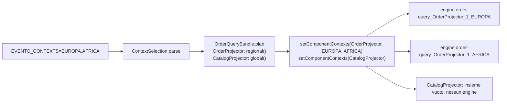
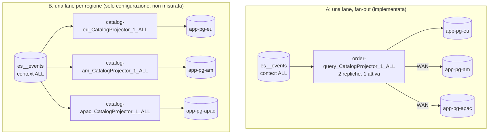

# Context, lane e il contesto globale `ALL`

[Indice](README.md) · usato da [L3](L3-multi-region-contexts.md)

## Il modello in una pagina

- Un **context** è una stringa sull'evento (`Event#getContext`). I comandi e le query non ne hanno
  uno (G23): l'aggregato lo copia da un campo del comando nell'evento, come fa `OrderAggregate`
  (`.setContext(cmd.getRegion())`).
- Un componente consumer (projector, saga, observer) riceve un **insieme di contesti** con
  `EventoBundle.Builder.setComponentContexts(Class, String...)`. Il builder avvia **un engine per
  contesto**; ogni engine è una **lane** indipendente con il proprio checkpoint e il proprio lock.
- Un engine chiede al server solo gli eventi del suo contesto; il filtro è SQL
  (`context LIKE ? ESCAPE '!'`), con `*` come unico wildcard (G15 corretto: `_` e `%` sono caratteri
  normali).

## Formato del consumerId

```
<bundleId>_<ComponentSimpleName>_<componentVersion>_<context>
```

Costruito identico da `ProjectorEngine`, `SagaEngine` e `ObserverEngine`. Esempi dal laboratorio
([integrazione](../results/_integration/after/checks.md), 17 id in tutto):

| consumerId | Deployment che lo esegue | Database dello stato |
|---|---|---|
| `order-query_OrderProjector_1_EUROPA` | `order-query-eu` | `app-pg-eu` |
| `order-query_OrderProjector_1_AFRICA` | `order-query-eu` (stessa JVM) | `app-pg-eu` |
| `order-query_OrderProjector_1_SUD_AMERICA` | `order-query-am` | `app-pg-am` |
| `order-query_OrderProjector_1_*` | `order-query-wildcard` | `app-pg-eu` |
| `order-query_CatalogProjector_1_ALL` | `order-query-global-eu` **e** `order-query-global-apac` (competono) | `consumers` sul cluster ES |
| `order-saga_PaymentSaga_1_CINA` | `order-saga-apac` | `app-pg-apac` |
| `order-observer_NotificationObserver_1_*` | `order-observer` | `app-pg-eu` |

Conseguenze:

- **Il consumerId non contiene l'istanza né la regione di deployment.** Due deployment con lo
  stesso bundle id e lo stesso contesto sono la **stessa lane** e competono per il lock
  (`JdbcConsumerLock.tryAcquire(consumerId)`, `pg_try_advisory_lock(hashtext(consumerId))`) —
  purché usino lo stesso database di stato: il lock è un advisory lock di quel database (G24).
- **Il bundle id contiene spesso `-`, il contesto spesso `_`**: la GUI dei server corretti estrae i
  campi con `ConsumerIds.parse`, non con `split("_")` (G16; S11 `:after` mostra `SUD_AMERICA` intero).
- **I contesti sono indicizzati per nome semplice della classe** (`componentClass.getSimpleName()`):
  due classi con lo stesso nome semplice nello stesso bundle condividono la configurazione (Low).

## Un engine per contesto



Regole del builder (`EventoBundle`):

| Voce per il componente | Engine avviati |
|---|---|
| nessuna voce | uno, contesto `*` (`contexts.getOrDefault(name, Set.of(Context.WILDCARD))`) |
| insieme vuoto | **nessuno** |
| `EUROPA`, `AFRICA` | due |
| `*` | uno, riceve ogni contesto |

Regole del laboratorio (`ContextSelection`): `EVENTO_CONTEXTS` accetta regioni, `ALL` o `*`;
rifiuta liste vuote, nomi sconosciuti e `*` mescolato ad altro. `regional()` toglie `ALL`,
`global()` restituisce `[ALL]` solo se `ALL` è elencato. `OrderSagaBundle.sagaContexts` rifiuta di
partire se alla saga non resta nessun contesto.

## `*` (WILDCARD) contro `"ALL"`

| Valore | Costante | Cosa riceve un consumer registrato con esso |
|---|---|---|
| `"*"` | `Context.WILDCARD` (alias deprecato `Context.ALL`), nel laboratorio `Contexts.WILDCARD` | **ogni** evento: tutte le regioni **e** `ALL` |
| `"ALL"` | nessuna nel framework; nel laboratorio `Contexts.GLOBAL` | **solo** gli eventi il cui contesto è esattamente `ALL` |
| `"EUROPA"` | `Regions` | solo gli eventi di EUROPA |

La trappola: `Context.ALL` **non** è `"ALL"`, è `"*"`. Chi scrive `Context.ALL` pensando al
contesto globale ottiene un consumer che riceve anche tutti gli ordini di tutte le regioni. Per
questo il framework ha introdotto `Context.WILDCARD` e deprecato `Context.ALL`, e il laboratorio
dichiara la propria costante `Contexts.GLOBAL = "ALL"` (usata da `PriceListService`).

Altra conseguenza: il deployment `*` (`order-query-wildcard`) **riceve** anche gli eventi `ALL`.
Se avviasse `CatalogProjector` con `*` diventerebbe una seconda lane del listino, con un altro
consumerId (`..._CatalogProjector_1_*`), che non compete con `..._ALL`. `ContextSelection.global()`
lo impedisce: il wildcard non accende la lane globale, e l'integrazione verifica che
`CatalogProjector_1_*` non esista.

`"ALL"` non contiene `*` né `_`, quindi anche i server senza G15 lo trattano come confronto esatto.

## Eventi globali: le alternative di fan-out

Gli eventi `ALL` (qui `PriceChangedEvent`) devono arrivare nel database di **ogni** regione.



### A: una lane globale (implementata)

Configurazione: vedi [L3](L3-multi-region-contexts.md) (`EVENTO_CONTEXTS=ALL`, stesso bundle id
`order-query`, `CONSUMER_STATE_DB_URL` condiviso sul database `consumers`, `DATA_TARGETS` con i tre
database). Idempotenza per target con `catalog_price.last_seq` (`CatalogStore`).

### B: una lane per regione (possibile con la sola configurazione)

La stessa immagine `order-query`, un deployment per cella, con un bundle id **per cella** (G24 usato
di proposito: lane indipendenti), il solo database locale come target e lo stato nel database locale:

```yaml
  order-query-catalog-eu:
    image: evento-lab-cluster/order-query:${LAB_TAG}
    environment:
      <<: [*env-common, *bus-eu, *db-eu]
      EVENTO_BUNDLE_ID: order-query-catalog-eu      # un bundle id per cella = una lane per cella
      EVENTO_INSTANCE_ID: order-query-catalog-eu
      EVENTO_CONTEXTS: ALL
      DATA_TARGETS: eu=jdbc:postgresql://app-pg-eu:5432,app-pg-eu-r:5432/app?targetServerType=primary&tcpKeepAlive=true&connectTimeout=5
      # CONSUMER_STATE_DB_URL non impostato: lo stato va in APP_DB_URL, il database della cella
```

(e lo stesso per `am` e `apac`, al posto di `order-query-global-*`). È lo stesso schema del profilo
`regional-observers` del compose (`EVENTO_BUNDLE_ID=order-observer-regional`). Richiede un server con
N1 (componenti chiavati per bundle): sul 2.4.6 due bundle con la stessa classe `CatalogProjector`
si cancellano a vicenda le righe di catalogo. **Non è stata eseguita nel laboratorio**: i numeri
qui sotto per B sono attesi, non misurati.

### Trade-off

| Aspetto | A: una lane (misurata, S16 `:after`) | B: una lane per regione (attesa) |
|---|---|---|
| Lane e checkpoint | 1 (`order-query_CatalogProjector_1_ALL`), 2 repliche | 3, una per cella, ognuna con la sua replica di standby se serve |
| Un database regionale giù | **si ferma tutto**: EU e AM hanno ricevuto 1 prezzo su 4 durante l'assenza di `app-pg-apac` | si ferma solo la lane di quella regione; le altre ricevono 4/4 |
| Scritture via WAN | N−1 target per evento (più il lock e il checkpoint sul cluster ES, via WAN per la replica APAC) | nessuna: ogni lane scrive nel proprio database |
| Tempo di fan-out | 10.2 s per 5 eventi su 3 database (N4: detentore EU 9 / APAC 6); 2.1 s su `:before` con il detentore fermo in EU; un singolo prezzo era nei tre database entro 1 s nella prova di integrazione | ≈ tempo di una proiezione locale per regione, indipendente dagli altri |
| Takeover | 7.3 s (integrazione 5.2 s, `:before` 7.7 s) | per regione, con repliche nella cella |
| Duplicati | 0; 6 replay assorbiti da `last_seq` | 0 per costruzione (una lane per database) con la stessa guardia |
| Carico di fetch sul server | 1 lane | N lane (N fetch dello stesso contesto) |
| Coerenza tra regioni | ogni evento è applicato ovunque prima di passare al successivo | le regioni possono essere a punti diversi del listino per un po' |
| Operatività | un solo checkpoint da sorvegliare (N7: `updated_at` non aiuta) | N checkpoint; un'aggiunta di regione = un deployment in più |

Scelta del laboratorio: **A**, perché è il caso che il framework deve sostenere (G24: una lane per
bundle e contesto) e perché misura il costo di una lane per N target. Per un sistema reale in cui
le regioni devono restare autonome anche durante il guasto di un'altra, B è la scelta migliore e
non richiede codice.

## Riepilogo delle regole

1. Contesto = regione, copiato dal comando nell'evento.
2. Una classe per responsabilità; le regioni sono solo configurazione (`setComponentContexts`).
3. Eventi globali con il contesto letterale `"ALL"`, mai `Context.ALL`.
4. Stesso bundle id + stesso contesto + stesso database di stato = stessa lane (competono).
5. Bundle id diverso = lane diversa (voluto per B, un errore per A).
6. Un insieme di contesti vuoto spegne il componente; nessuna voce lo accende su `*`.
7. Contesti con `_` solo su server con G15.
